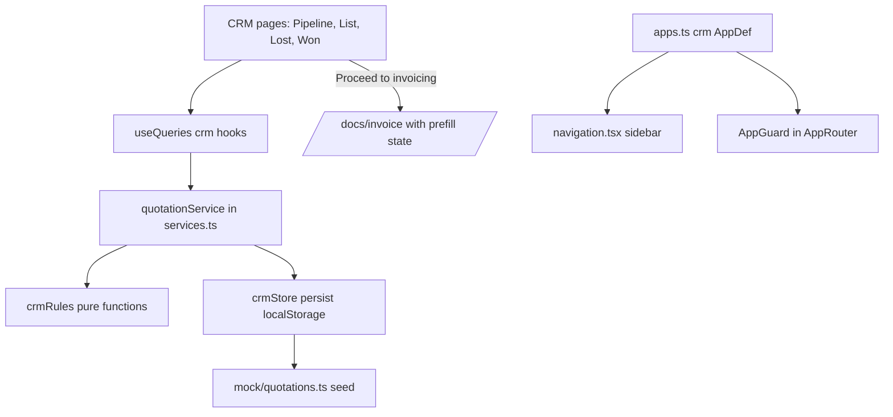

# Design Document

## Overview

The CRM plugin adds a quotation pipeline to AxleOps (React 18, TypeScript, Vite, Zustand, TanStack Query, react-router, Tailwind/shadcn). It follows the existing plugin conventions:

- An `AppDef` entry in `src/constants/apps.ts` (id `crm`), a schema in `appSchemas.ts` and presets in `appPresets.ts`.
- Lazy-loaded pages in `src/app/AppRouter.tsx`, wrapped in `AppGuard`. Sidebar items are derived automatically from `APPS` by `navigation.tsx`, so no navigation change is needed.
- A persisted Zustand store (like `bookingStore.ts`, `persist` middleware, versioned key) as the single source of truth.
- A mock service layer in `src/services/mock` and `src/services/services.ts`. In this plugin the service reads and writes only through the store.
- Query hooks in `src/hooks/useQueries.ts` style, kanban drag-and-drop in the style of `src/features/kanban/KanbanPage.tsx` (HTML5 `DragEvent`).

Odoo CRM is a visual reference only. No Odoo addon is changed. The Odoo mapping is documentation (see the last section).

### Key decisions

| Decision | Choice | Reason |
|---|---|---|
| State owner | `crmStore` (Zustand + `persist`, key `fleet-crm-v1`) | Matches `bookingStore`; survives refresh (Req 9). |
| Business rules | Pure functions in `crmRules.ts` | Testable without UI or storage; store and service call them. |
| Tab/view structure | One `CrmPage` with route-driven tabs: Pipeline, List, Lost, Won | Single app landing page plus extra `paths`, like other multi-page apps. |
| Invoice handoff | Navigate to `/docs/invoice` with `location.state.prefill` | `InvoicePage` has no prefill input today; it gains a small, optional read of `location.state`. |
| Org scoping | Quotations carry `orgId`; selectors filter by `currentOrgId()` | Same tenant model as `services.ts`. |

## Architecture



### Files

| File | Purpose |
|---|---|
| `src/types/quotation.ts` | `Quotation`, `QuotationPhase`, `PhaseHistoryEntry`, `LostReasonOption`. |
| `src/features/crm/crmRules.ts` | Transition table, validation, selectors, search, invoice prefill mapper. |
| `src/store/crmStore.ts` | Persisted store and actions. |
| `src/services/mock/quotations.ts` | Seed quotations (all four phases). |
| `src/services/services.ts` | `quotationService` additions (async, same signatures as a future API). |
| `src/hooks/useQueries.ts` | `useQuotations`, `useCreateQuotation`, `useChangePhase`. |
| `src/features/crm/CrmPage.tsx` | Tabbed shell. |
| `src/features/crm/PipelineBoard.tsx` | Awaiting and Tender kanban. |
| `src/features/crm/QuotationList.tsx` | List with phase filter and search. |
| `src/features/crm/LostTab.tsx`, `WonView.tsx` | Dedicated views. |
| `src/features/crm/LostReasonDialog.tsx`, `ReopenDialog.tsx`, `QuotationDetail.tsx` | Dialogs and detail drawer with history. |
| `src/constants/apps.ts`, `appSchemas.ts`, `appPresets.ts` | Registration (Req 1). |
| `src/app/AppRouter.tsx` | Lazy route(s) for `/crm`, `/crm/lost`, `/crm/won`. |
| `.kiro/specs/crm-plugin/odoo-mapping.md` | Optional split of the mapping section below (Req 11). |

## Components and Interfaces

### Registration (Req 1)

```ts
// src/constants/apps.ts
{
  id: 'crm', name: 'CRM', summary: 'Quotation pipeline: Awaiting, Tender, Lost and Won',
  icon: Handshake, category: 'Management', color: '#7c3aed',
  depends: ['customer_ani', 'invoice'],
  paths: ['/crm', '/crm/lost', '/crm/won'],
  labels: ['CRM Pipeline', 'Lost Quotations', 'Won Quotations'],
}
```

`appForPath` already resolves each path to the app, so `AppGuard` covers all three routes. Deactivation only changes `orgStore` activation; `crmStore` data is untouched (Req 1.3). `DEFAULT_SCHEMAS.crm` lists the quotation fields (`number`, `customerName`, `amount`, `phase` select with the four phases, `lostReason` select with the default options, `salesRep`, `validUntil`, `notes`). `APP_PRESETS.crm` offers a blank preset and a "Demo pipeline" preset; `AppPreset.records` gains an optional `quotations` key.

### Types

```ts
export type QuotationPhase = 'Awaiting' | 'Tender' | 'Lost' | 'Won';
export const PHASES: readonly QuotationPhase[] = ['Awaiting', 'Tender', 'Lost', 'Won'];

export interface PhaseHistoryEntry {
  id: string;
  timestamp: ISODate;
  user: string;
  fromPhase: QuotationPhase | null;   // null for creation
  toPhase: QuotationPhase;
  reason?: string;                    // lost reason or reopen reason
}

export interface Quotation extends BaseEntity {
  orgId: string;
  number: string;                     // e.g. QT-2026-0001
  customerId: string;
  customerName: string;
  amount: number;
  currency: string;
  phase: QuotationPhase;
  lostReason?: string;
  lostAt?: ISODate;
  lostBy?: string;
  salesRep?: string;
  validUntil?: ISODate;
  notes?: string;
  history: PhaseHistoryEntry[];
}

export const DEFAULT_LOST_REASONS = [
  'Price too high', 'Competitor chosen', 'Project cancelled', 'No response', 'Other',
] as const;
```

### Rules module (`crmRules.ts`, pure)

```ts
export const ALLOWED: ReadonlyArray<readonly [QuotationPhase, QuotationPhase]> = [
  ['Awaiting', 'Tender'], ['Awaiting', 'Lost'],
  ['Tender', 'Won'],      ['Tender', 'Lost'],
  ['Lost', 'Awaiting'],   // Reopen only
];

export type TransitionResult =
  | { ok: true; quotation: Quotation }
  | { ok: false; error: string };

export function isAllowed(from: QuotationPhase, to: QuotationPhase): boolean;
export function transitionError(from: QuotationPhase, to: QuotationPhase): string;
// "Cannot move quotation from Won to Tender" (names both phases, Req 3.6)

export function applyTransition(
  q: Quotation, to: QuotationPhase, user: string, now: ISODate, reason?: string,
): TransitionResult;

export function pipelineOf(qs: Quotation[]): Quotation[];            // Awaiting | Tender
export function byPhase(qs: Quotation[], p: QuotationPhase): Quotation[];
export function pipelineTotals(qs: Quotation[]): { count: number; amount: number };
export function searchLost(qs: Quotation[], text: string): Quotation[];
export function filterList(qs: Quotation[], phase: QuotationPhase | 'All', text: string): Quotation[];
export function toInvoicePrefill(q: Quotation): { customerId: string; customerName: string; amount: number; quotationNumber: string };
```

`applyTransition` is the only place that mutates phase. It rejects, in order: a pair not in `ALLOWED`; a move to Lost or a Reopen with a blank (empty or whitespace-only) reason. On success it returns a new `Quotation` (immutable update), sets `lostReason`, `lostAt`, `lostBy` when moving to Lost, clears them on Reopen (the reason is preserved in history), and appends one `PhaseHistoryEntry`.

### Store (`crmStore.ts`)

```ts
interface CrmState {
  quotations: Quotation[];
  create(draft: QuotationDraft, user: string): Quotation;     // phase = Awaiting, history[0] created
  changePhase(id: string, to: QuotationPhase, user: string, reason?: string): TransitionResult;
  resetToSeed(): void;
}
```

- `persist` with `name: 'fleet-crm-v1'`, `version: 1`, and a custom `storage` wrapper that catches `JSON.parse` failures: on failure it calls `console.warn('[crm] persisted data unreadable, loading seed')` and returns the seed (Req 9.3).
- Initial state is `seedQuotations` (at least one quotation per phase, Req 9.5) when nothing is persisted.
- Every `set` that changes quotations is persisted synchronously by the middleware (Req 9.1).

### Service (`services.ts`)

```ts
export const quotationService = {
  list(): Promise<Quotation[]>;                 // store.quotations filtered by currentOrgId()
  get(id: string): Promise<Quotation | undefined>;
  create(draft: QuotationDraft): Promise<Quotation>;
  changePhase(id: string, to: QuotationPhase, reason?: string): Promise<TransitionResult>;
};
```

The service uses `useCrmStore.getState()` and never touches `localStorage` directly (Req 9.4). It resolves the acting user from `useAuthStore`. Rejected transitions resolve with `{ ok: false, error }` instead of throwing, so the UI can show the message.

### UI behaviour

- **Pipeline (Req 6, 10):** two columns, Awaiting and Tender, each with a count and amount total from `pipelineTotals`. Dragging a card to the other column calls `changePhase(id, targetColumn)`. Only Awaiting to Tender is a column-to-column move that is valid. Tender to Awaiting is rejected and shows the error toast. Row actions: Move to Tender, Mark Won (Tender), Mark Lost.
- **Mark Lost:** opens `LostReasonDialog` with a select of `DEFAULT_LOST_REASONS` and a free-text field for Other. Submit is blocked while the reason is blank, and the service also rejects it.
- **Lost tab (Req 7):** table with number, customer, amount, reason, date lost, lost by; search box using `searchLost`; row click opens `QuotationDetail` with history; empty-state message when no Lost quotations; Reopen button opens `ReopenDialog` (reason required).
- **Won view (Req 8):** list of Won quotations; "Proceed to invoicing" navigates to `/docs/invoice` with `state: { prefill: toInvoicePrefill(q) }`. The button is disabled with a tooltip "Activate the Invoice app" when `isAppActive(orgId, 'invoice')` is false. `InvoicePage` reads `location.state?.prefill` once on mount to seed its `form` state (customer, amount, reference); with no state it behaves as today.
- **List view (Req 10.3):** `filterList` with a phase select (All plus four phases) and text search.
- Invalid change message (Req 3.6): the toast text is `transitionError(from, to)`.

## Data Models

Persisted JSON shape under `fleet-crm-v1`:

```json
{ "state": { "quotations": [ { "id": "qt-1", "orgId": "...", "number": "QT-2026-0001",
  "phase": "Lost", "lostReason": "Price too high", "history": [ { "fromPhase": null, "toPhase": "Awaiting" } ] } ] },
  "version": 1 }
```

Invariants:

1. `phase` is one of the four phases.
2. `phase === 'Lost'` implies `lostReason` is non-blank.
3. `history` is non-empty, ordered by time, and the last entry's `toPhase` equals `phase`.
4. Each entry's `fromPhase` equals the previous entry's `toPhase` (null for the first).

## Error Handling

| Situation | Behaviour |
|---|---|
| Transition not in `ALLOWED` | `{ ok: false, error }` naming current and requested phase; state unchanged; UI toast. |
| Blank Lost or Reopen reason | `{ ok: false, error: 'A reason is required' }`; state unchanged. |
| Unknown quotation id | `{ ok: false, error: 'Quotation not found' }`. |
| Corrupt localStorage JSON | Warn via `console.warn`, load seed, continue. |
| Invoice app inactive | Proceed action disabled with explanatory message. |
| Missing prefill state on `/docs/invoice` | Invoice form opens empty as before. |
| localStorage write failure (quota) | Zustand keeps in-memory state; a warning is logged. |

## Testing Strategy

The repo has no test runner configured in `package.json`. Add `vitest` and `fast-check` as dev dependencies and run with `vitest --run`.

- **Property tests** (fast-check, at least 100 runs each) target `crmRules.ts` and store persistence round trips. Each test carries the tag `Feature: crm-plugin, Property N: <title>`.
- **Unit/example tests** cover registration fields, default reasons, seed contents (all four phases), sidebar visibility on activate/deactivate, Lost-tab empty state, disabled invoicing action, and the drag-drop handler calling the service.
- UI layout and Odoo look-and-feel are not property-tested. Req 10.4 and 11 are checked by review and by confirming `git diff` shows no change under `odoo/addons`.

## Correctness Properties

*A property is a characteristic or behavior that should hold true across all valid executions of a system-essentially, a formal statement about what the system should do. Properties serve as the bridge between human-readable specifications and machine-verifiable correctness guarantees.*

### Property 1: New quotations start Awaiting

For any valid quotation draft, creating it yields a quotation whose phase is Awaiting and whose history contains exactly one creation entry.

**Validates: Requirements 2.2**

### Property 2: Allowed transitions set the target phase

For any quotation in a source phase and any allowed transition from that phase (Awaiting to Tender, Awaiting to Lost, Tender to Won, Tender to Lost, Lost to Awaiting), supplying a non-blank reason where required, applying the transition yields a quotation whose phase equals the target.

**Validates: Requirements 3.1, 3.2, 3.3, 3.4, 5.2**

### Property 3: Disallowed transitions are rejected without change

For any quotation and any requested phase pair that is not in the allowed set (including same-phase moves), the transition is rejected and the quotation is identical to its state before the attempt.

**Validates: Requirements 3.5**

### Property 4: Rejection message names both phases

For any disallowed (current, requested) phase pair, the error message contains both the current phase name and the requested phase name.

**Validates: Requirements 3.6**

### Property 5: Blank reasons are rejected

For any quotation in Awaiting or Tender and any whitespace-only or empty reason, moving it to Lost is rejected, and for any Lost quotation, reopening with a whitespace-only or empty reason is rejected. In both cases the phase and history are unchanged.

**Validates: Requirements 4.3, 5.3**

### Property 6: Successful transitions append a consistent history entry

For any successful transition, the history length grows by exactly one, and the new entry has a timestamp, the acting user, a from-phase equal to the previous phase, a to-phase equal to the new phase, and the supplied reason when the move is to Lost or a Reopen. A move to Lost also stores the reason on the quotation.

**Validates: Requirements 3.7, 4.4, 5.4**

### Property 7: Phase views partition quotations

For any collection of quotations, the Active_Pipeline contains exactly the Awaiting and Tender quotations, the Lost_Tab contains exactly the Lost quotations, and the Won_View contains exactly the Won quotations. Every quotation appears in exactly one of the three, so a quotation that becomes Lost or Won leaves the pipeline and a reopened quotation returns to it.

**Validates: Requirements 5.5, 6.1, 6.2, 7.1, 8.1, 8.2**

### Property 8: Pipeline totals exclude Lost and Won

For any collection of quotations, the pipeline count and amount total equal the count and sum of amounts over only the Awaiting and Tender quotations.

**Validates: Requirements 6.3**

### Property 9: Lost search matches case-insensitively

For any collection of Lost quotations and any search text, the search result is exactly the set of quotations whose number, customer name or lost reason contains the text ignoring case. Searching with an empty string returns all of them.

**Validates: Requirements 7.3**

### Property 10: Lost rows expose required fields

For any Lost quotation, its Lost-tab row model contains the quotation number, customer, amount, lost reason, date lost and the user who marked it Lost.

**Validates: Requirements 7.2**

### Property 11: List filter combines phase and text

For any collection, phase filter and search text, every returned quotation matches the phase (when not All) and the text, and every quotation that matches both is returned.

**Validates: Requirements 10.3**

### Property 12: Invoice prefill carries quotation data

For any quotation, the invoice prefill contains the quotation's customer, amount and quotation number unchanged.

**Validates: Requirements 8.4**

### Property 13: Store persistence round trip

For any sequence of create and phase-change operations, serializing the store state to localStorage and rehydrating it yields quotations with the same phases, lost reasons and phase histories.

**Validates: Requirements 9.1, 9.2**

### Property 14: Corrupt persisted data falls back to seed

For any string that is not valid JSON for the persisted shape, loading the store yields the seed quotations and logs a warning.

**Validates: Requirements 9.3**

### Property 15: Deactivation keeps quotations

For any store state, deactivating and reactivating the CRM app leaves the stored quotations unchanged.

**Validates: Requirements 1.3**

## Odoo Field Mapping (documentation only)

This table is documentation for a later integration. No Odoo addon under `odoo/addons` is created or modified. Odoo CRM concepts are `crm.lead` (opportunity), `crm.stage`, `crm.lost.reason`, and `sale.order` for quotations.

### Quotation fields

| AxleOps `Quotation` field | Odoo model.field | Notes |
|---|---|---|
| `id` | `crm.lead.id` (or `sale.order.id`) | Internal ids differ; keep a separate external-id column when syncing. |
| `number` | `sale.order.name` | Quotation reference, e.g. S00012. |
| `customerId` | `crm.lead.partner_id` / `sale.order.partner_id` | Maps to `res.partner`, from `customer_ani`. |
| `customerName` | `res.partner.name` (via `partner_id`) | Read-only denormalized copy. |
| `amount` | `crm.lead.expected_revenue` / `sale.order.amount_total` | Pipeline value. |
| `currency` | `res.currency` via `company_id.currency_id` | |
| `salesRep` | `crm.lead.user_id` / `sale.order.user_id` | Salesperson (`res.users`). |
| `validUntil` | `sale.order.validity_date` | |
| `notes` | `crm.lead.description` / `sale.order.note` | |
| `createdAt` | `create_date` | |
| `updatedAt` | `write_date` | |
| `orgId` | `company_id` | Tenant to company. |
| `lostReason` | `crm.lead.lost_reason_id` (`crm.lost.reason`) | Default reasons are created as `crm.lost.reason` records. |
| `lostAt` | `crm.lead.date_closed` | Date the lead was closed as lost. |
| `lostBy` | `crm.lead.write_uid` (at lost time) | No dedicated field in Odoo. |
| `history[]` | `mail.tracking.value` on `crm.lead.stage_id` | One tracking message per phase change. |
| `history[].reason` | `mail.message.body` | Reopen reason is posted as a chatter note. |

### Phase to stage and state

| AxleOps `phase` | Odoo `crm.lead` representation |
|---|---|
| Awaiting | `stage_id` = "New" (or "Qualified"), `active = True`, `probability` between 0 and 100 |
| Tender | `stage_id` = "Proposition", `active = True` |
| Lost | `active = False`, `probability = 0`, `lost_reason_id` set (Odoo `action_set_lost`) |
| Won | `stage_id.is_won = True`, `probability = 100` (Odoo `action_set_won`), linked `sale.order` confirmed |
| Reopen (Lost to Awaiting) | Odoo `toggle_active` / restore, then `stage_id` = "New" |

### Default lost reasons

| AxleOps option | Odoo `crm.lost.reason.name` |
|---|---|
| Price too high | "Too expensive" (stock Odoo name) |
| Competitor chosen | custom record |
| Project cancelled | custom record |
| No response | custom record |
| Other | custom record |

### Layout reference

| Odoo CRM element | AxleOps equivalent |
|---|---|
| Pipeline kanban with stage columns | `PipelineBoard` with Awaiting and Tender columns |
| List view with filters and search | `QuotationList` |
| "Lost" filter on archived leads | `LostTab` |
| Won opportunities (rainbow man, filter "Won") | `WonView` |
| "Create Invoice" from sale order | "Proceed to invoicing" |
