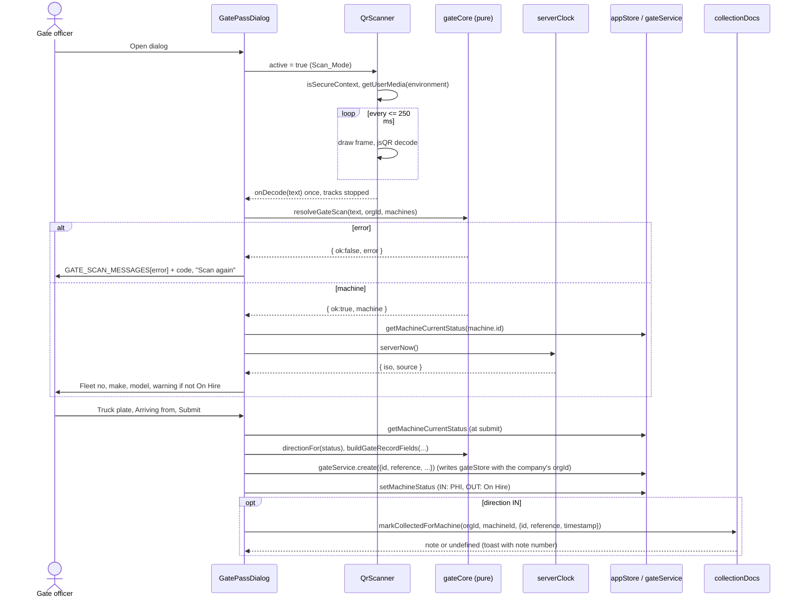
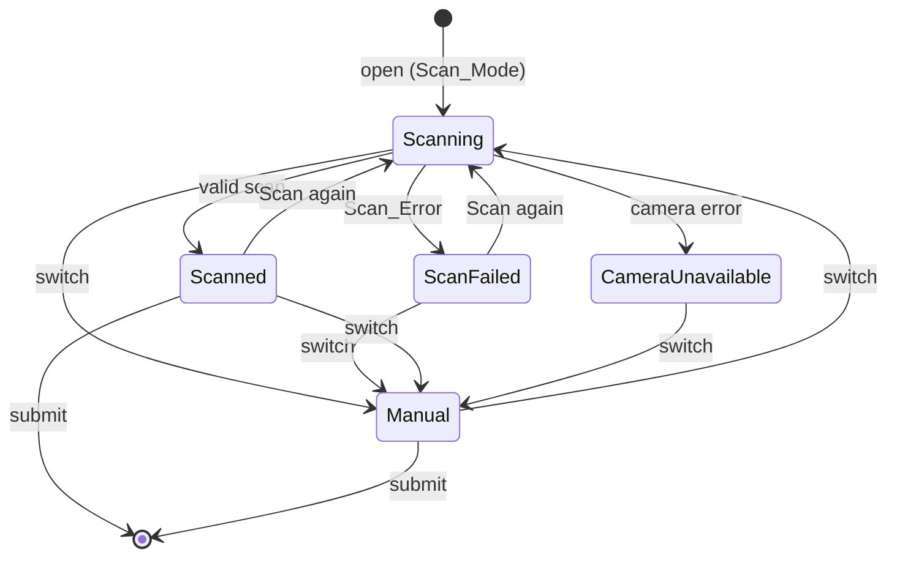
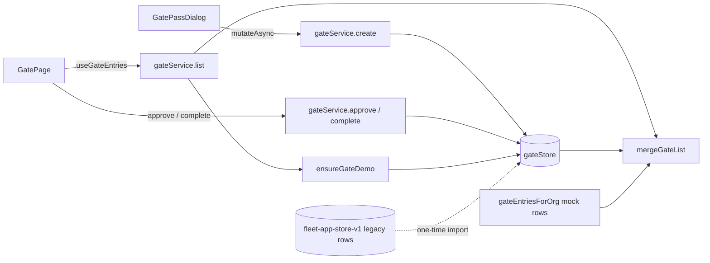

# Design Document

## Overview

The Gate Entry dialog (`GatePassDialog.tsx`) gains a QR scan mode. Gate staff scan the QR code printed on a Collection Note. The dialog resolves the code to a machine, fills the Fleet Number, and captures the gate time from an authoritative server clock. The existing Fleet Number dropdown stays as Manual_Mode. In both modes the date and time are captured automatically and the user never types them.

The design keeps decisions in pure modules that are easy to property-test, and keeps the browser, store and camera work in thin shells:

| Layer | Module | Role |
|---|---|---|
| Pure | `src/services/gateCore.ts` | Scan resolution, scan and camera messages, direction rule, record field builder, gate display formatter |
| Pure | `src/services/collectionCore.ts` (extended) | `pickNoteToCollect` |
| Clock | `src/services/serverClock.ts` | `serverNow`, `computeOffset`, `resetServerClock`. No store imports |
| Facade | `src/services/collectionDocs.ts` (extended) | `markCollectedForMachine` |
| UI | `src/features/gate/QrScanner.tsx` | Camera, frame decode loop, camera error reporting |
| UI | `src/features/gate/GatePassDialog.tsx` (changed) | Mode state, orchestration, submit |
| UI | `src/features/gate/GatePage.tsx` (changed) | Detail rows for capture data |
| Types | `src/types/gate.ts`, `src/store/appStore.ts` | New optional fields |
| Store | `src/store/gateStore.ts` (new) | Persisted, per-company Gate_Records, seed markers, legacy import (Req 14, 15) |
| Pure | `src/services/gateCore.ts` (extended) | `mergeGateList`, `migrateGateRecords`, `planGateSeeds`, `linkNoteToGate` |
| Pure | `src/services/collectionCore.ts` (extended) | `collectionStatusControl` (Req 16.1, 16.3) |
| Mock data | `src/services/mock/demoGate.ts` (new) | Pure builder of the three Gate_Seed_Records (Req 15) |
| Seeder | `src/services/demoSeed.ts` (extended) | `ensureGateDemo(orgId)` |
| Service | `src/services/services.ts` (`gateService` changed) | Thin wrappers over `gateStore`, list through `mergeGateList` |
| UI | `src/features/collection/CollectionDetail.tsx` (changed) | Collected is not selectable, hint, read-only gate link (Req 16) |
| Types | `src/types/collection.ts` | Collection_Gate_Link fields on `CollectionNote` |

Research findings that shaped the design:

- **jsqr** decodes `ImageData` (`jsQR(data, width, height, options)`) and returns `null` when no code is found, so a canvas `getImageData` loop is sufficient. It is loaded with a dynamic `import('jsqr')` so the scanner bundle is only fetched when the dialog is used. It must move from `devDependencies` to `dependencies` (Req 13.1).
- **Server time** in a browser-only app comes from the `Date` response header of a same-origin `HEAD` request. The header has 1-second precision, so the offset is computed at the midpoint of the request round trip (Req 7.3, 7.10). The Node HTTP server behind Vite and any normal static host sets `Date` on every response.
- **Local date and time** are derived with `Intl.DateTimeFormat(..., { timeZone, hourCycle: 'h23' }).formatToParts`. `hourCycle: 'h23'` avoids the `24:00:00` output that `hour12: false` produces in some engines. The builder reads no default time zone.
- **`gateService.create`** already spreads `...data` after its defaults and then forces `status: 'Pending'`, so a supplied `id` and `reference` win and a supplied `status` is overridden. No change to `services.ts` is needed for Req 9.7 to 9.9. It is covered by a test so the behaviour is pinned.

Assumptions:

- The orgId is `useAuthStore.getState().user?.orgId ?? JA_ORG_ID`, as in `collectionDocs.ts`.
- Scan mode resolves against `appMachineResolver.list(orgId)` from `collectionWiring.ts`. Manual mode lists the machines from `useMachines()` and converts the chosen one with `toMachineLite(machine, orgId)`.
- The camera needs a secure context. Plain-HTTP deployments get the Req 5.3 message and use Manual_Mode.
- Req 12.5 says a Gate_Record with a missing or unrecognised `gateTimeZone` is shown in UTC. If such a record has a stored `gateDate` and `gateTime` but no `timestamp` or `createdAt`, the stored values cannot be placed in any zone. The decided behaviour, which matches Req 12.5, is that the design shows the stored values with the zone label "Unknown" in that one case.

## Architecture



Dialog state machine:



Design decisions:

1. **Pure cores, thin shells.** `gateCore.ts` imports values only from `collectionCore.ts`, which is itself pure and types-only. An architecture test enforces this, so the logic is testable with fast-check without mocks.
2. **`resolveGateScan` delegates to `resolveQr`.** It is a one-line wrapper so the gate and fleet screens cannot diverge (Req 2.9). The property test compares the two for equal output.
3. **Capture time is taken once.** In Scan_Mode `serverNow()` runs when the scan is accepted. In Manual_Mode it runs at submit. The submit handler never calls it again in Scan_Mode.
4. **Persistence order.** The existing code writes the store first and then the service, so a service failure leaves an orphan record. The new order is `gateService.create` through the mutation, then the status change. Since `gateService.create` is now the single writer of `gateStore` (see "Gate_Store and per-company gate records"), nothing is stored unless the service call succeeds, which supports Req 11.10. A single `id` and `reference` are generated before the call (Req 9.3).
5. **Same-instant read of status.** Status is read once at submit and used for both direction and transition, so the direction rule (Req 10.1, 10.2) cannot disagree with the status change.
6. **Collection note update is best effort after save.** A failure there keeps the Gate_Record and shows an error (Req 11.11).

## Components and Interfaces

### Shared types (`src/types/gate.ts`)

```ts
export type TimeSource = 'server' | 'device';
export type CaptureMethod = 'QR' | 'Manual';

export interface GateEntry extends BaseEntity {
  // existing fields unchanged
  fleetNo?: string;
  timestamp: ISODate;          // already present, now ISO UTC with ms and Z for new records
  gateDate?: string;           // YYYY-MM-DD in gateTimeZone
  gateTime?: string;           // HH:mm:ss (24h) in gateTimeZone
  gateTimeZone?: string;       // IANA id
  captureMethod?: CaptureMethod;
  timeSource?: TimeSource;
  qrPayload?: string;
}
```

`StoredGateEntry` in `appStore.ts` gains the same optional fields (`fleetNo`, `timestamp`, `gateDate`, `gateTime`, `gateTimeZone`, `captureMethod`, `timeSource`, `qrPayload`), each optional so persisted and mock entries stay valid.

### `src/services/serverClock.ts`

```ts
import type { TimeSource } from '@/types/gate';   // type-only; no store imports

export interface ServerTime { iso: string; source: TimeSource }

export interface ClockDeps {
  fetchFn?: typeof fetch;      // default globalThis.fetch
  now?: () => number;          // default Date.now
  url?: string;                // default '/' (app's own origin)
  timeoutMs?: number;          // default 2000
  ttlMs?: number;              // default 300_000
}

/** offset = headerMs - (sentAt + receivedAt) / 2. Pure. */
export function computeOffset(headerMs: number, sentAt: number, receivedAt: number): number;

/** Never throws. Reuses a cached offset for ttlMs. One HEAD request at a time. */
export function serverNow(deps?: ClockDeps): Promise<ServerTime>;

/** Clears the cached offset and any in-flight marker. */
export function resetServerClock(): void;
```

Behaviour:

- Module state: `cache: { offset: number; cachedAt: number } | null` and `inflight: Promise<number | null> | null`.
- `serverNow` returns `{ iso: new Date(now() + offset).toISOString(), source: 'server' }` when the cache is fresh (`now() - cachedAt <= ttlMs`).
- Otherwise it starts a refresh unless `inflight` exists. The refresh records `sentAt = now()`, sends `fetchFn(url, { method: 'HEAD', cache: 'no-store', signal })`, aborts after `timeoutMs`, records `receivedAt = now()`, reads `headers.get('Date')`, and parses it with `Date.parse`. A missing header or `NaN` counts as failure.
- Every concurrent caller awaits the same `inflight` promise (Req 7.6). The promise is cleared in `finally`.
- On failure the result is `{ iso: new Date(now()).toISOString(), source: 'device' }`, nothing is cached, and nothing is thrown (Req 7.5).
- Only `serverNow()` is called by the dialog, so a real API can replace the internals without touching callers (Req 7.9).

### `src/services/gateCore.ts`

```ts
import { resolveQr, fleetNumberOf } from '@/services/collectionCore';   // values, from a pure module
import type { MachineLite, QrError, QrResult } from '@/services/collectionCore';
import type { GateDirection, CaptureMethod, TimeSource } from '@/types/gate';
```

Import rule: `gateCore.ts` may import values only from `@/services/collectionCore`. Every other import is `import type`. It has no `require` call and no dynamic `import()`. `collectionCore.ts` stays types-only, so `gateCore.ts` still reaches no store, browser API, clock or randomness.

```ts
/** Thin wrapper over resolveQr, unchanged (Req 2.9). */
export function resolveGateScan(raw: string, orgId: string, machines: MachineLite[]): QrResult;
```

`resolveGateScan` returns `resolveQr(raw, orgId, machines)` and nothing else.

```ts
export const GATE_SCAN_MESSAGES: Record<QrError, string>;   // 5 distinct messages, 1..200 chars trimmed

export type CameraErrorCode = 'INSECURE' | 'UNSUPPORTED' | 'DENIED' | 'NOT_FOUND' | 'OTHER';
export const CAMERA_MESSAGES: Record<CameraErrorCode, string>;   // each directs to Manual entry

/** Req 5.6 precedence: insecure, missing getUserMedia, then error name. */
export function mapCameraError(
  env: { isSecureContext: boolean; hasGetUserMedia: boolean },
  err?: { name?: string } | null,
): CameraErrorCode;

/** On Hire -> IN, anything else -> OUT (Req 10.1, 10.2). */
export function directionFor(currentStatus: string): GateDirection;

export interface GateRecordFields {
  fleetNo: string;
  timestamp: string;       // ISO UTC, ms, trailing Z
  gateDate: string;        // YYYY-MM-DD
  gateTime: string;        // HH:mm:ss
  gateTimeZone: string;
  captureMethod: CaptureMethod;
  timeSource: TimeSource;
  qrPayload?: string;      // present only when method is 'QR'
}

/** Pure. Throws RangeError for an invalid instant or time zone. */
export function buildGateRecordFields(
  captureIso: string,
  timeZone: string,
  machine: Pick<MachineLite, 'fleetNo' | 'assetNumber'>,
  method: CaptureMethod,
  source: TimeSource,
  qrPayload?: string,
): GateRecordFields;
```

`buildGateRecordFields` implementation notes:

- `fleetNo` is `fleetNumberOf(machine)`, imported from `collectionCore`.
- `const d = new Date(captureIso); if (isNaN(d.getTime())) throw new RangeError(...)`. `timestamp = d.toISOString()`.
- `new Intl.DateTimeFormat('en-US', { timeZone, hourCycle: 'h23', year: 'numeric', month: '2-digit', day: '2-digit', hour: '2-digit', minute: '2-digit', second: '2-digit' }).formatToParts(d)`. The constructor throws `RangeError` for an unknown zone.
- `gateDate = ${year}-${month}-${day}`, `gateTime = ${hour}:${minute}:${second}`, each zero-padded.
- `qrPayload` is set only when `method === 'QR'`.

Gate display (also in `gateCore.ts`):

```ts
export interface GateWhen {
  available: boolean;       // false -> UI shows "Not available" in both rows
  date?: string;            // YYYY-MM-DD
  time?: string;            // HH:mm:ss
  zone?: string;            // IANA id, 'UTC', or 'Unknown'
}

export function formatGateWhen(e: {
  gateDate?: string; gateTime?: string; gateTimeZone?: string;
  timestamp?: string; createdAt?: string;
}): GateWhen;

/** Returns '-' for undefined, null or empty, otherwise the value unchanged. */
export function dashIfMissing(v: string | undefined | null): string;
```

`formatGateWhen` order (Req 12.3 to 12.5): use stored `gateDate` and `gateTime` when both exist and the zone is valid. Otherwise derive from `timestamp`, then `createdAt`, in `gateTimeZone` when it is a recognised IANA id and in UTC (label `UTC`) otherwise. If no value parses, return `{ available: false }`. A zone is recognised when `new Intl.DateTimeFormat('en-US', { timeZone })` does not throw.

### `pickNoteToCollect` (in `src/services/collectionCore.ts`)

```ts
export interface NoteLite {
  id: string; orgId: string; machineId: string; status: string; createdAt: string;
}

/** Open = status is neither 'Collected' nor 'Closed'. Latest createdAt wins; first in list wins ties. */
export function pickNoteToCollect<T extends NoteLite>(
  notes: readonly T[], orgId: string, machineId: string,
): T | undefined;
```

It filters by org, machine and open status, compares `Date.parse(createdAt)`, and keeps the earlier element on equal timestamps by replacing only on a strictly greater value. It stays pure and imports types only.

### `markCollectedForMachine` (in `src/services/collectionDocs.ts`)

```ts
export interface GateLinkRef { id: string; reference: string; timestamp: string }

export function markCollectedForMachine(
  orgId: string, machineId: string, gate: GateLinkRef,
): CollectionNote | undefined {
  const store = useCollectionStore.getState();
  const note = pickNoteToCollect(store.notes, orgId, machineId);
  if (!note) return undefined;
  return store.patch(note.id, {
    status: 'Collected',
    collectedByGateId: gate.id,
    collectedByGateRef: gate.reference,
    collectedAt: gate.timestamp,
    updatedAt: new Date().toISOString(),
  });
}
```

The third argument is required, so no caller can mark a note Collected without a gate movement (Req 11.1, 11.7, 16.4). `collectedAt` is the Gate_Record `timestamp` (ISO UTC), not the wall clock at the time of the call. `collectionDocs.ts` keeps its rule of not importing `services.ts` or `appStore`. It also stays the only non-seed place under `src/services` that writes the status `Collected` (Req 16.9).

### `src/features/gate/QrScanner.tsx`

```ts
export interface QrScannerProps {
  active: boolean;                              // false stops the camera
  onDecode: (text: string) => void;             // called at most once per start
  onError?: (code: CameraErrorCode) => void;
}
export function QrScanner(props: QrScannerProps): JSX.Element;
```

Behaviour:

1. On `active` becoming true: `const code = precheck()`. If `!window.isSecureContext` report `INSECURE`. If `!navigator.mediaDevices?.getUserMedia` report `UNSUPPORTED`. Neither calls `getUserMedia` for the first case (Req 5.3).
2. `getUserMedia({ video: { facingMode: { ideal: 'environment' } }, audio: false })`. Rejection maps through `mapCameraError`.
3. If the effect was cleaned up while the promise was pending, stop the returned tracks immediately (a `cancelled` flag).
4. Attach the stream to a `<video playsInline muted>` and start `setInterval(tick, 200)`. `tick` skips when `video.readyState < 2`, draws the frame to an offscreen canvas, calls `getImageData`, and runs `jsQR(data, width, height, { inversionAttempts: 'dontInvert' })`. `jsQR` comes from a dynamic `import('jsqr')` that resolves before the first tick.
5. On a result: set a `doneRef`, clear the interval, stop all tracks, set `video.srcObject = null`, and call `onDecode(result.data)` unmodified. The `doneRef` guarantees one call.
6. On cleanup (`active` false or unmount): clear the interval, stop all tracks, release the video, and set `doneRef` so no later decode is delivered (Req 1.5, 1.7).
7. A track `ended` event after start reports `OTHER`.

The dialog restarts a scan by changing the `key` of `QrScanner` and setting `active` true.

### `GatePassDialog.tsx` changes

Local state (React `useState`, not in the zod form):

```ts
type Mode = 'scan' | 'manual';
interface ScanResult {
  machine: MachineLite;
  payload: string;
  capturedAt: ServerTime;             // from the single serverNow() call at scan time
  warnNotOnHire: boolean;
}
const [mode, setMode] = useState<Mode>('scan');
const [scan, setScan] = useState<ScanResult | null>(null);
const [scanError, setScanError] = useState<{ code: QrError; message: string } | null>(null);
const [cameraError, setCameraError] = useState<CameraErrorCode | null>(null);
const [inlineError, setInlineError] = useState<string | null>(null);   // clock or status failure
const [scanKey, setScanKey] = useState(0);
```

Rules:

- **Open:** reset to `mode='scan'`, no scan, no errors, `machineId` empty. The scanner is active when `open && mode === 'scan' && !scan && !scanError && !cameraError`.
- **onDecode:** `resolveGateScan(text, orgId, appMachineResolver.list(orgId))`, called directly. On error, set `scanError`, leave `machineId` empty, leave other fields alone (Req 3.7). On success, read `getMachineCurrentStatus` inside `try/catch` (Req 10.7), call `serverNow()` once and validate `!isNaN(Date.parse(iso))` (Req 8.1, 8.3), then `form.setValue('machineId', machine.id)` and set `scan`.
- **Scan again:** clear `scan`, `scanError`, `inlineError`, `machineId`, and bump `scanKey` (Req 3.9, 4.5).
- **Mode switch:** to manual clears scan data and `machineId` and `cameraError`. To scan clears `machineId` and bumps `scanKey` (Req 4.6, 4.7). The switch control is always rendered and enabled, including while the camera is unavailable (Req 5.7).
- **Fleet display:** in Scan_Mode with a scan the dialog shows `fleetNumberOf(machine)`, make and model, and an amber, non-blocking warning when `warnNotOnHire` (Req 10.3 to 10.6).
- **Submit gating:** the submit button is `disabled` in Scan_Mode when `scan` is null. The `<form onSubmit>` wrapper returns early in that case, so Enter in any field cannot submit (Req 4.1).
- **Manual list:** the dropdown shows `useMachines()` data. If the list is empty it shows a disabled "No machines available" item (Req 6.6). The date and time fields do not exist.
- **Submit:**
  1. `inlineError = null`. Read `status = getMachineCurrentStatus(machineId)` in `try/catch`. On throw, set `inlineError` "Machine status is unavailable", return.
  2. `direction = directionFor(status)`.
  3. Capture: Scan_Mode uses `scan.capturedAt`. Manual_Mode calls `serverNow()` once and validates the date. On an invalid result, set `inlineError` "Could not get the time" and return with form values kept (Req 8.3).
  4. `timeZone = Intl.DateTimeFormat().resolvedOptions().timeZone`. `fields = buildGateRecordFields(...)` inside the same `try`. A `RangeError` is handled as a time error.
  5. `id = 'ge-' + Date.now()` and `reference = 'GP-' + String(Date.now()).slice(-4)`, each generated once.
  6. `await createMutation.mutateAsync({ ...gateData, orgId, id, reference, gatePass: reference, ...fields })`. `gateService.create` writes the record to `gateStore` with the current orgId (Req 14.1), so the dialog no longer calls `appStore.addGateEntry`. Then `setMachineStatus` (IN: `PHI`, OUT: `On Hire`) and the existing toast. A failure in step 6 shows `toastError('Failed to log gate entry')` and skips the collection update (Req 11.10).
  7. If `direction === 'IN'`, call `markCollectedForMachine(orgId, machineId, { id, reference, timestamp: fields.timestamp })` in its own `try/catch`. A returned note produces `toastSuccess('Collection Note <number> marked Collected')`. `undefined` produces no toast. A throw produces `toastError('Collection note was not updated')` and leaves the saved record (Req 11.11).
  8. `form.reset()` and `onClose()`.

The `machineId` form field and zod schema stay unchanged, so the existing messages "Fleet number is required" and "Truck plate is required" apply in both modes (Req 6.5, 6.7). In Scan_Mode the Fleet Number control is replaced by the scan panel, and the zod error is shown next to it if it ever appears.

### `GatePage.tsx` changes

In the detail panel the `Timestamp` row is replaced by rows built from `formatGateWhen(selected)` and `dashIfMissing`:

- Fleet No. (`selected.fleetNo ?? selected.assetNumber`)
- Gate Date, Gate Time (with the zone label), or "Not available" for both
- Capture Method, Time Source (shows "Device time" next to the time when `timeSource === 'device'`)
- QR Payload, only when `captureMethod === 'QR'`, in full, or "Not available" when empty

Other missing optional values render as `-`.

### Test compatibility of `GatePassDialog.test.tsx`

The dialog now opens in Scan_Mode, so the existing test needs a small, mechanical update:

1. `vi.mock('./QrScanner', () => ({ QrScanner: () => null }))` so no camera code runs in jsdom.
2. `vi.mock('@/services/serverClock', () => ({ serverNow: vi.fn().mockResolvedValue({ iso: '2025-01-15T08:30:00.000Z', source: 'server' }) }))`.
3. `submitGateEntry` first clicks the "Enter fleet number manually" button, then continues as before.

Both assertions stay unchanged (On Hire trigger count, PHI transition). `markCollectedForMachine` runs for real in the Gate IN case and finds no open note, so it needs no mock.

### Gate_Store and per-company gate records (Req 14)

**Decision: a dedicated persisted store, `src/store/gateStore.ts`, key `fleet-gate-entries-v1`.** The alternative was to add `orgId` to `appStore.gateEntries`.

| Dimension | Dedicated `gateStore` (chosen) | Extend `appStore.gateEntries` |
|---|---|---|
| Fit with the codebase | Same shape as `collectionStore`, `mqdStore`, `thirdPartyStore`: all-orgs array, `forOrg`, `demoSeededOrgs`, total `migrate` | `appStore` is a large mixed store that also holds machine status |
| Legacy data | Legacy rows stay untouched in `fleet-app-store-v1`. They are copied once, so a bad import cannot damage machine status or other app data | Migration rewrites the persisted store that holds everything else |
| Blast radius | A malformed gate state resets only gate data | A malformed state affects the whole app store |
| Cost | One new file and a one-time import | None |

Existing data in `appStore.gateEntries` is never written again. `addGateEntry`, `updateGateEntry` and `getAllGateEntries` stay in `appStore.ts` and are marked `@deprecated` so persisted state and old tests still load. `getAllGateEntries` has no caller in the app.

```ts
// src/types/gate.ts
export interface GateRecord extends GateEntry {
  orgId: string;               // always present on a stored record
  machineId?: string;
  truckPlate?: string;
  arrivingFrom?: string;
  seedKey?: string;            // set only on Gate_Seed_Records; equals the record id
}

// src/store/gateStore.ts
interface GateState {
  entries: GateRecord[];                       // all companies
  seedMarkers: Record<string, string[]>;       // orgId -> ids of seed records created once
  legacyImported: boolean;                     // one-time import flag
  forOrg: (orgId: string) => GateRecord[];    // filter only, no ordering
  add: (r: GateRecord) => GateRecord;
  update: (id: string, patch: Partial<GateRecord>) => GateRecord;   // throws when the id is unknown
  upsert: (r: GateRecord) => GateRecord;       // used for copy-on-write of mock rows
  seedOrg: (orgId: string, seeds: GateRecord[]) => GateRecord[];    // inserts planned seeds and markers in one set()
}
```

`persist` options: `name: 'fleet-gate-entries-v1'`, `version: 1`, `partialize` keeps `entries`, `seedMarkers` and `legacyImported`, and `migrate` calls `migrateGateState(persisted)`.

**Migration (Req 14.8).** Two pure functions in `gateCore.ts` (type-only imports) carry the logic, so they are property-testable:

```ts
/** Total. Never throws. Drops values that are not objects or have no string id.
 *  Missing, non-string or empty orgId becomes 'org-ja'. A present orgId is kept.
 *  Fills driver '' , destination (arrivingFrom ?? ''), timestamp (createdAt) and
 *  createdAt/updatedAt only when absent, so legacy rows render in GatePage. */
export function migrateGateRecords(rows: unknown, defaultOrgId?: string): GateRecord[];

/** Total. Resets on malformed input, keeps valid fields, runs migrateGateRecords. */
export function migrateGateState(persisted: unknown): GateData;
```

The legacy rows come from `localStorage['fleet-app-store-v1']` (`JSON.parse(...).state.gateEntries`). On first load of `gateStore`, `importLegacyGateEntries()` (inside `gateStore.ts`, the only module that touches that key) runs `migrateGateRecords` over those rows, appends the ones whose id is not already in `entries`, and sets `legacyImported = true`. The flag stops the import from repeating, so a record the user later removes does not come back. `importLegacyGateEntries` never throws. If the read or parse fails it sets nothing and tries again next load.

**Listing (Req 14.3, 14.4, 14.9).** A new pure function in `gateCore.ts`:

```ts
/** persisted: all companies' rows. mock: the in-memory rows of gateEntriesForOrg(orgId). */
export function mergeGateList(
  persisted: readonly GateRecord[], mock: readonly GateEntry[], orgId: string,
): GateRecord[];
```

Result, in order:

1. Rows of `persisted` with `orgId === orgId` and no `seedKey` (user records), sorted by `Date.parse(createdAt)` descending. An unparseable value counts as `-Infinity`. Ties keep input order.
2. Rows of `persisted` with `orgId === orgId` and a `seedKey` (Gate_Seed_Records), in input order. The seeder inserts them in a fixed order.
3. Rows of `mock` whose id is not present in the result so far, stamped with `orgId`.

A record id appears at most once, and a persisted row shadows a mock row with the same id. No row with another `orgId` is ever returned. The mock rows are the existing `gateEntriesForOrg(orgId)` data (eight random rows for org-ja, none for other companies), kept so existing demo screens still have data.

**`gateService` becomes a thin wrapper (hooks and pages are unchanged):**

| Method | Behaviour |
|---|---|
| `list()` | `ensureGateDemo(orgId)`, then `mergeGateList(useGateStore.getState().entries, gateEntriesForOrg(orgId), orgId)` |
| `create(data)` | Builds the record as today (supplied `id` and `reference` win, `status` forced to `Pending`), fills `driver: ''` and `destination: arrivingFrom ?? ''` when absent, stamps `orgId = currentOrgId()` last so it cannot be overridden, then `gateStore.add`. Nothing is stored when it throws. |
| `approve(id)`, `complete(id)` | Look the id up in `gateStore` for the current org and `update` it. When it is only a mock row, copy it with the new status into `gateStore` through `upsert` (copy-on-write). The copy shadows the mock row in `mergeGateList`, so the new status survives a reload (Req 14.6). An unknown id throws `Gate entry not found`, as today. |

`useGateEntries` uses the query key `[...queryKeys.gateEntries, orgId]`. Existing invalidations use the prefix `queryKeys.gateEntries`, so they still match. This stops a cached list of one company from showing after the user switches to another (Req 14.4). `GatePage` search guards `driver` and `assetNumber` with `?? ''`.

**Machine resolution (Req 14.5).** No change is needed. The scanner uses `appMachineResolver.list(orgId)` and Manual_Mode uses `useMachines()` whose service reads `machinesForOrg(currentOrgId())`. A test pins this for two companies. **No dependency on demo accounts (Req 14.7):** `orgId` comes from `useAuthStore` and `currentOrgId()`, and nothing in the gate path compares the org with `org-ja` except the migration default.



### Gate_Demo_Seeder (Req 15)

**Pure builder: `src/services/mock/demoGate.ts`.**

```ts
export interface DemoGateCtx {
  machines: MachineLite[];                 // machines of the company (same list ensureCollectionDemo builds)
  j105StartDate?: string;                  // 'YYYY-MM-DD' from the J105 booking
  bookingSite?: string;                    // delivery address of that booking
  customerName?: string;
}
export const gateSeedId = (orgId: string, n: 1 | 2 | 3) => `ge-seed-${orgId}-${n}`;
export function demoGateSeedsForOrg(orgId: string, ctx: DemoGateCtx): GateRecord[];
```

It reuses `demoMachineId(orgId, n)` (n = 5, 4, 1 for J105, J104, J101) and skips a record when its machine is missing (Req 15.9). It builds the time fields with `buildGateRecordFields` so seed rows and live rows are produced by one function. Time zone is `Asia/Dubai` (UTC+4, no daylight saving, so a fixed offset is exact).

| n | Id | Reference | Machine | Direction and status | Capture | Timestamp (UTC) | Local (Asia/Dubai) |
|---|---|---|---|---|---|---|---|
| 1 | `ge-seed-<orgId>-1` | `GP-DEMO-0001` | J105 | OUT, Completed, delivery to customer (`notes: 'Delivery to customer'`, destination = booking site, customer = booking customer) | Manual, `timeSource: 'server'` | `Date.parse(startDate + 'T09:15:00+04:00') - 2 days` | start date minus 2 days, 09:15:00 |
| 2 | `ge-seed-<orgId>-2` | `GP-DEMO-0002` | J104 | IN, Completed | QR, `qrPayload = buildQrPayload(J104)`, `timeSource: 'server'` | `2026-11-28T10:20:00.000Z` | 2026-11-28 14:20:00 |
| 3 | `ge-seed-<orgId>-3` | `GP-DEMO-0003` | J101 | OUT, Pending | Manual, `timeSource: 'server'` | `2026-12-01T05:00:00.000Z` | 2026-12-01 09:00:00 |

Rules for all three rows:

- `orgId`, `seedKey = id`, `createdAt = updatedAt = timestamp`, `gatePass = reference`, `branchId: 'br-dxb'`, `branchName: 'Dubai'`, `fleetNo` from `fleetNumberOf(machine)`, `assetNumber` and `machineModel` from the machine, `truckPlate` and `arrivingFrom` fixed demo values, `driver: ''`.
- Row 1 is dated two days before the J105 booking start, so its `timestamp` is earlier than the hire start (Req 15.2). The booking start is `bookingStore` row `bk-demo-5` (or `bk-demo-<orgId>-5`) when present, otherwise `demoBookingsForOrg(orgId)[4].startDate`. The booking dates are relative to the day the demo is first loaded, so the seed is computed once and then persisted.
- Row 2's `gateDate`, `gateTime` and `gateTimeZone` are filled from the same `buildGateRecordFields` call and match the collection date of CN-2026-0002 (`2026-11-28`) (Req 15.3).
- The seeder never calls `setMachineStatus` or `markCollectedForMachine`. J105 stays On Hire and CN-2026-0001 stays open (Req 15.4). Scanning the payload of CN-2026-0001 at the gate then resolves J105, gives direction IN, sets J105 to PHI and sets CN-2026-0001 to Collected with the gate link.
- Row 3 is Pending so the user can approve and complete it (Req 15.5).
- Ids and references are numbered per company and the id carries the orgId (Req 15.6).

**Pure planner in `gateCore.ts`:**

```ts
/** Seeds to insert: not marked for the company and not already present by id. */
export function planGateSeeds(
  markers: readonly string[], existingIds: ReadonlySet<string>, seeds: readonly GateRecord[],
): GateRecord[];
```

**Seeder `ensureGateDemo(orgId)` in `demoSeed.ts` (idempotent, never throws, logs with the `[demoSeed]` prefix):**

1. Return when `orgId` is empty.
2. `ensureHireLinkDemo(orgId)`. This creates the demo machines, bookings and Collection Notes. `ensureHireLinkDemo` does not call `ensureGateDemo`, so there is no cycle.
3. Build `ctx` from `machinesForOrg(orgId)` and the J105 booking, then `seeds = demoGateSeedsForOrg(orgId, ctx)`.
4. `toInsert = planGateSeeds(state.seedMarkers[orgId] ?? [], new Set(state.entries.map(e => e.id)), seeds)`.
5. `gateStore.seedOrg(orgId, toInsert)` inserts the rows and adds their ids to `seedMarkers[orgId]` in one `set` call. A seed skipped because its machine is missing gets no marker, so it can still appear if the machine shows up later. A seed the user deleted keeps its marker and is never re-created (Req 15.8). No other row is read or changed (Req 15.10).
6. Collection_Gate_Link for CN-2026-0002: when the store holds seed row 2 and note `cn-demo-<orgId>-2` exists with status Collected and no `collectedByGateId`, call `collectionStore.patch(note.id, linkNoteToGate(note, row2))`. `linkNoteToGate` (pure, in `gateCore.ts`) returns `{ collectedByGateId, collectedByGateRef, collectedAt }` only when `collectedByGateId` is empty, otherwise `{}`. It never overwrites an existing link.

**Where it runs.** `gateService.list()` calls `ensureGateDemo(currentOrgId())` (the same pattern as `machineService.list` and `bookingService.list`). `'gate'` is added to `DEMO_APPS` in `demoSeed.ts`, so a company that has only the Gate app active still gets the demo machines, bookings and Collection Notes the seeds depend on. Without this a new company would see no seed rows, because Req 15.9 skips rows whose machine is missing.

### Collection_Gate_Link and Collection Note detail (Req 11.1, 16.1 to 16.5)

`CollectionNote` in `src/types/collection.ts` gains three optional fields:

```ts
export interface CollectionNote extends DocBase {
  // existing fields unchanged
  collectedByGateId?: string;     // Gate_Record id
  collectedByGateRef?: string;    // Gate_Record reference, e.g. 'GP-0421'
  collectedAt?: string;           // Gate_Record timestamp, ISO UTC
}
```

`collectionStore` needs no migration. `normalizeNote` spreads the raw row, so persisted notes without the fields stay valid, and rows with the fields keep them.

A new pure function in `collectionCore.ts`:

```ts
export interface StatusControl { readOnly: boolean; options: CollectionStatus[] }

/** Collected is never an option. A note that is Collected is read-only (Req 16.1, 16.3). */
export function collectionStatusControl(current: CollectionStatus): StatusControl;
```

- `current === 'Collected'` returns `{ readOnly: true, options: [] }`.
- Any other status returns `{ readOnly: false, options: ['Draft', 'Scheduled', 'Closed'] }`.

`CollectionDetail.tsx` uses it in place of the `STATUSES` constant:

- Not read-only: the existing `Select` shows `options` only.
- Read-only: a static badge shows `Collected`, with no Select. When `collectedByGateRef` is present, two extra rows show "Gate reference" (`collectedByGateRef`) and "Collected at" (`formatGateWhen({ timestamp: collectedAt, gateTimeZone: deviceTimeZone })` as `date time zone`). A note that is Collected without the link (legacy data) shows neither row.
- A muted hint under the status control always reads "Collected is set automatically at Gate-In in Gate Operations" (Req 16.2).
- The form keeps `status` unchanged for a Collected note, so Save cannot move it to another status or write Collected.

### Gate operations only in the Gate Operations app (Req 16)

The dialog and the three mutation hooks stay in `src/features/gate` and `src/hooks/useQueries.ts`. No other feature imports them today, and the architecture tests below keep it that way. Links from other apps to `/gate` stay plain route links (Req 16.7). `collectionDocs.markCollectedForMachine` is exported from `src/services` and called only by `GatePassDialog`.

Architecture tests in `src/architecture.test.ts` (use the existing `listFiles`, `specifiers` and `importStatements` helpers, exclude `*.test.ts(x)`):

| Test | Rule | Requirement |
|---|---|---|
| No gate operations outside the Gate app | Fails when a file outside `src/features/gate` has an import statement that names `GatePassDialog`, `useCreateGateEntry`, `useApproveGateEntry` or `useCompleteGateEntry`, or contains a call matching `/\b(addGateEntry\|updateGateEntry)\s*\(/`. Excluded as definitions: `src/hooks/useQueries.ts` (defines the hooks, no import of them) and `src/store/appStore.ts` (declares the deprecated actions with `name:` syntax, not call syntax). | 16.8 |
| Only the Gate app marks notes Collected | Fails when a file outside `src/features/gate` and `src/services` contains `/status\s*:\s*['"]Collected['"]/` or a call `patch(` / `set(` with `'Collected'` as an argument. Inside `src/services` only `collectionDocs.ts` may match. `src/services/mock/**` is excluded because it holds inert seed data (the `CN-2026-0002` literal), not a status change of an existing note. | 16.9 |
| `gateStore` write access | Fails when a file other than `src/store/gateStore.ts`, `src/services/services.ts`, `src/services/demoSeed.ts`, a file under `src/features/gate` or a test imports `@/store/gateStore`. This keeps Fleet, Collection Note, Planner, Transport and Dashboard from creating or changing Gate_Records. | 16.6 |
| Pure modules | `gateCore.ts` still imports values only from `collectionCore.ts` (the new functions use type imports only). `mock/demoGate.ts` imports only `gateCore`, `collectionCore`, `demoHireLink` and types. | 13.2 |

The requirements list the Gate-app rules as 16.8 and 16.9. If a legitimate hit appears in the first run of these tests, the test gets an explicit, commented allow-list entry for that file. The regexes are not loosened.

## Data Models

```ts
// Persisted gate record (StoredGateEntry and GateEntry, new optional fields)
{
  fleetNo?: string;                  // fleetNumberOf(machine)
  timestamp: string;                 // '2025-01-15T08:30:00.123Z'
  gateDate?: string;                 // '2025-01-15'   (in gateTimeZone)
  gateTime?: string;                 // '12:30:00'     (24h, in gateTimeZone)
  gateTimeZone?: string;             // 'Asia/Dubai'
  captureMethod?: 'QR' | 'Manual';
  timeSource?: 'server' | 'device';
  qrPayload?: string;                // 'AXLEOPS-FLEET:<orgId>:<machineId>:<fleetNo>', QR only
}
```

Clock cache (in memory, module scope): `{ offset: number /* ms */, cachedAt: number /* device ms */ } | null` plus `inflight: Promise<number | null> | null`.

Example: header `Date` is 08:30:00 GMT, `sentAt = T`, `receivedAt = T + 200`. Offset is `08:30:00 - (T + 100)`. A later call at device time `T + 5000` returns `iso` for `T + 5000 + offset`, `source: 'server'`.

Existing persisted entries have none of the new fields and remain valid.

### Data model changes for Requirements 14 to 16

```ts
// Gate_Store (localStorage 'fleet-gate-entries-v1', version 1)
{
  entries: GateRecord[];                  // GateEntry + orgId, machineId?, truckPlate?, arrivingFrom?, seedKey?
  seedMarkers: Record<string, string[]>;  // { 'org-ja': ['ge-seed-org-ja-1', 'ge-seed-org-ja-2', 'ge-seed-org-ja-3'] }
  legacyImported: boolean;
}

// CollectionNote (fleet-collection-notes-v1), new optional fields
{ collectedByGateId?: string; collectedByGateRef?: string; collectedAt?: string /* ISO UTC */ }
```

Example seed row (company `org-x`, J104):

```json
{
  "id": "ge-seed-org-x-2", "seedKey": "ge-seed-org-x-2", "orgId": "org-x",
  "reference": "GP-DEMO-0002", "gatePass": "GP-DEMO-0002",
  "direction": "IN", "status": "Completed",
  "timestamp": "2026-11-28T10:20:00.000Z",
  "gateDate": "2026-11-28", "gateTime": "14:20:00", "gateTimeZone": "Asia/Dubai",
  "captureMethod": "QR", "timeSource": "server",
  "qrPayload": "AXLEOPS-FLEET:org-x:mc-demo-4:J104"
}
```

Legacy rows from `fleet-app-store-v1` have no `orgId`. After import each has `orgId: 'org-ja'`. Rows with an `orgId` keep it. The legacy rows in `appStore` are not deleted or edited.

`appStore` is unchanged apart from `@deprecated` comments on `gateEntries`, `addGateEntry`, `updateGateEntry` and `getAllGateEntries`.

## Correctness Properties

A correctness property is a characteristic or behavior that should hold true across all valid executions of a system. It is a formal statement about what the system should do. Properties serve as the bridge between human-readable specifications and machine-verifiable correctness guarantees.

Reflection on overlap: the prework identified overlapping criteria. Req 2.1 and 2.11 merge into one round-trip property. Req 2.2 to 2.6 and 2.9 merge into one classification property that also compares against `resolveQr`. Req 7.3, 7.7 and 7.10 merge into one `computeOffset` property. Req 8.5 to 8.10 merge into one record-fields property, and Req 8.11 stays separate as the time-zone round trip. Req 11.1, 11.4, 11.6 and 11.8 merge into one pick-and-collect property. Req 9.6 and 12.2 to 12.5 merge into the formatter properties.

### Property 1: Scan round trip

For any list of machines in which the normalised `fleetNumberOf` values are unique within each org, and for any machine in that list, resolving `buildQrPayload(machine)` in that machine's own org returns `{ ok: true, machine }` with that same machine.

**Validates: Requirements 2.1, 2.11**

### Property 2: Scan errors are classified and match `resolveQr`

For any string, org id and machine list, `resolveGateScan(raw, orgId, machines)` equals `resolveQr(raw, orgId, machines)`. Further, for any payload that is not in the `AXLEOPS-FLEET:<orgId>:<machineId>:<fleetNo>` format the error is `OTHER`. For any well-formed payload with a different org the error is `OTHER_ORG`. For any payload in the current org that matches no machine by id or Fleet Number the error is `NOT_FOUND`. For any payload whose normalised Fleet Number matches more than one machine the error is `AMBIGUOUS`. For any payload whose machine id and Fleet Number identify different machines the error is `MISMATCH`. No error result contains a machine.

**Validates: Requirements 2.2, 2.3, 2.4, 2.5, 2.6, 2.9**

### Property 3: Scan messages are complete and distinct

For all five scan errors `OTHER`, `OTHER_ORG`, `NOT_FOUND`, `AMBIGUOUS`, `MISMATCH`, `GATE_SCAN_MESSAGES` has exactly one message, each is 1 to 200 characters after trimming, and no two are equal.

**Validates: Requirements 3.6**

### Property 4: Camera error precedence

For any combination of `isSecureContext`, `getUserMedia` availability and error name, `mapCameraError` returns `INSECURE` when the context is insecure, otherwise `UNSUPPORTED` when `getUserMedia` is missing, otherwise `DENIED` for `NotAllowedError` and `SecurityError`, `NOT_FOUND` for `NotFoundError` and `OverconstrainedError`, and `OTHER` for any other name.

**Validates: Requirements 5.1, 5.2, 5.3, 5.4, 5.5, 5.6**

### Property 5: Clock offset round trip and accuracy

For any integer `headerMs`, `sentAt` and `receivedAt` with `receivedAt >= sentAt`, `computeOffset(headerMs, sentAt, receivedAt) + (sentAt + receivedAt) / 2` equals `headerMs`. For any simulated server whose true time `T` is truncated to whole seconds in the `Date` header, the time returned by `serverNow` at device time `now` differs from the true server time at that moment by at most 1000 ms plus half of `receivedAt - sentAt`.

**Validates: Requirements 7.3, 7.7, 7.10**

### Property 6: Cached offset produces server time

For any device time, offset and elapsed time within the 300-second window, `serverNow` makes no new request and returns `iso` equal to the current device time plus the offset, with `source` equal to `server`.

**Validates: Requirements 7.4**

### Property 7: Clock failure falls back to device time

For any failure kind (rejected request, abort at the 2-second timeout, missing `Date` header, unparseable `Date` header) and any device time, `serverNow` resolves with `iso` equal to the device time and `source` equal to `device`, does not throw, and does not cache an offset, so the next call sends a new request.

**Validates: Requirements 7.5**

### Property 8: Record fields are consistent and deterministic

For any valid capture instant, valid IANA time zone, machine, capture method, time source and optional payload, `buildGateRecordFields` returns `timestamp` equal to `new Date(captureIso).toISOString()` (matching `^\d{4}-\d{2}-\d{2}T\d{2}:\d{2}:\d{2}\.\d{3}Z$`), `gateDate` matching `^\d{4}-\d{2}-\d{2}$`, `gateTime` matching `HH:mm:ss` with hours 00 to 23, `gateTimeZone` equal to the input zone, `fleetNo` equal to `fleetNumberOf(machine)`, `captureMethod` and `timeSource` equal to the inputs, and `qrPayload` equal to the input payload only when the method is `QR`. Calling it twice with the same arguments returns equal results.

**Validates: Requirements 8.5, 8.6, 8.7, 8.8, 8.9, 8.10**

### Property 9: Local date and time round trip

For any capture instant and any valid IANA time zone, excluding local times made ambiguous by a daylight-saving transition, converting `gateDate` and `gateTime` from `gateTimeZone` to UTC equals `timestamp` truncated to whole seconds.

**Validates: Requirements 8.11**

### Property 10: Direction follows machine status

For any status string, `directionFor(status)` is `IN` when the status is `On Hire` and `OUT` for every other status.

**Validates: Requirements 10.1, 10.2**

### Property 11: Gate service honours supplied identity and forces Pending

For any supplied `id`, `reference` and `status` value in the input data, `gateService.create` stores a record with that exact `id` and `reference` and with status `Pending`. For any input without `id` or `reference`, the stored record has a generated non-empty value for each.

**Validates: Requirements 9.7, 9.8, 9.9**

### Property 12: Missing values render as a dash

For any gate record, `dashIfMissing(value)` returns `-` for undefined, null or empty values and returns every present value unchanged.

**Validates: Requirements 9.6**

### Property 13: Gate display fallback order

For any combination of present and absent `gateDate`, `gateTime`, `gateTimeZone`, `timestamp` and `createdAt`, `formatGateWhen` uses the stored date and time when both are present and the zone is recognised, otherwise derives them from `timestamp`, otherwise from `createdAt`. It returns `available: false` when no value is usable or parseable. The returned time matches `HH:mm:ss`. When the zone is missing or unrecognised and a derived value is used, the zone is `UTC` and the derived date and time equal the UTC fields of the source instant.

**Validates: Requirements 12.2, 12.3, 12.4, 12.5**

### Property 14: Picking and collecting a note

For any list of Collection_Notes, org and machine, `pickNoteToCollect` returns `undefined` when there is no open note for that org and machine, and otherwise returns an open note of that org and machine that has the latest `createdAt`, choosing the first in list order on ties. Setting the picked note to `Collected` produces a list in which that note has status `Collected` and every other note is unchanged. A note with status `Collected` or `Closed`, a note of another org, and a note of another machine are never picked.

**Validates: Requirements 11.1, 11.4, 11.6, 11.8**

### Property 15: Collecting is idempotent with at most one open note

For any list of Collection_Notes with at most one open note for a given org and machine, applying the collect step twice gives the same list as applying it once. For any list with `k >= 2` open notes, each application collects exactly one further open note in descending `createdAt` order.

**Validates: Requirements 11.9**

Reflection for Requirements 14 to 16: Req 14.4 and 14.9 both state isolation, so they share Property 16. Req 14.3 (order and seed placement) is a separate ordering property because it can fail while isolation holds. Req 15.1, 15.7, 15.8 and 15.10 describe one reducer (`planGateSeeds` plus `seedOrg`), but idempotence and "never touch other rows" fail in different ways, so they stay two properties. Req 11.1, 11.7 and 16.4 are one property about the stored link. Req 16.1 and 16.3 are one property about the status control. Criteria about the architecture (14.7, 16.5 to 16.9), the toast, the hint text, and browser persistence wiring are example or smoke tests, not properties.

### Property 16: Gate list isolation

For any set of Gate_Records belonging to any number of companies, any mock rows, and any orgId, `mergeGateList(records, mock, orgId)` contains no record whose `orgId` differs from that orgId, and every persisted record of that orgId appears in it exactly once.

**Validates: Requirements 14.4, 14.9**

### Property 17: Gate list order and shadowing

For any set of persisted records of one company (user records and Gate_Seed_Records) and any mock rows, `mergeGateList` returns user records first in descending `createdAt` (equal values keep input order), then the Gate_Seed_Records in input order, then the mock rows whose id is not already present. Every id appears at most once, and a persisted record with the same id as a mock row replaces it.

**Validates: Requirements 14.3, 14.6**

### Property 18: Legacy migration is total and assigns org-ja

For any array of arbitrary values (objects with or without `orgId`, non-objects, objects without a string id), `migrateGateRecords` does not throw, returns only records with a non-empty string `id` and a non-empty string `orgId`, sets `orgId` to `org-ja` for every input without a usable `orgId`, keeps the `orgId` of every input that has one, and leaves every other present field unchanged. Applying it to its own output returns an equal result.

**Validates: Requirements 14.8**

### Property 19: Gate state persistence round trip

For any valid Gate_Store state (records of several companies, seed markers, import flag), serialising it with JSON and passing the result through `migrateGateState` returns an equal state.

**Validates: Requirements 14.2, 14.6**

### Property 20: Status change persists and lists once

For any company, any record in `gateStore` or any mock row of that company, and any of `approve` or `complete`, after the call the merged list contains exactly one row with that id, its status is the new status, and the other rows are unchanged. The change is still present after `gateStore` is rebuilt from its serialised state.

**Validates: Requirements 14.6**

### Property 21: Seeding is idempotent

For any starting Gate_Store state, company and machine set, applying the seeder twice (plan, insert, record markers) gives the same entries and markers as applying it once. After the first application every inserted seed id is in `seedMarkers[orgId]`.

**Validates: Requirements 15.1, 15.7**

### Property 22: Seeding respects markers, missing machines and user records

For any starting state with any subset of seed ids already marked, any user records, and any machine set, the seeder inserts exactly the seeds whose id is not marked and whose Demo_Machine exists, never re-creates a marked seed (including one the user deleted), and leaves every record that existed before unchanged and in the same position.

**Validates: Requirements 15.8, 15.9, 15.10**

### Property 23: Seed records are well formed

For any company id, any J105 booking start date and any machine set, `demoGateSeedsForOrg` returns for each present Demo_Machine exactly one record. Each id contains the orgId and carries `orgId`, ids and references are unique within the company, and the same machine set in two different companies gives disjoint ids. The J105 record is OUT, Completed, Manual, with a delivery reason, and its `timestamp` is earlier than the start of the hire start date. The J104 record is IN, Completed, QR, with `qrPayload` equal to `buildQrPayload` of the J104 machine, `timeSource` `server`, and `gateDate`, `gateTime` and `gateTimeZone` equal to `buildGateRecordFields` of its timestamp in `Asia/Dubai`. The J101 record is OUT and Pending. No seed record changes a machine status.

**Validates: Requirements 15.2, 15.3, 15.5, 15.6**

### Property 24: Gate link is written only into an empty link

For any Collected Collection_Note and any gate record, `linkNoteToGate(note, gate)` returns the three link fields taken from the gate (`id`, `reference`, `timestamp`) when the note has no `collectedByGateId`, and returns no fields when it has one, so an existing link is never overwritten.

**Validates: Requirements 15.3, 16.3**

### Property 25: Collecting stores the gate link on exactly one note

For any list of Collection_Notes, org, machine and gate `{ id, reference, timestamp }`, when `pickNoteToCollect` selects a note, `markCollectedForMachine` leaves that note with status `Collected`, `collectedByGateId` equal to `gate.id`, `collectedByGateRef` equal to `gate.reference` and `collectedAt` equal to `gate.timestamp`, and leaves every other note deep-equal to its previous value. When no note is selected the store is unchanged and the result is `undefined`.

**Validates: Requirements 11.1, 11.6, 11.7, 16.4**

### Property 26: Collected is never selectable

For any Collection_Note status, `collectionStatusControl(status).options` does not contain `Collected`, and `collectionStatusControl(status).readOnly` is true exactly when the status is `Collected`. When it is read-only, `options` is empty.

**Validates: Requirements 16.1, 16.3**

## Error Handling

| Condition | Detected by | User sees | State after |
|---|---|---|---|
| Decoded text is not a valid payload (`OTHER`) | `resolveGateScan` | `GATE_SCAN_MESSAGES.OTHER` and code `OTHER`, "Scan again" | `machineId` empty, camera stopped, no record |
| Other org (`OTHER_ORG`), no match (`NOT_FOUND`), duplicate fleet no (`AMBIGUOUS`), id and fleet no disagree (`MISMATCH`) | `resolveGateScan` | Mapped message and code, "Scan again" | Same as above. A second failed scan replaces the shown error |
| Insecure context | `mapCameraError` | "Camera needs HTTPS or localhost. Use manual entry." | `getUserMedia` not called, Manual switch enabled, entered data kept |
| `getUserMedia` missing | `mapCameraError` | "Scanning is not supported in this browser. Use manual entry." | Same |
| `NotAllowedError`, `SecurityError` | `mapCameraError` | "Camera permission was denied. Use manual entry." | Same |
| `NotFoundError`, `OverconstrainedError` | `mapCameraError` | "No camera was found. Use manual entry." | Same |
| Other `getUserMedia` error or stream ends | `mapCameraError` | "The camera could not be used. Use manual entry." | Same |
| `serverNow()` rejects, or returns an invalid date, or builder throws `RangeError` | Dialog | Inline error "Could not get the time. Try again." | No record, selection and fields kept, retry possible |
| Server clock request fails or times out | `serverNow` | Nothing. Record is stored with `timeSource: 'device'` and shown as "Device time" on the Gate page | Normal save |
| `getMachineCurrentStatus` throws (at scan or at submit) | Dialog `try/catch` | Inline error "Machine status is unavailable" | No record (submit) or no accepted scan (scan), data kept |
| `gateService.create` fails | Dialog `try/catch` | `toastError('Failed to log gate entry')` | Nothing stored in `appStore`, no status change, no collection update |
| `markCollectedForMachine` throws after save | Dialog `try/catch` | `toastError('Collection note was not updated')` | Gate_Record kept, notes unchanged |
| No open Collection_Note on Gate IN | `markCollectedForMachine` returns `undefined` | No toast | Notes unchanged |
| Missing or unparseable fields on an old record | `formatGateWhen`, `dashIfMissing` | `-` or "Not available" | Rest of the panel unchanged |
| Late `getUserMedia` resolution after close | `QrScanner` `cancelled` flag | Nothing | Returned tracks stopped immediately |
| Persisted gate state is malformed or not JSON | `migrateGateState` | Nothing. A `console.warn` is logged | Gate_Store resets to empty. The legacy rows in the old app store are imported again because `legacyImported` is false |
| Legacy rows cannot be read or parsed | `importLegacyGateEntries` | Nothing | Import skipped, flag stays false, retried next load |
| A stored row lacks `orgId`, `driver`, `destination` or `timestamp` | `migrateGateRecords` | Row listed with defaults (`org-ja`, empty driver, destination from `arrivingFrom`, `timestamp` from `createdAt`) | Row kept |
| `approve` or `complete` for an unknown id | `gateService` | `toastError` from `GatePage` (existing) | Nothing changes |
| `gateStore` write fails (storage full) | zustand `persist` | None. The in-memory record is kept | Record is lost on reload. Same limit as the other persisted stores |
| Seeder throws, or a Demo_Machine is missing | `ensureGateDemo` `try/catch`, `demoGateSeedsForOrg` | Nothing. `console.error('[demoSeed]', err)` for a throw | The seeds that can be built are created. A skipped seed gets no marker |
| J105 booking start date missing or unparseable | `demoGateSeedsForOrg` | Nothing | The J105 seed is skipped for this run, the other seeds are created |
| Collection Note CN-2026-0002 missing when linking | `ensureGateDemo` | Nothing | No link written, no error |
| `markCollectedForMachine` called with a note that already has a link | `markCollectedForMachine` | Nothing | The picked note is open, so it has no link. Link fields are overwritten only on the note being collected |
| Old Collected note without gate link shown in detail | `CollectionDetail` | Status shown read-only, no gate reference rows | Nothing changes |

## Testing Strategy

The feature is mostly pure functions and a small clock service, so property-based testing applies to the pure layer. The camera, dialog and Gate page are interaction and UI code, so they use example-based component tests with mocks. PBT is not used for the camera, Radix interactions, toasts or rendering.

### Property-based tests (fast-check v4, vitest)

- Library: `fast-check` v4. Do not write a property runner by hand. `fc.stringOf` does not exist in v4, so strings are built with `fc.array(fc.constantFrom(...chars)).map(a => a.join(''))`, `fc.string()` and `fc.stringMatching`.
- Every property is one `fc.assert(fc.property(...), { numRuns: 100 })` test (use more for Property 9).
- Every test carries a tag comment: `// Feature: gate-in-qr-scan, Property N: <property text>`.
- Files under `src/services/__tests__/gate/`:

| File | Properties |
|---|---|
| `gateScan.property.test.ts` | 1, 2, 3, 4 |
| `serverClock.property.test.ts` | 5, 6, 7 |
| `gateRecord.property.test.ts` | 8, 9, 10 |
| `gateDisplay.property.test.ts` | 12, 13 |
| `collectNote.property.test.ts` | 14, 15 |
| `gateService.property.test.ts` | 11 |

Generator and oracle notes:

- Machines: unique ids, org ids from a small set, fleet numbers drawn so that normalised values are unique per org for Property 1, and with deliberate duplicates (differing only by case or whitespace) for the `AMBIGUOUS` branch of Property 2.
- Property 2 uses constructed generators per error kind, plus a free-string generator for the equality with `resolveQr`.
- Property 5 and 6 inject `now` and `fetchFn` through `ClockDeps` with a fake `Response` that carries a `Date` header formatted with `toUTCString()`. Property 7 failure kinds include a fetch that never settles, driven by `vi.useFakeTimers()`. Each test calls `resetServerClock()` first.
- Property 8 generates instants with `fc.date({ min: new Date('1970-01-01'), max: new Date('2100-01-01') })` and zones from `fc.constantFrom('UTC', 'Asia/Dubai', 'Asia/Kolkata', 'America/New_York', 'Europe/London', 'Australia/Lord_Howe', 'Pacific/Chatham', 'Asia/Kathmandu')`.
- Property 9 uses an independent oracle in the test file. It builds candidate UTC instants from the local fields and the zone offsets observed at the instant plus or minus 24 hours, keeps the candidates whose forward conversion reproduces the same local fields, and skips the case when two candidates exist (ambiguous). The test asserts the remaining candidate equals `timestamp` truncated to seconds.
- Properties 14 and 15 generate notes with statuses from the real status set, `createdAt` values with deliberate ties, and several orgs and machines. A store-level test also checks `markCollectedForMachine` against `useCollectionStore` and `collectionStore.patch`.
- Property 11 calls the real `gateService.create` with generated `id`, `reference` and `status` values, including `Approved` and `Completed`.

### Unit and component tests (example based)

- `QrScanner.test.tsx` (jsdom, `navigator.mediaDevices.getUserMedia`, `window.isSecureContext` and `jsqr` mocked, fake timers):
  - requests `facingMode` environment, shows the preview only after the stream resolves;
  - decodes within 250 ms and calls `onDecode` once with the unmodified text, and stops all tracks;
  - stops tracks on unmount and when `active` becomes false, and delivers no later decode;
  - maps each camera error and the precedence cases;
  - stops tracks when `getUserMedia` resolves after unmount.
- A real-image smoke test generates a QR image with `qrcode` (already a dependency), draws it to `ImageData`, and checks that `jsqr` returns the payload. This guards the library integration without a camera.
- `GatePassDialog.scan.test.tsx` with `QrScanner` mocked to expose a "simulate decode" button and `serverNow` mocked:
  - valid scan fills fleet number, make and model, enables submit, sets `captureMethod: 'QR'` and stores `qrPayload`;
  - each of the five scan errors shows its message and code, keeps submit disabled, shows "Scan again", and leaves the other fields as entered;
  - Enter in a field does not submit without a valid scan;
  - Scan again and mode switches clear the scan state as listed in Req 4;
  - non-On-Hire machine shows the non-blocking warning, On Hire shows none, and a replaced scan updates it;
  - `serverNow` rejecting or returning an invalid date blocks the record and keeps the fields;
  - `getMachineCurrentStatus` throwing shows the status error and creates no record;
  - one `id` and one `reference` reach both `gateService.create` (through the mutation) and `addGateEntry`;
  - IN calls `markCollectedForMachine` and toasts the note number, OUT does not, no open note gives no toast, a collect failure keeps the record and shows the error, and a failed save never calls it;
  - Manual_Mode shows the org machine list, no date or time fields, saves `captureMethod: 'Manual'`, and shows "Fleet number is required" and "Truck plate is required".
- `GatePassDialog.test.tsx` is updated as described in Components and Interfaces and must pass with zero failures (Req 13.4).
- `GatePage.test.tsx` renders the detail panel for records with all fields, with none, and with a device time source, and checks the rows, `-`, "Not available", "Device time" and the full QR payload.
- Role access: a table test over all roles checks that `hasPageAccess('/gate')` is true for exactly Security, Ops Executive, Operations Manager, Executive Manager and Managing Director.

### Tests for Requirements 14 to 16

Property tests for Properties 16 to 26 use `fast-check` v4, `numRuns: 100`, and the tag `// Feature: gate-in-qr-scan, Property N: <property text>`. Each is one test.

| File | Properties | Notes |
|---|---|---|
| `src/services/__tests__/gate/gateList.property.test.ts` | 16, 17, 18, 19 | Pure `mergeGateList`, `migrateGateRecords`, `migrateGateState`. Generators: 1 to 3 org ids from a small set, ids drawn from a small pool so shadowing happens, `createdAt` with deliberate ties and unparseable strings, legacy rows built with `fc.oneof` of objects with and without `orgId`, numbers, `null` and strings |
| `src/services/__tests__/gate/gateService.property.test.ts` (extended) | 11, 20 | Real `gateService` and `gateStore`, `useAuthStore` set to a generated org. Resets `gateStore` and the mock cache in `beforeEach`. Property 20 rebuilds the store from `JSON.parse(JSON.stringify(state))` |
| `src/services/__tests__/gate/gateSeed.property.test.ts` | 21, 22, 23, 24 | `demoGateSeedsForOrg`, `planGateSeeds`, `gateStore.seedOrg` on a reset store, `linkNoteToGate`. Machine sets are subsets of the five demo machines. Start dates from `fc.date` formatted as `YYYY-MM-DD` |
| `src/services/__tests__/gate/collectNote.property.test.ts` (extended) | 25 | `markCollectedForMachine` against a reset `useCollectionStore` |
| `src/services/__tests__/collectionStatusControl.property.test.ts` | 26 | Enumerates the four statuses through `fc.constantFrom` |

Example-based tests:

- `gateStore.test.ts`: a legacy row without `orgId` in `localStorage['fleet-app-store-v1']` is imported once with `orgId` `org-ja`, a second load does not import it again, and the `appStore` rows are not modified (Req 14.8). A malformed legacy value does not throw.
- `gateService.test.ts`: two companies; `list` for company A never includes company B rows after both created records (Req 14.4); `create` with an `orgId` in the payload still stores the current org; approve of a mock row survives rebuilding the store.
- `demoSeed.gate.test.ts`: for `org-ja` and a new company with the Gate app active, `ensureGateDemo` creates three rows (Req 15.1); the J105 row is Completed and Manual and dated before the booking start; the J104 row has the QR payload and matches CN-2026-0002; the J101 row is Pending; J105 stays On Hire and CN-2026-0001 stays open. A second call creates nothing. Deleting a seed row and calling again does not bring it back. A company without J104 skips that row and creates the other two. CN-2026-0002 receives `collectedByGateId`, `collectedByGateRef` and `collectedAt` once.
- End-to-end flow in `GatePassDialog.scan.test.tsx`: after `ensureGateDemo`, scanning the payload of CN-2026-0001 for J105 (QR mock) saves an IN record, sets J105 to `PHI`, sets CN-2026-0001 to `Collected` with `collectedByGateId` equal to the new record id, `collectedByGateRef` equal to its reference and `collectedAt` equal to its `timestamp`, and the toast contains `CN-2026-0001` (Req 15.4, 11.1, 11.2).
- `GatePage.test.tsx`: the page lists only the rows returned by the mocked hook, and records created by a company other than the current one are not shown after the mock switches org (Req 14.3, 14.4). A legacy-style row without `driver` does not break search.
- `CollectionDetail.test.tsx`: for a Draft, Scheduled and Closed note the status select offers no `Collected` option and shows the hint "Collected is set automatically at Gate-In in Gate Operations" (Req 16.1, 16.2). A Collected note shows no select, shows the badge, and shows the gate reference and the collected-at value when the link is present and neither row when it is absent (Req 16.3).
- `GatePassDialog.scan.test.tsx` and `GatePassDialog.test.tsx` are updated for the new writer. The spy on `appStore.addGateEntry` is replaced by an assertion on `useGateStore.getState().entries`: one record with the same `id` and `reference` that the mutation received, and the current `orgId` (Req 9.3, 14.1). The setup resets `useGateStore` instead of `appStore.gateEntries`. `markCollectedForMachine` assertions check the three-argument call.
- `appStore` regression: existing tests that read `appStore.gateEntries` keep passing because the field and actions remain.

### Architecture tests (`src/architecture.test.ts`)

Follow the existing source-reading pattern and add:

- The three architecture tests for Req 16.8, 16.9 and `gateStore` access from "Gate operations only in the Gate Operations app", and the import rule for `gateCore.ts` and `mock/demoGate.ts` (Req 13.2).
- A test that `src/types/collection.ts` still declares `Collected` in `CollectionStatus` and that `CollectionDetail.tsx` no longer contains the literal array `['Draft', 'Scheduled', 'Collected', 'Closed']`.

- `gateCore.ts` has no non-type import except from `@/services/collectionCore`, no `require(`, and no `import(` expression (Req 13.2, as applied by the import decision above).
- `serverClock.ts` imports from no module under `@/store/` or `store/` (Req 13.3).
- `collectionCore.ts` keeps its types-only rule, which now covers `pickNoteToCollect`.
- `collectionDocs.ts` still does not import `@/services/services` or `@/store/appStore`.
- `package.json` lists `jsqr` under `dependencies` and not under `devDependencies` (Req 13.1).

### Final verification (Req 13.6)

`tsc -b` exits 0, `vitest --run` passes with zero failures, ESLint shows no new errors on touched files compared with the baseline, `git status` shows no change under `odoo/`, the branch is `feature/crm-plugin`, and no commit is added by this work.
