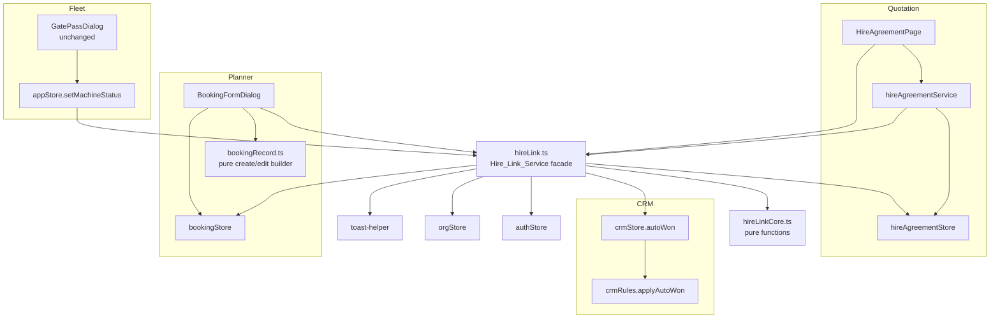
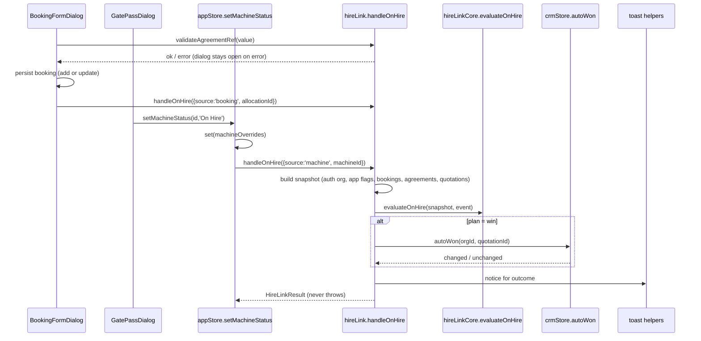

# Design Document

## Overview

This design links a Planner booking to a Hire Agreement and, through the agreement, to a CRM quotation. When the booked machine goes On Hire, the Linked_Quotation moves to Won automatically.

Link chain: `Booking.hireAgreementId` → `HireAgreement.id` → `HireAgreement.quotationId` → `Quotation.id`.

The design rests on five decisions.

1. **One cross-plugin module.** A new `Hire_Link_Service` (`src/services/hireLink.ts`, backed by a pure `src/services/hireLinkCore.ts`) is the only place that reads or writes more than one plugin's store. Planner, Fleet and Quotation code call it. They never import each other's stores.
2. **Persisted agreements.** Hire agreements move from an in-memory cache (`hireAgreementsForOrg`) into a persisted zustand store, `hireAgreementStore`. `hireAgreementService` keeps its signatures and the React Query hooks stay unchanged, but the service reads and writes the store.
3. **A separate CRM rule.** `crmRules.applyAutoWon` and `crmStore.autoWon` add the Awaiting/Tender → Won change. `ALLOWED` and `changePhase` are not touched.
4. **Two trigger points, one handler.** (a) `BookingFormDialog` after it persists a booking. (b) `appStore.setMachineStatus` when the new status is `On Hire`. Both call `hireLink.handleOnHire`. `GatePassDialog` is not changed, so Gate OUT raises the event exactly once through `setMachineStatus`.
5. **Pure decision core.** `hireLinkCore.evaluateOnHire` takes a plain-data snapshot and returns either a skip reason or the quotation id to win. The facade gathers the snapshot from stores, applies the result, and shows notices. This keeps the logic testable without React or localStorage.

### Findings from the code that shape the design

| Finding | Source | Consequence |
|---|---|---|
| Hire agreements live in `hireAgreementCache` and every org copies the same `ha-1..ha-5`. | `src/services/mock/orgData.ts` | Replace with a persisted store and org-unique seed ids. Remove `hireAgreementsForOrg`. |
| `hireAgreementService.create` builds `id: 'ha-' + Date.now()` and spreads `...data` last, so a caller can overwrite `id`. `update` spreads `data` over the record. | `src/services/services.ts` | The service must set `id` and `orgId` itself and strip them from patches. |
| `BookingFormDialog` always generates `id: bk-user-${Date.now()}` and `reference`, then calls `updateBooking(booking.id, newBooking)`, which overwrites both on edit. | `BookingFormDialog.tsx` | Split create and edit record building into a pure helper that never emits `id`, `reference`, `createdAt` or `orgId` on edit. |
| `updateBooking` silently does nothing when the id is not in `userBookings`. The dialog's `booking` prop comes from `bookingService` (mock data), so editing a demo booking is a no-op that still toasts "updated". | `bookingStore.ts`, `BookingFormDialog.tsx` | Demo bookings cannot hold a link. The Hire Agreement field is disabled for them. |
| `Booking.status` has `Returned`, not `Completed`. | `src/types/booking.ts` | "Completed" in the requirements maps to `Returned`. |
| `getActiveBookingForMachine` reads `fleet-bookings-v1` from `localStorage` to avoid a circular import. | `appStore.ts` | No cycle exists (see Architecture). The new code imports `useBookingStore` directly. The old helper is left unchanged. |
| `HireAgreement.customerId` (`CUST-000125`) and `Quotation.customerId` (`CUS-0001`) are different id spaces. Company names differ too (`ABC Company LLC` vs `ABC Company`). | `customerani.ts`, `mock/quotations.ts`, `CrmShared.tsx` | "Same company" cannot be an id match. The design uses a normalised company name key (`companyKey`). This is the main risk, see Open Points. |
| Active org is `useAuthStore.user.orgId` (fallback `JA_ORG_ID`). `orgStore` holds no "selected org". | `authStore.ts`, `CrmPage.tsx`, `services.ts` | Active_Org is read from `authStore`. `orgStore.isAppActive(orgId, appId)` answers App_Active. |
| `crmRules.applyTransition` records no win date for Won. Only Lost records `lostReason/lostAt/lostBy`. | `crmRules.ts` | Requirement 9.6 means: Won gets no extra fields. `applyAutoWon` produces the same object shape as a manual Tender → Won. |
| Nothing calls `machineService.updateStatus` or `useUpdateMachineStatus`. Only `appStore.setMachineStatus` changes status in practice. | grep of `src` | Trigger (b) hooks `setMachineStatus` only. The mock `machineService` path is documented as not hooked. |
| Apps `planner` depends on `fleet`; `crm` depends on `customer_ani`, `invoice`; `quotation` has no dependencies. | `src/constants/apps.ts` | No dependency is added. Inactive apps are handled at runtime. |

## Architecture

### Module layout and import rules



Rules:

- Only `hireLink.ts` may import stores from two different plugins. `bookingStore`, `hireAgreementStore` and `crmStore` are imported by their own plugin and by `hireLink.ts` only.
- `hireLinkCore.ts` imports types only. It has no store, React or toast imports.
- `hireLink.ts` must not import `services.ts`, `appStore.ts` or any component. This keeps the graph acyclic.
- No entry is added to `depends` in `src/constants/apps.ts`.

### Circular import check

`appStore.ts` is imported by no store or service (grep of `src/store`, `src/services`, `src/hooks`, `src/lib`, `src/constants`). The new edge `appStore → hireLink → {bookingStore, hireAgreementStore, crmStore, authStore, orgStore}` therefore closes no cycle, provided `hireLink` never imports `appStore`. The existing `authStore → orgStore` and `authStore → QueryProvider` edges are unchanged. The `localStorage` workaround in `getActiveBookingForMachine` is not needed by the new code. That helper is left as is, because the breakdown flow uses it with a different "first match" meaning.

### Trigger flow



### Handling the two booking sources and two machine-status sources

| Source | Decision | Reason |
|---|---|---|
| Bookings: `bookingService` (demo JSON per org, read-only in practice) | Not read by `hireLink`. Demo bookings have no `hireAgreementId` and cannot be linked. | They are seed data. Editing them through the dialog already does nothing. |
| Bookings: `useBookingStore.userBookings` (persisted) | The only source for allocation resolution and for `hireAgreementId`. | Matches `getActiveBookingForMachine` and is where the dialog saves. |
| Machine status: `appStore.machineOverrides` via `setMachineStatus` | Trigger (b) fires here. | Every real status change (Gate, PHI, PDI, Job Card) goes through it. |
| Machine status: `machineService.updateStatus` (in-memory demo list) | Not hooked. `useUpdateMachineStatus` has no caller today. | A future caller must route On Hire through `hireLink.handleOnHire`. This is stated in a code comment next to `useUpdateMachineStatus`. |

Consequence: if a machine has an active demo booking and an active user booking, the exactly-one rule counts only the user booking. This is accepted because demo data carries no link.

## Components and Interfaces

### 1. Types (`src/types`)

```ts
// hireagreement.ts
export interface HireAgreement {
  id: string;            // Hire_Agreement_ID, immutable, globally unique
  orgId: string;         // owning organisation
  quotationId: string;   // Quotation.id, '' when not linked
  agreementNo: string;   // display only, editable, not unique
  /* ...existing fields unchanged... */
}
export type SeedHireAgreement = Omit<HireAgreement, 'orgId' | 'quotationId'>;

// booking.ts
export interface Booking extends BaseEntity {
  /* ...existing fields... */
  orgId?: string;            // set on creation; absent on legacy records
  hireAgreementId?: string;  // Hire_Agreement_ID; absent when unlinked
}
```

`src/services/mock/hireagreement.ts` changes its declared type to `SeedHireAgreement[]`. Its content is unchanged.

### 2. `hireAgreementStore` (Quotation plugin, `src/store/hireAgreementStore.ts`)

Persisted zustand store, key `fleet-hire-agreements-v1`, `version: 1`.

```ts
interface HireAgreementState {
  agreements: HireAgreement[];   // all orgs
  seededOrgs: string[];          // orgs whose seed rows were already inserted
  ensureSeeded(orgId: string): void;                       // idempotent
  forOrg(orgId: string): HireAgreement[];
  getById(id: string): HireAgreement | undefined;          // across orgs, used for ownership checks
  insert(a: HireAgreement): void;
  patch(id: string, data: Partial<HireAgreement>): HireAgreement;   // strips id, orgId, createdAt
  remove(id: string): void;
  newId(): string;                                         // collision-checked against all rows
}
```

- **Id format.** Created rows get `ha-<base36 time>-<4 random base36>` and `newId()` retries until no row in any org has that id. Seed rows get the deterministic id `ha-seed-<orgId>-<n>` (n = 1..5). The seed id depends on the org id, so two orgs never share one, and seeding an org twice cannot add duplicates.
- **Seeding.** `ensureSeeded(orgId)` copies the five demo agreements with `orgId`, a seed id and `quotationId: ''`. It does nothing if `orgId` is in `seededOrgs`. It is called by `hireAgreementService` and by `hireLink` before any read. It is never called during render.
- **Optional demo link.** For `JA_ORG_ID` only, the seed may preset `quotationId` for a seed agreement to a matching `qt-seed-*` quotation, only when their `companyKey`s are equal. This is confirmed during implementation and is not required by any criterion.
- **Migration** (`migrate(persisted, version)`): runs `normalizeAgreement` on each row: `quotationId ?? ''`, `orgId ?? JA_ORG_ID`, all other fields kept. A missing or malformed `agreements` array yields an empty list and an empty `seededOrgs` (so seeds reappear). `partialize` stores `agreements` and `seededOrgs`.

### 3. `hireAgreementService` (Quotation plugin, `services.ts`)

Same exported shape, now backed by the store. Latency (`delay`) is kept.

```ts
list:   () => delay(store.forOrg(orgId))                    // after ensureSeeded
get:    (id) => delay(store.forOrg(orgId).find(...))
create: (data) => {
  hireLink.assertQuotationMatchesCompany(orgId, data);      // throws HireLinkValidationError
  const rec = { ...defaults, ...stripKeys(data, ['id','orgId','createdAt','updatedAt']),
                id: store.newId(), orgId, quotationId: data.quotationId ?? '' , createdAt: now, updatedAt: now };
  store.insert(rec); return delay(rec);
}
update: (id, data) => {   // ownership: record.orgId must equal orgId, else throw
  hireLink.assertQuotationMatchesCompany(orgId, { ...existing, ...data });
  return delay(store.patch(id, stripKeys(data, ['id','orgId','createdAt'])));
}
delete: (id) => {
  const refs = hireLink.findAllocationsForAgreement(id);
  if (refs.length) throw new HireAgreementInUseError(refs);
  store.remove(id); return delay({ success: true });
}
```

The React Query hooks in `useQueries.ts` (`useHireAgreements`, `useCreateHireAgreement`, `useUpdateHireAgreement`, `useDeleteHireAgreement`) are unchanged. `queryKeys.hireAgreements` stays the invalidation key. Because `agreements` is persisted and the query cache is reset on login (`resetQueryCache`), the list survives reload.

Two new exported errors (in `hireLink.ts`): `HireLinkValidationError` (carries `message`) and `HireAgreementInUseError` (carries `references: {id, reference}[]`).

### 4. `HireAgreementPage` (Quotation plugin)

- Add a **Quotation** `<select>` in the header block of the form, using the page's existing plain-HTML input style. Its options come from `useQuotationOptions(companyName)`, a new hook in `useQueries.ts` that calls `hireLink.listQuotationOptions(orgId, companyName)`. The query key is `[...queryKeys.hireAgreements, 'quotation-options', companyName]`.
- `listQuotationOptions` returns `{ active: boolean; options: { id, number, opportunity, phase }[] }`. When `active` is false (CRM inactive) the select is `disabled` and a notice reads "CRM app is inactive". The stored `quotationId` is kept unchanged on save.
- The empty option saves `quotationId: ''`.
- `handleSave` catches `HireLinkValidationError` and shows its message (for example "Quotation belongs to a different company than this agreement"). Other errors keep the existing generic message.
- `handleDelete` adds `onError`. For `HireAgreementInUseError` it shows "Cannot delete: used by bookings BK-…, BK-…".
- Changing the customer on an existing agreement does not clear `quotationId`. Save then fails company validation if the two no longer match.

### 5. `hireLinkCore.ts` (pure)

```ts
export type SkipReason =
  | 'CRM_INACTIVE' | 'QUOTATION_INACTIVE' | 'NOT_ON_HIRE'
  | 'ALLOCATION_NOT_FOUND' | 'NO_ACTIVE_ALLOCATION' | 'MULTIPLE_ACTIVE_ALLOCATIONS'
  | 'ALLOCATION_ORG_MISMATCH' | 'NO_AGREEMENT_ID' | 'AGREEMENT_NOT_FOUND'
  | 'AGREEMENT_ORG_MISMATCH' | 'NO_QUOTATION_ID' | 'QUOTATION_NOT_FOUND'
  | 'QUOTATION_ORG_MISMATCH' | 'QUOTATION_LOST' | 'ALREADY_WON' | 'INTERNAL_ERROR';

export interface AllocationLite { id; reference; machineId; orgId?: string; hireAgreementId?: string;
                                  startDate: string; endDate: string; status: BookingStatus }
export interface AgreementLite  { id; orgId; agreementNo; customerName; quotationId }
export interface QuotationLite  { id; orgId; number; phase; customerName }

export interface Snapshot {
  orgId: string;                       // Active_Org
  today: string;                       // YYYY-MM-DD, injected
  crmActive: boolean; quotationActive: boolean;
  allocations: AllocationLite[];       // userBookings only
  agreements: AgreementLite[];
  quotations: QuotationLite[];
}
export type OnHireEvent =
  | { source: 'booking'; allocationId: string }
  | { source: 'machine'; machineId: string };

export type Plan =
  | { kind: 'skip'; reason: SkipReason; quotationNumber?: string; allocationId?: string }
  | { kind: 'win'; quotationId: string; allocationId: string; agreementId: string };

evaluateOnHire(s: Snapshot, e: OnHireEvent): Plan
resolveActiveAllocation(allocs: AllocationLite[], machineId: string, today: string):
  { ok: true; allocation: AllocationLite } | { ok: false; reason: 'NO_ACTIVE_ALLOCATION' | 'MULTIPLE_ACTIVE_ALLOCATIONS' }
isActiveAllocation(a: AllocationLite, today: string): boolean
validateAgreementRef(raw: string, s: Pick<Snapshot,'orgId'|'crmActive'|'agreements'|'quotations'>):
  { ok: true; agreementId?: string } | { ok: false; code: ValidationCode; message: string }
traceAllocation(s, allocationId): { ok: true; allocation; agreement; quotation } | { ok: false; reason: SkipReason }
allocationsForQuotation(s, quotationId): AllocationLite[]
companyKey(name: string): string
orderAgreementOptions(agreements: AgreementLite[], companyName?: string): AgreementLite[]
```

**`evaluateOnHire` check order** (each step returns a skip plan, so the first failing step decides the reason):

1. `!crmActive` → `CRM_INACTIVE`. Then `!quotationActive` → `QUOTATION_INACTIVE`. Both checks run before any record is read (13.1).
2. Resolve the allocation. `booking` source: find by id, else `ALLOCATION_NOT_FOUND`; then require `status === 'On Hire'`, else `NOT_ON_HIRE`. `machine` source: `resolveActiveAllocation`, giving `NO_ACTIVE_ALLOCATION` or `MULTIPLE_ACTIVE_ALLOCATIONS`.
3. `(allocation.orgId ?? JA_ORG_ID) !== orgId` → `ALLOCATION_ORG_MISMATCH`. Legacy bookings without `orgId` are treated as `JA_ORG_ID`. They are always unlinked, so this only affects the "exactly one" count.
4. Empty `hireAgreementId` → `NO_AGREEMENT_ID`.
5. Agreement lookup by `id` equality only. Missing → `AGREEMENT_NOT_FOUND`. `agreement.orgId !== orgId` → `AGREEMENT_ORG_MISMATCH`.
6. Empty `quotationId` → `NO_QUOTATION_ID`.
7. Quotation lookup by `id` equality only. Missing → `QUOTATION_NOT_FOUND`. `quotation.orgId !== orgId` → `QUOTATION_ORG_MISMATCH`.
8. `phase === 'Lost'` → `QUOTATION_LOST`. `phase === 'Won'` → `ALREADY_WON`.
9. Otherwise `{ kind: 'win', quotationId }`.

`isActiveAllocation`: `startDate <= today <= endDate` and `status` not in `{'Cancelled','Returned'}`. `today` is a local-date string passed in by the facade (`toLocalISODate(new Date())`). The existing helper uses the UTC date. The local date is used here because dispatch happens in UAE time, which is ahead of UTC by 4 hours. The `computeBookingStatus` function uses local `Date` objects, so the two agree.

`validateAgreementRef` order: trim; empty → `{ ok: true }` with no id (4.8). Look up by `id` only (an `agreementNo` match counts as not found). Then `NOT_FOUND` "Hire Agreement ID not found"; `ORG_MISMATCH` "Hire Agreement belongs to another organisation"; `NO_QUOTATION` "Hire Agreement has no linked quotation"; and, only when `crmActive`, `QUOTATION_NOT_FOUND` "Linked quotation not found" (also returned when the quotation exists in another org, since the planner may only see its own org's quotations).

`companyKey(name)`: lower-case, replace non-alphanumerics with a space, drop trailing legal-form tokens (`llc`, `l l c`, `pjsc`, `ltd`, `limited`, `fze`, `fzco`, `inc`, `co` as a final token), collapse whitespace. `ABC Company LLC` and `ABC Company` both give `abc company`. The function is idempotent.

`orderAgreementOptions` is a stable partition: agreements whose `companyKey(customerName)` equals `companyKey(companyName)` first, the rest after, each group keeping input order.

### 6. `hireLink.ts` (facade, the Hire_Link_Service)

```ts
// Used by Planner
validateAgreementRef(raw: string): ValidationResult                 // reads auth org, crm flag, stores
listAgreementOptions(companyName?: string): AgreementOption[]       // Active_Org, ordered
describeLink(agreementId: string): LinkSummary | undefined          // agreementNo, id, quotation number (6.5)
// Used by Fleet and Planner triggers
handleOnHire(e: OnHireEvent): HireLinkResult                        // never throws
// Used by Quotation
listQuotationOptions(orgId: string, companyName: string): { active: boolean; options: QuotationOption[] }
assertQuotationMatchesCompany(orgId: string, a: Pick<HireAgreement,'customerName'|'quotationId'>): void
findAllocationsForAgreement(agreementId: string): { id: string; reference: string }[]
// Traceability (6.6, 6.7)
resolveAllocation(allocationId: string): TraceResult
allocationsForQuotation(quotationId: string): AllocationLite[]

export type HireLinkResult =
  | { outcome: 'won'; quotationId: string; quotationNumber: string }
  | { outcome: 'skipped'; reason: SkipReason; quotationNumber?: string };
```

`handleOnHire` steps: read `orgId` from `useAuthStore.getState().user?.orgId ?? JA_ORG_ID`; read `crmActive`/`quotationActive` from `useOrgStore.getState().isAppActive`; call `useHireAgreementStore.getState().ensureSeeded(orgId)`; build the snapshot; call `evaluateOnHire`; for `win`, call `useCrmStore.getState().autoWon(orgId, quotationId, 'System')`; map the result to a notice; return. The whole body is in `try/catch`. A caught error is logged with `console.error('[hireLink]', err)`, shows `toastError('Could not update the linked quotation')` and returns `{ outcome: 'skipped', reason: 'INTERNAL_ERROR' }`.

The snapshot projection copies only the lite fields. `allocations` come from `useBookingStore.getState().userBookings`. `quotations` come from `useCrmStore.getState().quotations`. No other module in a plugin reads those stores for the link.

**Notice policy** (all through `@/lib/toast-helper`):

| Outcome | Helper | Text |
|---|---|---|
| `won` | `toastSuccess` | `Quotation <number> moved to Won` |
| `QUOTATION_LOST` | `toastWarning` | `Quotation <number> is Lost and was not changed` |
| `CRM_INACTIVE` | `toastInfo` | `CRM app is inactive; quotation not updated` |
| `QUOTATION_INACTIVE` | `toastInfo` | `Quotation app is inactive; quotation not updated` |
| `NO_ACTIVE_ALLOCATION` | `toastInfo` | `No active booking linked to this machine` |
| `MULTIPLE_ACTIVE_ALLOCATIONS` | `toastWarning` | `Multiple active bookings; link cannot be resolved` |
| `NO_AGREEMENT_ID` | `toastInfo` | `Booking has no Hire Agreement` (machine source only) |
| `AGREEMENT_NOT_FOUND` | `toastWarning` | `Hire Agreement not found` |
| `QUOTATION_NOT_FOUND` | `toastWarning` | `Linked quotation not found` |
| `QUOTATION_ORG_MISMATCH`, `AGREEMENT_ORG_MISMATCH`, `ALLOCATION_ORG_MISMATCH` | `toastError` | `Linked quotation belongs to another organisation` (the agreement and allocation variants say "Hire Agreement" / "Booking" in place of "Linked quotation") |
| `NO_QUOTATION_ID` | none | silent (15.3) |
| `ALREADY_WON`, `NOT_ON_HIRE`, `ALLOCATION_NOT_FOUND` | none | silent (10.1, 7.2) |
| `INTERNAL_ERROR` | `toastError` | `Could not update the linked quotation` |

For the `booking` source the `NO_AGREEMENT_ID` case is silent (4.8 and 15.2). Every skip returns its reason code in `HireLinkResult` (13.4). No queue or retry list is kept, so a reactivated CRM app never replays skipped events (13.7).

### 7. CRM plugin

`crmRules.ts` adds, below `applyTransition` and leaving `ALLOWED`, `isAllowed` and `applyTransition` unchanged:

```ts
export const AUTO_WON_REASON = 'Auto: machine On Hire';

export type AutoWonResult =
  | { kind: 'changed'; quotation: Quotation }
  | { kind: 'unchanged'; reason: 'ALREADY_WON' | 'QUOTATION_LOST' };

export function applyAutoWon(q: Quotation, user: string, now: string): AutoWonResult {
  if (q.phase === 'Won')  return { kind: 'unchanged', reason: 'ALREADY_WON' };
  if (q.phase === 'Lost') return { kind: 'unchanged', reason: 'QUOTATION_LOST' };
  const entry: PhaseHistoryEntry = { id: newId(), timestamp: now, user,
    fromPhase: q.phase, toPhase: 'Won', reason: AUTO_WON_REASON };
  return { kind: 'changed',
    quotation: { ...q, phase: 'Won', updatedAt: now, history: [...q.history, entry] } };
}
```

The function takes only the quotation, a user name and a timestamp. It cannot read Job_State (9.4). The `Won` result has the same fields as a manual Tender → Won plus the history `reason` (9.6).

`crmStore.ts` adds one action and no persistence change (`version` stays 2):

```ts
autoWon: (orgId: string, id: string, user: string) =>
  | { ok: true; result: AutoWonResult }
  | { ok: false; error: 'QUOTATION_NOT_FOUND' | 'QUOTATION_ORG_MISMATCH' }
```

It finds the quotation by `id`, rejects a quotation whose `orgId !== orgId`, calls `applyAutoWon`, and writes with one `set` that replaces only that quotation. `evaluateOnHire` already screens org and phase, so the store check is a second guard.

### 8. Planner plugin

**`bookingStore.ts`**: bump `persist` to `version: 1`; `migrate` returns `{ userBookings }` with each record unchanged (so `hireAgreementId` and `orgId` stay absent on old records). `updateBooking` keeps its signature but ignores `id` in the patch (`const { id: _ignored, ...rest } = data`), so a stray id cannot overwrite the record.

**`src/features/planner/bookingRecord.ts`** (new, pure):

```ts
buildBookingRecord(args: {
  mode: 'create' | 'edit';
  data: BookingFormData;            // validated form values
  existing?: Booking;               // present when mode === 'edit'
  orgId: string; now: string;
  names: { customerName; assetNumber; machineModel; branchName };
  status: BookingStatus; totalValue: number;
  idSeed: number;                   // Date.now(), injected for tests
}): Booking
```

- `create`: sets `id: bk-user-<idSeed>`, `reference: BK-<year>-<last 4 of idSeed>`, `orgId`, `createdAt = updatedAt = now`.
- `edit`: copies `id`, `reference`, `createdAt` and `orgId` from `existing`; sets `updatedAt = now`. `orgId` falls back to the active org only when `existing.orgId` is absent (legacy record).
- Both modes set `hireAgreementId` to the trimmed value, or omit the key when empty.

**`BookingFormDialog.tsx`**:

- Schema: `hireAgreementId: z.string().optional()`. Default value from `booking.hireAgreementId` (4.7).
- New field **Hire Agreement** under the Branch row: an `Input` with `list="hire-agreement-options"` and a `<datalist>`. Each `<option value={agreement.id}>` carries the label `agreementNo · customerName · id` (4.2). Picking an entry puts the id in the input, not the number (4.3). Options come from `useHireAgreementOptions(customerName)`, a hook in `useQueries.ts` that wraps `hireLink.listAgreementOptions`. It is keyed under `queryKeys.hireAgreements`, so agreement edits refresh it. The customer name comes from the selected `customerId`, which gives the company-first order (4.4).
- Below the field, when its value resolves, a read-only line shows `Agreement No · Hire Agreement ID · Quotation number` from `hireLink.describeLink` (6.5).
- When `booking` is set but `useBookingStore.getState().userBookings` has no record with that id, the input is disabled with the helper text "Demo bookings cannot be linked".
- `onSubmit` order:
  1. `const v = hireLink.validateAgreementRef(data.hireAgreementId ?? '')`. On failure call `form.setError('hireAgreementId', { message })` and return before touching the store (5.9). The dialog stays open.
  2. Build the record with `buildBookingRecord` and call `addBooking` or `updateBooking` (this is the existing step, now with the correct fields).
  3. Existing success toast.
  4. If `status === 'On Hire'` and a valid `hireAgreementId` exists, call `hireLink.handleOnHire({ source: 'booking', allocationId: record.id })`. This step is outside any code that can roll back the save, and `handleOnHire` never throws (7.4).
  5. `form.reset(); onClose()`.

The existing `catch` that shows "Failed to save booking" now wraps steps 1 and 2 only.

### 9. Fleet plugin

`appStore.setMachineStatus` gets one added statement after the existing `set(...)`:

```ts
if (status === 'On Hire') {
  hireLink.handleOnHire({ source: 'machine', machineId });   // never throws
}
```

- The trigger lives in the store action, so every caller (Gate OUT today, others later) raises the event. Statuses other than `On Hire` raise nothing (8.7).
- `GatePassDialog` is not changed. It calls `setMachineStatus(..., 'On Hire', ...)` once per submit, so the event is raised once per action (8.2). A rule for reviewers: no component may call `handleOnHire` with `source: 'machine'`. If a future change did, the CRM idempotency (below) would still keep the data correct.
- The notice from `handleOnHire` appears before the dialog's own "Gate entry OUT" toast. The machine status is already written when the notice shows, so a failure cannot undo it (8.9).
- Calling `setMachineStatus` with `On Hire` when the machine is already On Hire raises another event. It is harmless because of idempotency.

### 10. Dependencies and tooling

Add `vitest`, `fast-check`, `jsdom` and `@vitest/coverage-v8` (optional) as dev dependencies, a `"test": "vitest --run"` script, and `vitest.config.ts` (`environment: 'node'` by default; store tests use `// @vitest-environment jsdom` for `localStorage`). The project uses Vite 8, so the implementation must pick a vitest release whose peer range includes it. Test files live next to sources as `*.test.ts` and are excluded from the production bundle by Vite automatically. `tsconfig.app.json` includes `src`, so test files must import `describe/it/expect` explicitly from `vitest` rather than rely on globals.

## Data Models

### Persisted stores

| Store | Key | Version | Shape | Migration |
|---|---|---|---|---|
| `hireAgreementStore` (new) | `fleet-hire-agreements-v1` | 1 | `{ agreements: HireAgreement[], seededOrgs: string[] }` | Rows get `quotationId ?? ''` and `orgId ?? JA_ORG_ID`. Bad shape → empty lists. |
| `bookingStore` | `fleet-bookings-v1` | 0 → 1 | `{ userBookings: Booking[] }` | Identity. New fields are optional, so old rows load as unlinked. |
| `crmStore` | `fleet-crm-v1` | 2 (unchanged) | `{ quotations: Quotation[] }` | None. The new history entry uses the existing optional `reason` field. |
| `appStore` | `fleet-app-store-v1` | unchanged | unchanged | None. |

### Field rules

| Field | Rule |
|---|---|
| `HireAgreement.id` | Created once by `newId()`, never patched, unique across all rows of all orgs. |
| `HireAgreement.orgId` | Set by the service from the active org, never taken from form data, never patched. |
| `HireAgreement.quotationId` | `''` or a `Quotation.id` whose `companyKey(customerName)` equals the agreement's. Checked on create and update when CRM is active. |
| `HireAgreement.agreementNo` | Free text, may repeat. Never used as a key. |
| `Booking.hireAgreementId` | Absent or a Hire_Agreement_ID that passed `validateAgreementRef` at save time. It is not rewritten when the agreement changes. |
| `Booking.orgId` | Set on creation from the active org; copied unchanged on edit. |
| `PhaseHistoryEntry` (auto) | `{ id, timestamp, user: 'System', fromPhase: 'Awaiting' \| 'Tender', toPhase: 'Won', reason: 'Auto: machine On Hire' }`. |

### Validation codes

`ValidationCode = 'NOT_FOUND' | 'ORG_MISMATCH' | 'NO_QUOTATION' | 'QUOTATION_NOT_FOUND'`, mapped to the four messages in Requirement 5.

### Open points

- **Company match.** `companyKey` is a heuristic because the two plugins keep different customer ids. If it rejects valid pairs in practice, the fallback is to compare `HireAgreement.customerId` against a new `Quotation.customerAniId` once CRM stores the ANI id. Until then Requirements 2.2 and 2.6 use `companyKey`.
- **Reserved bookings.** A booking in `Reserved` status that is inside its period counts as an Active_Allocation, because the requirements exclude only Cancelled and Completed (`Returned`). If hire desk wants Reserved excluded, the change is one entry in `isActiveAllocation`.
- **Time zone.** `today` uses the browser's local date. Tests inject it.

## Correctness Properties

*A property is a characteristic or behavior that should hold true across all valid executions of a system-essentially, a formal statement about what the system should do. Properties serve as the bridge between human-readable specifications and machine-verifiable correctness guarantees.*

**Reflection on redundancy.** The prework produced about 80 testable criteria. They reduce to the 14 properties below.

- 1.2, 1.3, 1.4 and 2.7 merge into Property 1 (identity and ownership never change).
- 3.1, 3.2, 3.3, 6.1, 6.2, 6.3 and 14.1 merge into Property 2 (persistence round trip and legacy migration).
- 5.1 to 5.8 merge into one oracle-based Property 4. 4.2, 4.3 and 4.4 merge into Property 5.
- 4.5, 4.6, 4.8, 6.4 and 15.4 merge into Property 6 (the booking record builder).
- 8.4, 8.5 are edge cases of 8.3 and share Property 8.
- 9.1, 9.2, 9.3, 9.6, 10.1, 10.5 and 11.1 merge into Property 9 (`applyAutoWon`).
- 10.2 to 10.4 and 14.3 merge into Property 10. 12.1 to 12.4 and 12.8 merge into Property 11.
- 8.6, 8.8, 12.5 to 12.7, 13.1 to 13.4, 15.2 and 15.3 merge into Property 12 (chain validity and skips), which also covers 7.2 and 7.3.
- 7.4, 8.9, 11.3 and 13.5 merge into Property 14 (failure isolation).
- 15.5 (determinism) is asserted inside Property 12 and Property 7, not as a separate property.

### Property 1: Agreement identity and ownership are stable and unique

*For any* set of organisation ids, any sequence of agreement creates and updates across them (including patches that try to set `id`, `orgId` or `createdAt`, and edits to `agreementNo` or `quotationId`), and any seeding of those orgs in any order and any number of times, every stored `HireAgreement.id` is distinct, each id and `orgId` of an existing record is the same before and after every update, each created record's `orgId` equals the active org even if the input carries another, and seeding an org a second time adds no rows.

**Validates: Requirements 1.1, 1.2, 1.3, 1.4, 1.5, 2.7**

### Property 2: Persistence round trip and legacy migration

*For any* list of hire agreements, bookings (with and without `hireAgreementId` and `orgId`), and quotations (with auto-won history), writing the store to storage and rehydrating it yields an equal list. *For any* legacy agreement rows that lack `quotationId` or `orgId`, `migrate` keeps every original field value, sets `quotationId` to `''`, and loses no row. *For any* legacy booking row, `migrate` returns it unchanged and `evaluateOnHire` treats it as unlinked without error.

**Validates: Requirements 3.1, 3.2, 3.3, 6.1, 6.2, 6.3, 14.1, 15.2**

### Property 3: Quotation options and company check

*For any* agreement, any set of quotations across orgs and companies, and any `crmActive` flag, `listQuotationOptions` returns only quotations of the active org whose `companyKey(customerName)` equals the agreement's `companyKey` and omits none that qualify when CRM is active, and returns `active: false` with no options when CRM is inactive. `assertQuotationMatchesCompany` throws if and only if CRM is active, `quotationId` is non-empty, and the selected quotation's company key differs. Saving with an empty `quotationId` always stores `''`. `companyKey` is idempotent.

**Validates: Requirements 2.2, 2.3, 2.4, 2.6**

### Property 4: Hire agreement reference validation

*For any* registry of agreements and quotations across orgs, any `crmActive` flag and any raw input string (including valid ids padded with whitespace, `agreementNo` values, other-org ids, empty strings, and ids of agreements with an empty or dangling `quotationId`), `validateAgreementRef` returns: ok without an id for an empty or whitespace-only input; otherwise it trims the input and looks it up by `id` equality only; returns `NOT_FOUND` when no id matches (including when an `agreementNo` matches), `ORG_MISMATCH` when the matched agreement's org differs from the active org, `NO_QUOTATION` when its `quotationId` is empty, `QUOTATION_NOT_FOUND` when CRM is active and no quotation of the active org has that id, and ok with the matched id otherwise. When CRM is inactive the last check is skipped. The function does not modify its inputs.

**Validates: Requirements 5.1, 5.2, 5.3, 5.4, 5.5, 5.6, 5.7, 5.8**

### Property 5: Agreement option list content and order

*For any* list of agreements across orgs and any company name, `listAgreementOptions` returns only agreements of the active org, each option's value equals the agreement's `id`, each label contains `agreementNo`, `customerName` and `id`, the result is a permutation of the active org's agreements, every agreement whose `companyKey` equals the company's comes before every one that does not, and the relative order inside each group is the input order.

**Validates: Requirements 4.2, 4.3, 4.4**

### Property 6: Booking record builder

*For any* validated form data, any existing booking, any org id and any time: in `edit` mode the built record has the same `id`, `reference`, `createdAt` and `orgId` as the existing booking (falling back to the active org only when the existing record has none); in `create` mode it has a new `id` and `reference` and `orgId` equal to the active org; in both modes `hireAgreementId` equals the trimmed form value, and the key is absent when the trimmed value is empty.

**Validates: Requirements 4.5, 4.6, 4.8, 6.4, 15.4**

### Property 7: Allocation to quotation trace round trip

*For any* snapshot and any allocation whose chain resolves (allocation → agreement → quotation, all in the active org), `traceAllocation` returns that agreement and quotation, and `allocationsForQuotation` of that quotation contains the allocation. *For any* allocation whose chain does not resolve, `traceAllocation` returns the reason code of the first missing link. *For any* snapshot, `allocationsForQuotation(q)` equals the allocations whose agreement has `quotationId === q`. Two calls with the same snapshot return equal results, and the same trace result is obtained after the stores are persisted and rehydrated.

**Validates: Requirements 6.6, 6.7, 6.8, 14.2, 15.5**

### Property 8: Active allocation resolution

*For any* list of allocations, any machine id and any date, `resolveActiveAllocation` considers exactly the allocations of that machine with `startDate <= today <= endDate` and a status other than `Cancelled` or `Returned`. It returns that allocation when there is exactly one, `NO_ACTIVE_ALLOCATION` when there are none, and `MULTIPLE_ACTIVE_ALLOCATIONS` when there are two or more, in which case it selects none.

**Validates: Requirements 8.3, 8.4, 8.5**

### Property 9: `applyAutoWon` transition rule

*For any* quotation: if its phase is `Awaiting` or `Tender`, the result is `changed` with phase `Won`, `updatedAt` equal to the given time, and a history that is the old history plus exactly one entry with `fromPhase` equal to the old phase, `toPhase: 'Won'`, the given timestamp and `reason: 'Auto: machine On Hire'`, and every other field is equal to the input; for a `Tender` input the result equals the result of the manual `applyTransition(q, 'Won', …)` except for that entry's `reason` and `user`. If its phase is `Won` or `Lost`, the result is `unchanged` and the input is not modified. `isAllowed('Awaiting','Won')` is false and the other entries of `ALLOWED` are as before.

**Validates: Requirements 9.1, 9.2, 9.3, 9.4, 9.5, 9.6, 10.1, 10.5, 11.1, 15.1**

### Property 10: Idempotence across trigger paths

*For any* valid chain (allocation, agreement, quotation in `Awaiting` or `Tender`) and any non-empty sequence of On Hire events on it from the booking path, the machine path, or both in any order (including after a persist and rehydrate between events), the quotation's final phase is `Won`, it has exactly one history entry with the auto reason, and the state after the first event equals the state after all later events.

**Validates: Requirements 10.2, 10.3, 10.4, 14.3**

### Property 11: Only the linked quotation changes

*For any* CRM store (including other quotations of the same company, quotations sharing the same `hireAgreementNo`, quotations of other orgs and `Lost` quotations), any agreements (including duplicate `agreementNo` values) and any On Hire event, the set of quotations whose phase or history differ after the event is a subset of the singleton containing the quotation whose `id` equals the `quotationId` of the allocation's own agreement. When two agreements share an `agreementNo`, each allocation resolves to the quotation of its own agreement id.

**Validates: Requirements 7.3, 12.1, 12.2, 12.3, 12.4, 12.8**

### Property 12: Chain validity and skip conditions

*For any* snapshot and event, `evaluateOnHire` is total (it never throws) and returns `win` only when all of the following hold: CRM and Quotation apps are active; the event resolves to one allocation; the allocation, agreement and quotation belong to the active org; the allocation has a `hireAgreementId` that matches an agreement; the agreement has a `quotationId` that matches a quotation; the allocation status is `On Hire` (booking source); and the quotation phase is `Awaiting` or `Tender`. Otherwise it returns `skip` with the reason of the first failed check in the documented order. When either app is inactive the reason is `CRM_INACTIVE` or `QUOTATION_INACTIVE` whatever the other data is, and a booking-source event for an allocation whose status is not `On Hire` returns `NOT_ON_HIRE`. Whenever the plan is `skip`, applying the facade leaves the CRM store unchanged.

**Validates: Requirements 7.2, 8.6, 8.8, 12.5, 12.6, 12.7, 13.1, 13.2, 13.3, 13.4, 15.2, 15.3**

### Property 13: Agreement delete guard

*For any* set of agreements and bookings, `hireAgreementService.delete(id)` is rejected with `HireAgreementInUseError` if and only if at least one booking has `hireAgreementId === id`; the error lists exactly those bookings; and the store is unchanged after a rejection. When no booking references the id, the agreement is removed and no other agreement changes.

**Validates: Requirements 3.4**

### Property 14: Failure isolation

*For any* injected failure inside the Hire_Link_Service (a throwing store read, a throwing `autoWon`, a throwing toast) and any originating action (booking save with status `On Hire`, `setMachineStatus(…, 'On Hire')`), `handleOnHire` does not throw, returns an `INTERNAL_ERROR` skip result, and the saved booking or the machine override written by the originating action is still present. For any status other than `On Hire`, `setMachineStatus` does not call `handleOnHire` and the CRM store is unchanged.

**Validates: Requirements 7.4, 8.7, 8.9, 11.3, 13.5**

## Error Handling

| Situation | Behaviour | Surface |
|---|---|---|
| Hire Agreement value is invalid on booking save | `validateAgreementRef` returns a code and message. Nothing is persisted. The dialog stays open. | `form.setError('hireAgreementId', …)` with one of the four messages from Requirement 5. |
| Quotation company differs from the agreement's company | `assertQuotationMatchesCompany` throws `HireLinkValidationError`. Nothing is saved. | `toastError(error.message)` in `HireAgreementPage.handleSave`. |
| Agreement delete is blocked by bookings | `HireAgreementInUseError` with the booking references. | `toastError("Cannot delete: used by …")`. |
| Update or delete of an agreement owned by another org | Service throws `Hire agreement not found`, as today's service does for a missing id. | Existing generic error toast. |
| Booking saved but On Hire handling skipped | Booking stays saved. `handleOnHire` returns a reason and shows the notice table above. | Toast from the notice policy. |
| Machine status set but handling skipped | Status stays written. Same notices. | Toast. |
| Unexpected exception inside `handleOnHire` | Caught, logged with `console.error('[hireLink]', err)`, `INTERNAL_ERROR` returned. The originating action is not rolled back. | `toastError('Could not update the linked quotation')`. |
| A toast helper throws while reporting | The notice call is wrapped in its own `try/catch` so a failing notice cannot turn a skip into an exception. | Console only. |
| Persisted agreements unreadable or wrong shape | `migrate` and the store's storage wrapper fall back to empty lists, so seed agreements reappear. The failure is logged with `console.warn`. | Console only. |
| Persisted bookings from an older version | Loaded unchanged and treated as unlinked. | None. |
| CRM or Quotation app inactive | Skip with a reason and an info notice. CRM state is not read or changed. Skipped events are not queued. | Toast. |
| Agreement or quotation deleted after linking | Booking keeps its `hireAgreementId`. On Hire handling skips with `AGREEMENT_NOT_FOUND` or `QUOTATION_NOT_FOUND`. | Toast. |
| `crmStore.autoWon` called with a quotation of another org | Returns `{ ok: false, error: 'QUOTATION_ORG_MISMATCH' }` and changes nothing. | Mapped to the org-mismatch error toast. |

## Testing Strategy

### Approach

Property-based testing applies to this feature. The decision logic (`hireLinkCore`, `applyAutoWon`, the booking record builder, store migrations, `companyKey`) is pure or close to pure, input varies widely (ids, names, dates, phases, org ids, event orders), and 100 iterations are cheap in memory. UI rendering, dialog wiring and toast text are covered by example-based tests, because there is no universal "for all inputs" statement for them.

### Tooling to add

Neither a test runner nor a property-testing library is installed (`package.json` has only `lint` and `typecheck`). Add:

- `vitest` (runner, version chosen to be compatible with the project's Vite 8),
- `fast-check` (property-based testing library; it is not implemented from scratch),
- `jsdom` (for `localStorage` in persisted-store tests),
- `@testing-library/react` and `@testing-library/user-event` (only for the few dialog example tests).

Add the script `"test": "vitest --run"` and a `vitest.config.ts` that reuses the `@` path alias from `vite.config.ts`. Tests sit beside the code as `*.test.ts(x)`. Use `// @vitest-environment jsdom` in files that touch `localStorage` or React. Each store test resets its store with `useXStore.setState(initial)` and `localStorage.clear()` in `beforeEach`. Toasts are mocked with `vi.mock('@/lib/toast-helper')`.

### Property tests

Each correctness property is one `fast-check` test with `{ numRuns: 100 }` or more, and a comment tag in this format:

`// Feature: hire-agreement-planner-link, Property <n>: <property text>`

| Property | Test file | Subject under test | Generators |
|---|---|---|---|
| 1 | `src/store/hireAgreementStore.test.ts` | store + service create/update/seed | org ids, patch objects with `id`/`orgId`, op sequences |
| 2 | `src/store/persistence.test.ts` | all three stores, `migrate` | agreements, bookings, quotations, legacy rows |
| 3 | `src/services/hireLinkCore.test.ts` | `listQuotationOptions`, `assertQuotationMatchesCompany`, `companyKey` | company names with legal suffixes, org ids |
| 4 | `src/services/hireLinkCore.test.ts` | `validateAgreementRef` | registries, raw strings with whitespace padding and number collisions, oracle function |
| 5 | `src/services/hireLinkCore.test.ts` | `orderAgreementOptions`, option builder | agreement lists, company names |
| 6 | `src/features/planner/bookingRecord.test.ts` | `buildBookingRecord` | form data, existing bookings |
| 7 | `src/services/hireLinkCore.test.ts` | `traceAllocation`, `allocationsForQuotation` | full snapshots, broken chains |
| 8 | `src/services/hireLinkCore.test.ts` | `resolveActiveAllocation` | allocations with dates around `today`, all statuses |
| 9 | `src/features/crm/crmRules.test.ts` | `applyAutoWon`, `ALLOWED` | quotations in all four phases with random history |
| 10 | `src/services/hireLink.test.ts` | `handleOnHire` against real stores | event sequences, optional rehydrate between events |
| 11 | `src/services/hireLink.test.ts` | `handleOnHire` | CRM stores with decoy quotations and duplicate numbers |
| 12 | `src/services/hireLinkCore.test.ts` | `evaluateOnHire` | snapshots with each link randomly broken, app flags, org ids |
| 13 | `src/services/hireAgreementService.test.ts` | `delete` | agreements and bookings |
| 14 | `src/services/hireLink.test.ts` | `handleOnHire`, `setMachineStatus` | failure injection via `vi.spyOn`, all machine statuses |

Generators take care to produce collisions on purpose: equal `agreementNo` across agreements, equal `hireAgreementNo` and `customerName` across quotations, `agreementNo` strings equal to other agreements' ids, and dates on the start and end boundaries of the period.

### Unit and example tests

- **Dialog** (`BookingFormDialog.test.tsx`): invalid id keeps the dialog open and leaves `userBookings` unchanged (5.9); `handleOnHire` is called after `addBooking` and only when status is `On Hire` (7.1); edit pre-fills the stored id (4.7); a demo booking disables the field; the datalist shows number, company and id (4.1, 4.2).
- **Gate flow** (`GatePassDialog.test.tsx`): Gate OUT calls `handleOnHire` once (8.2); Gate IN calls it zero times.
- **Machine status** (`appStore.test.ts`): `setMachineStatus(id,'On Hire')` calls `handleOnHire` once (8.1).
- **Quotation page** (`HireAgreementPage.test.tsx`): the select is disabled with the notice when CRM is inactive (2.5); a mismatched quotation shows the error (2.6).
- **Notices** (`hireLink.test.ts`): one assertion per row of the notice table, including the Lost warning naming the reference (11.2) and the success text naming reference and phase (9.7).
- **No replay** (`hireLink.test.ts`): a skipped event while CRM is inactive, then CRM activated, leaves the CRM store unchanged (13.7).
- **Structure** (`architecture.test.ts`): a grep-style test fails if any file under `src/features/planner`, `src/features/gate` or `src/features/documents` imports `@/store/crmStore`, and fails if `src/constants/apps.ts` gains a `depends` entry that points between `planner`, `fleet`, `quotation` and `crm` beyond what exists today (13.6, 9.4).
- **Regression** (`crmRules.test.ts`): the table of manual transitions behaves as before (15.1).

### Manual check

Create a quotation in CRM, create a hire agreement linked to it, create a booking with that agreement id for a machine and today's dates with the four gates complete, and confirm the quotation moves to Won. Repeat with Gate OUT for a booking whose dates include today, confirm one history entry, then reload and confirm it persists. Turn CRM off and repeat to confirm the info notice and no CRM change.
