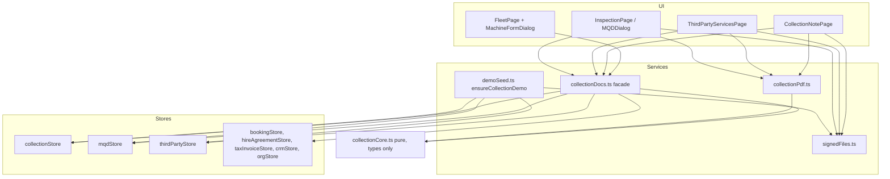

# Design Document

## Overview

This feature adds three PDF documents (Collection Note, Machine Quality Document, Third-Party Services) that are created together by one "Initiate Off-Hire / Collection" action on an On Hire machine. Each document copies its quotation, invoice, hire agreement, customer and fleet details from the stored reference chain. The Collection Note carries a QR code built from stored machine data, and decoding it resolves exactly one machine in the organisation. Signed copies are kept in IndexedDB with an in-memory fallback.

The code follows the pattern already used for hire linking and quotation invoicing: a pure core, a facade that reads stores, and thin UI. Language is TypeScript (React, zustand, zod, vitest, fast-check). Work is on branch `feature/crm-plugin`. This document describes the design only; no code is changed by this spec step.

### Findings from the existing code

| Area | Finding | Consequence |
|---|---|---|
| `Machine` type (`src/types/machine.ts`) | No `fleetNo`. Mock machines carry an untyped `fleetNo` (J101..J120) equal to `assetNumber`. | Add optional typed `fleetNo?: string`. Fleet_Number = trimmed `fleetNo` if non-empty, else `assetNumber`. |
| `MachineFormDialog.tsx` | The form field `fleetNo` is saved as `assetNumber` only. | Save both `fleetNo` and `assetNumber`, and reject duplicates before saving. |
| `machineService` (`services.ts`) | Machines are an in-memory per-org array from `machinesForOrg`. `create/update` have no uniqueness check. Status shown to users also depends on `machineOverrides` in `appStore`. | Add the duplicate check in `machineService.create/update` through the pure core. Collection code gets machine status through an injected resolver, never by importing `appStore`. |
| Demo machines | org-ja: `mc-1..mc-5` = J101..J105. `mc-4` (J104) is booked by JKL (HA-2026-004), `mc-5` (J105) by MNO (HA-2026-005, On Hire). Other orgs get copies `mc-demo-1..5` via `demoMachinesForOrg`, with the same fleet numbers. | Demo collection data attaches to `demoMachineId(orgId, 4|5)`. |
| Hire link demo | `ensureHireLinkDemo(orgId)` is skipped for org-ja, uses a `localStorage` flag per org, and calls `ensureInvoiceDemo`. | `ensureCollectionDemo(orgId)` is added next to it with its own once-per-org flag, called from `ensureHireLinkDemo` and directly for org-ja. |
| Invoices | `TaxInvoice` has `quotationId`, `sequence`, `invoiceNo`, `status` (Draft, Sent, Paid, Overdue, Cancelled). Demo invoice `QT-2026-0010/01` is for the MNO quotation. Demo agreement HA-2026-004 has seed invoice `INV-2026-004`. | "Active" invoice = status not Cancelled. Latest = highest `sequence`, ties broken by `createdAt`. |
| Transport | `appStore.addTransportJob(StoredTransportJob)` is the only creator. | The page builds a `StoredTransportJob` and passes `addTransportJob` as an injected callback. |
| MQD | `MQDDialog` only logs the form; `inspectionService.createMQD` writes a mock with a time-based reference. Page title is "Maintenance Quality Document". | Add `mqdStore`, persist on save, rename the title to "Machine Quality Document". |
| Documents | `collection_note` renders `DocumentAppPage` (placeholder). `apps.ts` has no `third_party_services`. | Add `CollectionNotePage` and `ThirdPartyServicesPage`, new app entry, new route. |
| Architecture test | Only `planner`, `gate` and `documents` are checked against `crmStore`. `apps.ts` edges are checked for planner, fleet, quotation, crm. | Extend with the new boundaries (Requirement 13). |
| Packages | `fast-check`, `vitest`, `jsdom` exist. `jspdf`, `qrcode`, `jsqr` do not. | Install them (see Dependencies). |

## Architecture



Rules (Requirement 13):

- `collectionCore.ts` imports types only. It has no stores, no browser APIs, no clock and no randomness. Dates and years are inputs.
- `collectionDocs.ts` and `collectionPdf.ts` never import `services.ts` or `appStore.ts`. Machine data and statuses arrive through an injected `MachineResolver`; transport job creation arrives through an injected `TransportJobCallback`, both passed in by the page. This keeps the import graph acyclic (`appStore` already imports `hireLink`, and `services.ts` imports `demoSeed`).
- `features/collection` and `features/thirdparty` do not import `crmStore`. Quotation data is read in `collectionDocs.ts` (a service, not a feature folder), the same way `hireLink.ts` does.
- `apps.ts` dependency edges are unchanged. The new app `third_party_services` is added with `depends: []` (no edges to planner, fleet, quotation or crm). Runtime checks for "is app active" use `orgStore.isAppActive`, not `depends`.

### File layout

```
src/services/collectionCore.ts        pure logic and types
src/services/collectionDocs.ts        facade over stores
src/services/collectionPdf.ts         jspdf + qrcode; data in, Blob out
src/services/signedFiles.ts           IndexedDB with in-memory fallback
src/services/demoSeed.ts              + ensureCollectionDemo
src/services/mock/demoCollection.ts   pure demo record builders
src/store/collectionStore.ts
src/store/mqdStore.ts
src/store/thirdPartyStore.ts
src/types/collection.ts               shared record types
src/features/collection/              CollectionNotePage, InitiateDialog, CollectionDetail
src/features/thirdparty/              ThirdPartyServicesPage, ServiceLineTable
src/features/fleet/                   FleetPage + MachineFormDialog changes, QR panel
src/features/inspections/             MQDDialog persistence, MQD list/detail
```

## Components and Interfaces

### Types (`src/types/collection.ts`)

```ts
export type DocType = 'CN' | 'MQD' | 'TPS';
export type CollectionStatus = 'Draft' | 'Scheduled' | 'Collected' | 'Closed';
export type SignedStatus = 'Pending' | 'Signed';
export type ServiceType = 'Transport' | 'Crane' | 'Escort' | 'Inspection' | 'Cleaning' | 'Other';
export const SERVICE_TYPES: readonly ServiceType[] =
  ['Transport', 'Crane', 'Escort', 'Inspection', 'Cleaning', 'Other'];

export type MissingLink = 'BOOKING' | 'AGREEMENT' | 'QUOTATION' | 'INVOICE';

export interface ReferenceFields {
  machineId: string;
  fleetNo: string;
  machineDescription: string;        // "<make> <model>"
  serialNumber: string;
  customerName: string;
  customerId: string;
  bookingId: string;
  bookingRef: string;
  hireAgreementId: string;
  hireAgreementNo: string;
  quotationId: string;
  quotationNo: string;
  invoiceId: string;
  invoiceNo: string;
  site: string;
  missing: MissingLink[];            // links that could not be resolved
  notes: string[];                   // human text for each missing link
}

export interface SignedFileRef { key: string; name: string; mime: string; size: number; uploadedAt: string }

interface DocBase extends ReferenceFields {
  id: string;
  orgId: string;
  number: string;                    // CN-2026-0001
  cnId?: string; mqdId?: string; tpsId?: string;   // ids of the set created together
  signedStatus: SignedStatus;
  signedFile?: SignedFileRef;
  createdAt: string; updatedAt: string;
}
export interface CollectionNote extends DocBase {
  status: CollectionStatus; date: string; collectionAddress: string;
  driver: string; vehicle: string; remarks: string;
}
export interface MqdRecord extends DocBase {
  date: string; hirer: string; fields: Record<string, string>; photoKeys: string[];
}
export interface ServiceLine {
  id: string; provider: string; serviceType: ServiceType; description: string;
  date: string; reference: string; quantity: number; rate: number;
}
export interface TpsDocument extends DocBase {
  lines: ServiceLine[]; notes: string; approvedBy: string; signature: string;
}
```

`fleetNo?: string` is added to `Machine` in `src/types/machine.ts`. The existing `cnId/mqdId/tpsId` fields satisfy Requirement 1.2: every document of a set stores all three ids, including its own.

### `collectionCore.ts` (pure)

```ts
export interface MachineLite { id: string; orgId: string; fleetNo?: string; assetNumber: string; make?: string; model?: string; serialNumber?: string }

// Fleet numbers (Req 4)
export function fleetNumberOf(m: Pick<MachineLite,'fleetNo'|'assetNumber'>): string;
export function normalizeFleetNo(s: string): string;               // trim + lower-case
export function findDuplicateFleetNo(machines: MachineLite[], candidate: { id?: string; orgId: string; fleetNo?: string; assetNumber: string }): MachineLite | undefined;

// QR (Req 5)
export const QR_PREFIX = 'AXLEOPS-FLEET';
export function buildQrPayload(m: MachineLite): string;            // AXLEOPS-FLEET:<org>:<id>:<fleetNo>
export type QrError = 'OTHER' | 'OTHER_ORG' | 'NOT_FOUND' | 'AMBIGUOUS' | 'MISMATCH';
export type QrResult = { ok: true; machine: MachineLite } | { ok: false; error: QrError };
export function parseQrPayload(raw: string): { orgId: string; machineId: string; fleetNo: string } | null;
export function resolveQr(raw: string, currentOrgId: string, machines: MachineLite[]): QrResult;

// Deep links (Req 6)
export type DeepLinkResult = QrResult | { ok: false; error: 'DEEP_LINK_NOT_FOUND' };
export function resolveFleetQuery(params: { fleet?: string; id?: string; qr?: string }, orgId: string, machines: MachineLite[]): DeepLinkResult | null;

// Numbering (Req 2)
export type CounterKey = string;                                    // `${orgId}|${type}|${year}`
export const counterKey = (orgId: string, type: DocType, year: number): CounterKey;
export function formatDocNumber(type: DocType, year: number, seq: number): string;
export function parseDocNumber(n: string): { type: DocType; year: number; seq: number } | null;
export function nextSequence(counters: Record<CounterKey, number>, key: CounterKey): { seq: number; counters: Record<CounterKey, number> };

// References (Req 3)
export interface RefSnapshot {
  orgId: string;
  bookings: BookingLite[]; agreements: AgreementLite[];
  quotations: QuotationLite[]; invoices: InvoiceLite[];
}
export function resolveReferences(machine: MachineLite, customerFallback: string | undefined, snap: RefSnapshot): ReferenceFields;

// Initiate plan (Req 1)
export interface InitiateInput {
  orgId: string; machine: MachineLite; status: string;             // status from injected resolver
  mqdActive: boolean; tpsActive: boolean; transportActive: boolean;
  date: string; year: number; ids: { cn: string; mqd: string; tps: string };
  refs: ReferenceFields;
}
export type InitiateError = 'NOT_ON_HIRE' | 'WRONG_ORG';
export type InitiatePlan =
  | { ok: false; error: InitiateError }
  | { ok: true; cn: CollectionNote; mqd?: MqdRecord; tps?: TpsDocument; skipped: ('MQD' | 'TPS')[]; transport: boolean };
export function planInitiate(input: InitiateInput, numbers: { cn: string; mqd?: string; tps?: string }): InitiatePlan;
export function canInitiate(status: string, collectionActive: boolean): boolean;
export function pickerMachines<T extends MachineLite>(machines: T[], statusOf: (id: string) => string): T[];

// Third-party services (Req 9)
export function validateServiceLine(l: { serviceType: string; quantity: unknown; rate: unknown }): { ok: true } | { ok: false; field: 'serviceType'|'quantity'|'rate'; message: string };
export function lineAmount(l: Pick<ServiceLine,'quantity'|'rate'>): number;
export function tpsTotal(lines: ServiceLine[]): number;

// Signed copies (Req 11)
export const ALLOWED_SIGNED_MIME: readonly string[];               // application/pdf, image/*
export function validateSignedFile(f: { type: string; name: string }): { ok: true } | { ok: false; message: string };

// Persistence migration (Req 2.6)
export function migrateCounters(raw: unknown, docs: { orgId: string; number: string }[]): Record<CounterKey, number>;
```

Behaviour:

- `fleetNumberOf` returns `fleetNo.trim()` when non-empty, otherwise `assetNumber.trim()`.
- `findDuplicateFleetNo` compares `normalizeFleetNo(fleetNumberOf(...))` only among machines with the same `orgId` and a different `id`.
- `buildQrPayload` reads only the stored machine (`orgId`, `id`, Fleet_Number). Any `:` inside a field is not escaped because `parseQrPayload` splits on the first three colons; the fleet number is the remainder. Ids and org ids in this app contain no colon.
- `resolveQr` order of checks: format (`OTHER`), organisation (`OTHER_ORG`), then in the current organisation: machine by id and machines by normalised fleet number. No match by either gives `NOT_FOUND`; id and fleet number match different machines gives `MISMATCH`; more than one machine with that fleet number gives `AMBIGUOUS` (checked before `MISMATCH`, so a duplicated fleet number is reported as ambiguous); exactly one machine matching both gives `ok`. The function is total: any string input returns a `QrResult`.
- `resolveFleetQuery` returns `null` when no query keys are present, resolves `qr` through `resolveQr`, and for `fleet`+`id` returns the machine matching both or `DEEP_LINK_NOT_FOUND`.
- `formatDocNumber(type, year, seq)` gives `CN-2026-0001`; sequences above 9999 widen the digits (never truncate). `nextSequence` returns `counters[key] + 1` and writes it back.
- `resolveReferences`:
  1. Booking: bookings of the machine in the organisation. Prefer status `On Hire`, then `Allocated` (active); otherwise the one with the latest `startDate`, ties by `id`. None gives `BOOKING` missing and every dependent field blank.
  2. Agreement: by `booking.hireAgreementId` in the organisation. Not found gives `AGREEMENT`.
  3. Quotation: by `agreement.quotationId` in the organisation. Not found gives `QUOTATION`.
  4. Invoice: invoices with `quotationId` equal to the quotation id and status not `Cancelled`; latest by `sequence`, then `createdAt`. For quotation-less agreements the facade falls back to the latest invoice with the agreement's `hireAgreementNo` (this is how `INV-2026-004` for HA-2026-004 resolves). None gives `INVOICE`.
  5. Each missing link adds one entry to `missing` and one sentence to `notes`, for example "Hire agreement not linked to booking BK-DEMO-0004". Customer name falls back to the booking, then to `machine.currentCustomer`.
  Always returns; never throws.
- `planInitiate` returns `NOT_ON_HIRE` when `status !== 'On Hire'`. Otherwise it builds the Collection Note (status `Draft`, signed `Pending`) and, when active, the MQD and TPS drafts. All created documents carry `cnId`, `mqdId`, `tpsId` for the set (a skipped document leaves its id empty). Skipped documents are listed in `skipped` so the page can name them in a notice.
- `lineAmount = quantity * rate`, rounded to 2 decimals using integer cents (`Math.round(q*r*100)/100`). `tpsTotal` sums integer cents of line amounts, so totals are order independent and exact.
- `validateServiceLine` accepts only finite non-negative numbers (strings that are not numbers, `NaN`, `Infinity` and negative values are rejected) and only the six service types.

### `collectionDocs.ts` (facade)

```ts
export type MachineResolver = {
  list(orgId: string): MachineLite[];
  statusOf(machineId: string): string;               // includes status overrides
};
export type TransportJobCallback = (cn: CollectionNote) => void;   // throws on failure

export interface InitiateResult {
  ok: boolean;
  error?: InitiateError;
  cn?: CollectionNote; mqd?: MqdRecord; tps?: TpsDocument;
  notices: { level: 'info' | 'error'; message: string }[];
}

export function initiateOffHire(args: {
  machineId: string; date: string; machines: MachineResolver; createTransportJob?: TransportJobCallback;
}): InitiateResult;
export function refreshReferences(type: DocType, id: string): void;
export function listPickerMachines(machines: MachineResolver): MachineLite[];
export function resolveQrForCurrentOrg(raw: string, machines: MachineResolver): QrResult;
export function mergedMqdList(mockList: Inspection[]): MqdRow[];
export function deleteDocument(type: DocType, id: string): void;   // keeps the counter
```

`initiateOffHire` flow: read active org; call `ensureHireLinkDemo` and `ensureCollectionDemo`; look up the machine and status through the resolver; build a `RefSnapshot` from the booking, hire agreement, CRM and tax invoice stores; resolve references; read `orgStore.isAppActive` for `mqd`, `third_party_services`, `transport`; draw numbers from the stores' counters; call `planInitiate`; insert the documents in one store action each; then call `createTransportJob` if the Transport app is active. If the callback throws, the documents stay and an error notice is returned. The facade owns toasts only through the returned `notices`, which the page shows (the page already uses `toast-helper`).

The page passes `{ list: orgId => machinesForOrg(orgId), statusOf: id => useAppStore.getState().getMachineCurrentStatus(id) }`, so `appStore` is imported by the feature page only. Pages import `services.ts` and `appStore.ts`; the facade does not.

### `collectionPdf.ts`

```ts
export interface PdfContent { title: string; number: string; sections: { heading: string; rows: [string, string][] }[]; table?: { head: string[]; rows: string[][]; footer?: string[] }; qr?: string; signatures: string[] }
export function collectionNoteContent(cn: CollectionNote): PdfContent;       // pure
export function mqdContent(mqd: MqdRecord): PdfContent;                       // pure
export function tpsContent(tps: TpsDocument): PdfContent;                     // pure
export async function renderPdf(content: PdfContent): Promise<Blob>;          // jspdf
export async function qrDataUrl(payload: string): Promise<string>;            // qrcode
export async function collectionNotePdf(cn: CollectionNote, machine: MachineLite): Promise<Blob>;
export async function mqdPdf(mqd: MqdRecord): Promise<Blob>;
export async function tpsPdf(tps: TpsDocument): Promise<Blob>;
```

The `*Content` builders are pure and are what tests assert on (Document_Number, quotation and invoice references, customer, fleet, every service line, notes, approvedBy, total, every edited MQD field, and the signature area labels). `renderPdf` turns content into a `Blob` (`application/pdf`) with jspdf and draws the QR PNG from `qrDataUrl(buildQrPayload(machine))` using `qrcode`. Downloads use `URL.createObjectURL` in the page. `jspdf` and `qrcode` are loaded with dynamic `import()` inside the async functions so they stay out of the main bundle. Dynamic import is allowed here because the core-only restriction applies to `collectionCore.ts`.

### `signedFiles.ts`

```ts
export interface SignedFilesApi {
  put(key: string, file: Blob, meta: { name: string; mime: string }): Promise<SignedFileRef>;
  get(key: string): Promise<{ blob: Blob; ref: SignedFileRef } | undefined>;
  remove(key: string): Promise<void>;
  readonly backend: 'indexeddb' | 'memory';
}
export function createSignedFiles(idb?: IDBFactory | null): SignedFilesApi;
export const signedFiles: SignedFilesApi;
export function attachSigned(type: DocType, id: string, file: File): Promise<void>;   // validates, stores, sets Signed
```

Database `axleops-signed-files`, object store `files`, key `${orgId}/${type}/${docId}` (one key per document, so a replacement overwrites). MQD photos use `${orgId}/MQD/${docId}/photo-${n}`. If `indexedDB` is undefined or `open` fails, the module uses a `Map` for the session and sets `backend` to `memory`. A failed single transaction on an open database rejects with an error that the caller shows; it does not silently switch backends. `attachSigned` calls `validateSignedFile` first, then `put`, then sets `signedStatus: 'Signed'` and `signedFile` on the document in the owning store.

### Stores

All three stores follow `taxInvoiceStore`: `create(persist(...))`, `version`, `partialize`, a named exported pure `migrate…State` function, normalised rows, ids from `newId()` that avoid collisions.

```ts
interface CollectionData {
  notes: CollectionNote[];            // all orgs
  counters: Record<CounterKey, number>;
  demoSeededOrgs: string[];           // once-per-org demo flag
}
interface CollectionState extends CollectionData {
  forOrg(orgId: string): CollectionNote[];
  getById(id: string): CollectionNote | undefined;
  issueNumber(orgId: string, year: number): string;   // bumps the counter, returns CN-YYYY-NNNN
  insert(n: CollectionNote): void;
  patch(id: string, data: Partial<CollectionNote>): CollectionNote;   // id, orgId, number, createdAt immutable
  remove(id: string): void;                                          // counters untouched
  newId(): string;
}
```

`mqdStore` (`fleet-mqd-v1`) and `thirdPartyStore` (`fleet-third-party-v1`) have the same shape with `records` / `documents`, and `issueNumber` for their own type. Counters are keyed `orgId|type|year`, so each organisation, type and year has its own sequence. `remove` never lowers a counter, so a deleted number is not reissued (Req 2.6).

`migrate…State(persisted)` is total: for any input it returns valid state. Malformed input resets to empty state with a `console.warn`. Rows that are not objects with a string `id` are dropped; missing `orgId` defaults to `JA_ORG_ID`; arrays and counter maps are type-checked. Counters are rebuilt as the maximum of the stored value and the highest sequence found in stored document numbers per key (`migrateCounters`), so a counter can never be lower than an existing number.

### Fleet changes

- `MachineFormDialog`: submit writes `fleetNo` and `assetNumber` (same value). Before saving it calls `findDuplicateFleetNo` with the org's machine list; on a duplicate it sets a form error "Duplicate fleet number" and does not save.
- `machineService.create/update`: calls `findDuplicateFleetNo` and throws `DuplicateFleetNoError` (no change made). This enforces Req 4.3 for other callers, such as presets. Org isolation comes from `machinesForOrg(currentOrgId())`, so the same fleet number in another org passes.
- `FleetPage`: reads `useSearchParams`. `fleet`+`id` or `qr` go through `resolveFleetQuery`; success opens the machine detail panel, an error shows a message with the code. The detail panel shows the QR (`qrDataUrl(buildQrPayload(machine))`) and, when the machine is `On Hire` (effective status) and `collection_note` is active, the "Initiate Off-Hire / Collection" button, which opens the initiate dialog with the machine preselected.

### Collection Note app

`CollectionNotePage` replaces the placeholder at `/docs/collection-note` (route changed in `AppRouter.tsx`). It has: a list (number, fleet number, customer, quotation, invoice, date, collection status, signed status), an initiate dialog whose picker comes from `listPickerMachines` and shows fleet numbers, and a detail view with editable non-reference fields, read-only reference fields, a "Refresh references" action, a QR preview, links to the linked MQD and TPS documents, Download PDF, and signed-copy upload/view. Save calls `collectionStore.patch`.

### Third-Party Services app

New entry in `apps.ts`:

```ts
{ id: 'third_party_services', name: 'Third-Party Services', summary: 'Outside services used for collections',
  icon: Truck, category: 'Documents', color: '#64748b', paths: ['/docs/third-party-services'], labels: ['Third-Party Services'] }
```

with `defaultSchema` and preset entries only if the `DEFAULT_SCHEMAS` lookup requires them (the app has a custom page, so the schema is not used). Route `/docs/third-party-services` renders `ThirdPartyServicesPage`. List columns: number, collection note number, fleet number, customer, total, signed status. The detail form edits every field, with a line table (provider, type select, description, date, reference/PO, quantity, rate, amount), notes, approvedBy and signature. Invalid quantity or rate shows an inline message and is not stored. Add/remove line recomputes the total from `tpsTotal`.

### MQD

`MQDDialog` gains an optional `record` prop (edit mode) and `onSaved`. On submit it creates or patches an `MqdRecord` in `mqdStore` (reference from `issueNumber`), saves photos through `signedFiles.put`, and keeps the existing `inspectionService.createMQD` call out of the new path. `InspectionPage` for `type="MQD"` lists `mergedMqdList(mockList)`: persisted records first, then the mock rows, with columns reference, fleet number, hirer, Collection Note number, signed status. The title is changed to "Machine Quality Document". Download MQD PDF is shown in the detail view.

## Data Models

Persisted keys:

| Store | Key | Version | Contents |
|---|---|---|---|
| collectionStore | `fleet-collection-notes-v1` | 1 | `notes`, `counters`, `demoSeededOrgs` |
| mqdStore | `fleet-mqd-v1` | 1 | `records`, `counters`, `demoSeededOrgs` |
| thirdPartyStore | `fleet-third-party-v1` | 1 | `documents`, `counters`, `demoSeededOrgs` |
| IndexedDB | `axleops-signed-files` / `files` | 1 | `{ key, blob, name, mime, size, uploadedAt }` |

Counter keys look like `org-ja|CN|2026`. The three stores each keep their own `counters` map, containing only their own type.

### Demo data

`mock/demoCollection.ts` has pure builders (no store access). `demoCollectionForOrg(orgId, ctx)` returns the records below and takes ids from `demoMachineId(orgId, n)`:

| Record | Machine | Details |
|---|---|---|
| CN-2026-0001 | J105 (`mc-5` / `mc-demo-5`) | MNO Company LLC, status Scheduled, date 2026-12-14, quotation QT-2026-0010, hire agreement HA-2026-005, invoice QT-2026-0010/01, signed Pending, linked to MQD-2026-0001 and TPS-2026-0001 |
| MQD-2026-0001 | J105 | draft, signed Pending |
| TPS-2026-0001 | J105 | signed Pending, lines: Gulf Haulage LLC, Transport, low-bed transport, 1 x 1,200; Al Rafi Cranes, Crane, 50T crane lift, 1 x 2,500; total AED 3,700 |
| CN-2026-0002 | J104 (`mc-4` / `mc-demo-4`) | JKL Company LLC, status Collected, signed Signed, hire agreement HA-2026-004, invoice INV-2026-004, signed copy is a generated placeholder PDF |

Reference fields on the demo rows are produced by `resolveReferences` against the seeded stores, not typed by hand, so they stay consistent with the other apps. The HA-2026-004 agreement has no quotation link (quotation QT for JKL is Lost), so CN-2026-0002 has `missing: ['QUOTATION']` with a note, and its invoice comes from the agreement-number fallback. This exercises the missing-link path in the demo. IDs are `cn-demo-<orgId>-1|2`, `mqd-demo-<orgId>-1`, `tps-demo-<orgId>-1` (Req 12.8). The org-ja demo uses the same ids with `org-ja`.

### Seeding approach

`ensureCollectionDemo(orgId)` in `demoSeed.ts`:

1. Return if `orgId` is empty or `collectionStore.demoSeededOrgs` includes `orgId`.
2. Call `ensureHireLinkDemo(orgId)` and the agreement/invoice `ensureSeeded` calls so the reference chain exists, then confirm that the J105 and J104 machines exist in `machinesForOrg(orgId)` (a machine that does not exist is skipped, Req 12.1). If neither machine exists, return without setting the flag so a later run can seed.
3. Build the demo records, insert those whose ids are not present, set the counters to at least the highest seeded number (CN 2, MQD 1, TPS 1 for 2026), and add `orgId` to `demoSeededOrgs` in the three stores in the same step.
4. Put the placeholder PDF (generated by `renderPdf` from a minimal content, or a small static byte string if jspdf fails) with `signedFiles.put` for CN-2026-0002. Failure here is logged and does not block the rest.
5. Wrap everything in `try/catch`, log with `console.error('[demoSeed]', err)`, never throw.

Because of the flag, a second run changes nothing (Req 12.9), and a record the user deleted is not recreated (Req 12.10). `ensureHireLinkDemo` calls `ensureCollectionDemo(orgId)` at the end of its normal path and in the `done` branch; for org-ja, which returns early today, the call is placed before the early return so org-ja is also seeded. `services.ts` list calls and the facade already call `ensureHireLinkDemo`, so no new call sites are needed.

## Error Handling

| Situation | Behaviour |
|---|---|
| Machine not On Hire at initiate | `planInitiate` returns `NOT_ON_HIRE`; no documents created; dialog shows the reason. |
| MQD or TPS app inactive | Documents skipped; Collection Note created; info notice names the skipped document. |
| Transport callback throws | Documents kept; error notice; the failure is not rethrown. |
| Reference link missing | Fields blank, `missing` and `notes` filled, creation completes. |
| Duplicate fleet number | `DuplicateFleetNoError` / form error; nothing saved. |
| QR or deep link invalid | Error code returned (`OTHER`, `OTHER_ORG`, `NOT_FOUND`, `AMBIGUOUS`, `MISMATCH`, `DEEP_LINK_NOT_FOUND`); Fleet page shows the code and opens no machine. |
| Invalid service line value | Validation message on the field; value not stored. |
| Signed file wrong type | Rejected before storage with a message; status unchanged. |
| IndexedDB unavailable or open fails | In-memory backend for the session. |
| Corrupt persisted state | `migrate…State` resets or repairs; warning logged. |
| PDF generation fails | Caught in the page; error toast; no state change. |
| Demo seeding fails | Logged; app continues. |

## Correctness Properties

*A property is a characteristic or behavior that should hold true across all valid executions of a system-essentially, a formal statement about what the system should do. Properties serve as the bridge between human-readable specifications and machine-verifiable correctness guarantees.*

### Property 1: Fleet number selection

For any machine, `fleetNumberOf` returns the trimmed `fleetNo` when it is set and non-empty after trimming, and the trimmed `assetNumber` otherwise.

**Validates: Requirements 4.2**

### Property 2: Fleet number uniqueness is per organisation and normalised

For any list of machines and any candidate machine, `findDuplicateFleetNo` reports a duplicate if and only if another machine with a different id in the same organisation has an equal Fleet_Number after trimming and lower-casing. Machines in other organisations never cause a duplicate.

**Validates: Requirements 4.3, 4.4, 4.5**

### Property 3: QR payload round trip

For any machine with an id, organisation and Fleet_Number, `parseQrPayload(buildQrPayload(machine))` returns the same organisation, machine id and Fleet_Number, and the payload begins with `AXLEOPS-FLEET:`. Rendering the payload to a QR image with `qrcode` and decoding it with `jsqr` returns the identical string.

**Validates: Requirements 5.1, 5.2, 7.5**

### Property 4: QR resolver success

For any current organisation and any list of machines in which a machine M has a unique normalised Fleet_Number, `resolveQr(buildQrPayload(M), org, machines)` returns `ok` with M.

**Validates: Requirements 5.5**

### Property 5: QR resolver errors

For any machine list and payload string, `resolveQr` returns exactly one outcome and never throws. A string that does not match the format returns `OTHER`. A well-formed payload with a different organisation returns `OTHER_ORG`. A payload whose id and Fleet_Number match no machine in the organisation returns `NOT_FOUND`. A payload whose Fleet_Number matches several machines returns `AMBIGUOUS`. A payload whose id matches one machine and whose Fleet_Number matches a different single machine returns `MISMATCH`.

**Validates: Requirements 5.6, 5.7, 5.8, 5.9, 5.10**

### Property 6: Deep link resolution

For any machine list, `resolveFleetQuery` with `fleet` and `id` returns the machine matching both values in the organisation, and returns a not-found error when no machine matches both. With `qr` it returns the same result as `resolveQr`.

**Validates: Requirements 6.1, 6.2, 6.3, 6.4**

### Property 7: Document number format round trip

For any document type, year and sequence number from 1 up, `parseDocNumber(formatDocNumber(type, year, seq))` returns the same type, year and sequence, and the number matches `<TYPE>-<year>-<4+ digits>`.

**Validates: Requirements 2.1, 2.2, 2.3**

### Property 8: Sequences are independent and increment by one

For any sequence of issue operations across organisations, types and years, the n-th number issued for a given (organisation, type, year) has sequence n, and issuing for one key does not change any other key.

**Validates: Requirements 2.4, 2.5**

### Property 9: Numbers are never reused

For any sequence of issue and delete operations on a document store, every number issued for a given (organisation, type, year) is distinct from all numbers issued before it, including numbers of deleted documents.

**Validates: Requirements 2.6**

### Property 10: Migrate totality and counter floor

For any value passed to a store `migrate…State` function (including null, primitives, malformed arrays and counter maps with wrong types), the result is a valid state, and for every stored document the counter of its (organisation, type, year) is at least that document's sequence.

**Validates: Requirements 2.5, 2.6**

### Property 11: Reference chain resolution

For any snapshot of bookings, agreements, quotations and invoices, `resolveReferences` for a machine selects an active booking when one exists and otherwise the latest booking, follows the stored links to agreement, quotation and the latest non-cancelled invoice by quotation id, and copies their references. For each link that cannot be followed, the dependent reference fields are empty, `missing` names that link, and `notes` contains one entry for it. The function always returns a result.

**Validates: Requirements 3.1, 3.2, 3.3, 3.4, 3.5**

### Property 12: Refresh is idempotent and equals a fresh resolve

For any snapshot and any document created from an earlier snapshot, refreshing references yields the same reference fields as resolving against the current snapshot, and refreshing twice gives the same result as refreshing once.

**Validates: Requirements 3.7**

### Property 13: Initiate plan

For any machine, status and active-app flags, `planInitiate` fails with `NOT_ON_HIRE` when the status is not On Hire. Otherwise it creates a Collection Note with status Draft and signed status Pending, creates an MQD draft if and only if the MQD app is active and a TPS draft if and only if the Third-Party Services app is active, lists each skipped document, and every created document stores the ids of the whole set.

**Validates: Requirements 1.1, 1.2, 1.8, 1.9, 1.12**

### Property 14: Picker and action visibility

For any list of machines and statuses, `pickerMachines` returns exactly the machines whose status is On Hire, and `canInitiate(status, active)` is true if and only if the status is On Hire and the Collection Note app is active.

**Validates: Requirements 1.3, 1.5, 1.6, 1.7**

### Property 15: Service line validation

For any service type string, quantity and rate, `validateServiceLine` accepts the line if and only if the type is one of Transport, Crane, Escort, Inspection, Cleaning or Other and both quantity and rate are finite non-negative numbers.

**Validates: Requirements 9.4, 9.10**

### Property 16: Totals

For any list of valid service lines, each line amount equals quantity times rate, the document total equals the sum of line amounts with no tax, the total does not depend on line order, and adding a line changes the total by exactly that line's amount while removing it restores the previous total.

**Validates: Requirements 9.5, 9.6, 9.9**

### Property 17: PDF content completeness

For any Collection Note, MQD or TPS document, the content model built for the PDF contains the Document_Number, quotation reference, invoice reference, customer name and fleet number, and signature area labels. For a TPS document it also contains every service line, the notes, approvedBy and the total. For an MQD it contains every edited field value.

**Validates: Requirements 7.4, 7.6, 7.7, 7.8**

### Property 18: Signed copy store round trip

For any file contents, name and allowed type, `put` followed by `get` returns the same bytes and metadata, and a second `put` for the same key replaces the first so `get` returns only the latest file.

**Validates: Requirements 11.1, 11.3, 11.5, 11.6**

### Property 19: Signed file type validation

For any MIME type string, `validateSignedFile` accepts the file if and only if the type is `application/pdf` or begins with `image/`.

**Validates: Requirements 11.4**

### Property 20: MQD persistence round trip and merge

For any MQD record, saving it to `mqdStore` and reading it back returns an equal record, and the merged list contains every persisted record and every mock row.

**Validates: Requirements 10.1, 10.3, 10.4**

### Property 21: Demo seed idempotence and org-specific ids

For any organisation id, running `ensureCollectionDemo` twice gives the same stores as running it once, a demo record deleted after the first run is not recreated by later runs, and demo identifiers contain that organisation's id so different organisations never share an identifier.

**Validates: Requirements 12.1, 12.8, 12.9, 12.10**

## Testing Strategy

Two kinds of tests are used together. Property tests (fast-check, already a dev dependency, at least 100 runs each) cover the pure core and store logic. Example tests cover UI, PDF output, specific demo records and wiring.

Each property test carries the tag comment `Feature: offhire-collection-docs, Property <n>: <title>`.

### Property tests

| Property | File | Notes |
|---|---|---|
| 1, 2, 4, 5, 6, 7, 8, 11, 12, 13, 14, 15, 16, 19 | `src/services/collectionCore.test.ts` | Pure, no mocks. Generators for machines (with case and whitespace variants of fleet numbers, duplicates, several orgs), snapshots (random missing links), operations. |
| 3 | `src/services/collectionQr.test.ts` | Payload round trip is pure. The image round trip renders with `qrcode.toDataURL`/`toCanvas` and decodes with `jsqr` in the jsdom environment (needs `canvas` support or the raw bitmap via `QRCode.create` modules to build RGBA data; the test builds RGBA from `QRCode.create(...).modules` to avoid a canvas dependency). |
| 8, 9, 10, 20 | `src/store/collectionStores.test.ts` | Model-based: apply random issue/delete operations to a store and a simple reference model. Stores are reset between runs. `migrate…State` receives `fc.anything()` and malformed objects. |
| 17 | `src/services/collectionPdf.test.ts` | Asserts on `*Content` builders. |
| 18 | `src/services/signedFiles.test.ts` | Memory backend through `createSignedFiles(null)`; IndexedDB backend with `fake-indexeddb` (dev dependency, install with the others). |
| 21 | `src/services/demoSeed.collection.test.ts` | Random org ids, stores reset, `localStorage` cleared between runs. |

### Example and integration tests

- Initiate flow: transport callback success, failure (documents kept, error notice) and Transport inactive (callback not called).
- PDF smoke: `renderPdf` returns a Blob that starts with `%PDF` for each document type.
- Demo records: after seeding org-ja, CN-2026-0001 (J105, MNO, Scheduled, 2026-12-14, QT-2026-0010, HA-2026-005, QT-2026-0010/01), MQD-2026-0001, TPS-2026-0001 (lines 1,200 and 2,500, total 3,700), CN-2026-0002 (J104, Collected, Signed, HA-2026-004, INV-2026-004, placeholder file stored).
- Components (React Testing Library, if already in use; otherwise skipped): Fleet action visibility, picker contents, read-only reference fields, MQD title, QR panel.
- Smoke: `apps.ts` has `third_party_services` with path `/docs/third-party-services`; `Machine` type has `fleetNo`.

### Architecture test additions (`src/architecture.test.ts`)

- `collectionCore.ts` imports only types and has no `require`/dynamic import.
- `collectionDocs.ts` and `collectionPdf.ts` do not import `services.ts` or `appStore.ts`.
- `features/collection` and `features/thirdparty` do not import `crmStore` (added to the existing directory list).
- The existing `apps.ts` edge test continues to pass, which covers "dependency edges unchanged".

### Dependencies

```
npm install jspdf qrcode --legacy-peer-deps
npm install -D @types/qrcode jsqr fake-indexeddb --legacy-peer-deps
```

`jsqr` is a dev dependency used only in tests. `fake-indexeddb` is an addition beyond the list given for this design and is used only to test the IndexedDB backend; drop it if only the memory backend is to be tested. Install with `--legacy-peer-deps` because the project has peer dependency conflicts. These installs happen in the implementation tasks, not in this step.
