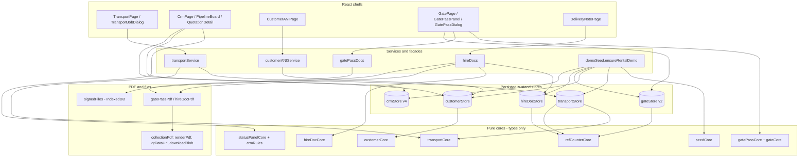
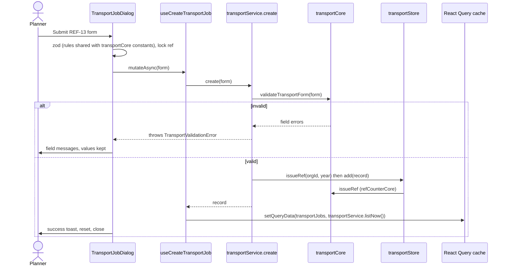
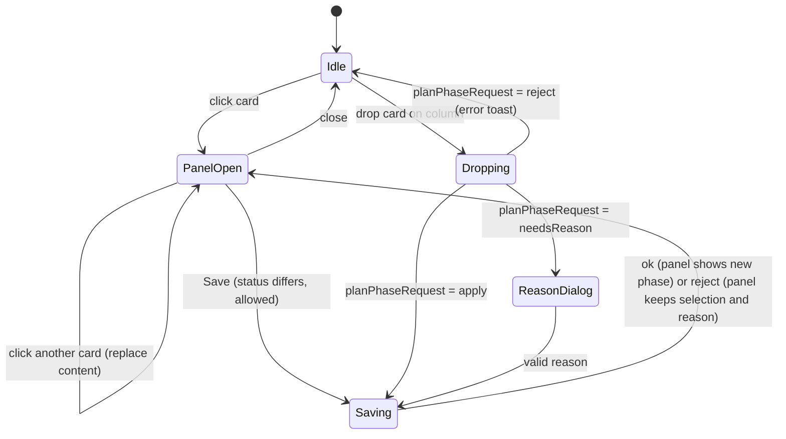
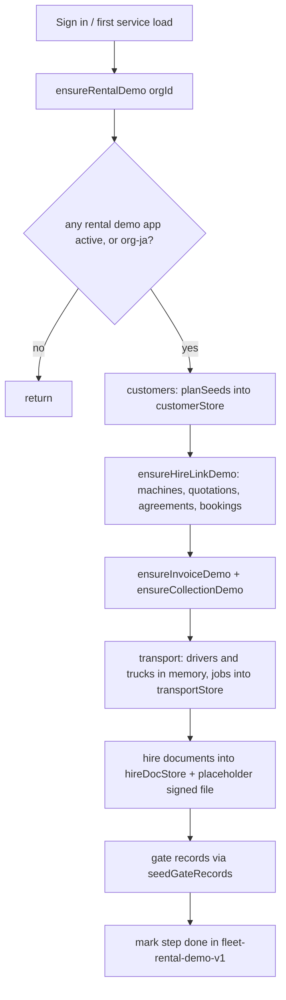

# Design Document

## Overview

This feature connects the apps of the rental project so that one rental can be followed from customer to quotation, hire agreement, planner booking, fleet machine, invoice, collection note, MQD, Third-Party Services document, transport job and gate pass. It delivers the six user tasks and the Delivery Note / hire-document workstream of `requirements.md`.

The design follows the pattern already used by `gateCore` / `gateStore` / `demoGate`: **pure cores with type-only imports, persisted per-company zustand stores, thin service facades, and thin React shells.** Every decision that varies with input (numbering, mapping, validation, ordering, status options, QR payloads, upload rules, seed planning) lives in a pure module that can be property-tested.

### Module map

| Area | Layer | New or changed module | Role |
|---|---|---|---|
| Shared | Pure | `src/services/refCounterCore.ts` (new) | `issueRef`, `counterKey`, `counterFloorFromRefs`. One implementation of `<PREFIX>-<year>-<4 digits>` used by `TJ`, `GP`, `DN`, `HMQD`, `HTPS` |
| Shared | Pure | `src/services/seedCore.ts` (new) | `planSeeds`, `demoDay`, `integrityViolations` |
| Transport | Pure | `src/services/transportCore.ts` (new) | Form validation, form to record mapping, record to view, list merge and order, counters, REF-13 rows |
| Transport | Store | `src/store/transportStore.ts` (new) | Persisted per-company jobs, counters, seed markers, mock-row overrides, legacy import |
| Transport | Service | `transportService` in `services.ts` (changed) | Thin wrapper over the store and `transportCore` |
| Transport | UI | `TransportPage.tsx`, `TransportJobDialog.tsx` (changed) | No `slice(0, 8)`, typed detail panel, double-submit guard |
| CRM | Pure | `src/features/crm/statusPanelCore.ts` (new) | `statusOptions`, `validateReason`, `planPhaseRequest`, `columnSummary`, `cardModel`, `formatAedWhole` |
| CRM | UI | `PipelineBoard.tsx` (new, extracted), `CrmShared.tsx` (`QuotationDetail` gets a status editor), `CrmPage.tsx` (changed) | Four columns, Status panel, shared phase-change path |
| Customers | Pure | `src/services/customerCore.ts` (new) | `normalizeCustomerName`, `findCustomer`, `planFindOrCreate`, canonical demo set, `canonicalizeDemoName`, `linksForCustomer` |
| Customers | Store | `src/store/customerStore.ts` (new) | Persisted Customer_Registry |
| Customers | Service | `customerANIService` (changed), `customerService` (changed) | Read and write the registry |
| Gate | Pure | `src/services/gatePassCore.ts` (new) | `buildGatePayload`, `parseGatePayload`, `classifyScan`, `resolveGatePassScan`, `pngFileName` |
| Gate | PDF | `src/services/gatePassPdf.ts` (new) | `gatePassContent` (pure), `gatePassPdf` (uses `renderPdf`) |
| Gate | Facade | `src/services/gatePassDocs.ts` (new) | Resolves linked quotation, agreement, collection note and company name; prints |
| Gate | Store | `src/store/gateStore.ts` (v1 to v2) | Adds `counters` and `issueRef` |
| Gate | UI | `GatePassPanel.tsx` (new), `GatePage.tsx`, `GatePassDialog.tsx` (changed) | QR, Download PNG, Print PDF, scan dispatch, success state |
| Hire documents | Pure | `src/services/hireDocCore.ts` (new) | Status derivation, `validateSignedUpload`, `planGenerate`, `listHireDocRows`, `canDownloadSigned` |
| Hire documents | PDF | `src/services/hireDocPdf.ts` (new) | Delivery Note, hire MQD and hire TPS content; reuses `renderPdf`, `mqdContent`, `tpsContent` |
| Hire documents | Store | `src/store/hireDocStore.ts` (new) | Persisted documents, counters, seed markers |
| Hire documents | Facade | `src/services/hireDocs.ts` (new) | Generate, download, upload through `signedFiles` |
| Hire documents | UI | `src/features/documents/DeliveryNotePage.tsx` (new), `AppRouter.tsx` (changed) | Replaces the placeholder at `/docs/delivery-note` |
| Demo | Seeder | `src/services/demoSeed.ts` (extended), `src/services/mock/demoRental.ts` (new) | `ensureRentalDemo(orgId)`, pure builders of the new demo records |
| Verification | Tests | `src/services/__tests__/e2e/*`, `traceability.md` | Requirement 8 |

### Research findings that shaped the design

All findings come from reading the current code.

- **Transport is split across three places.** `TransportJobDialog` posts the 15 REF-13 fields to `transportService.create`, which pushes the raw form onto the in-memory `transportJobsForOrg` array. The page reads the `TransportJob` view type (`destination`, `origin`, `assetNumber`, `machineModel`, `distance`) and throws on `job.destination.split('-')` for a form-shaped job. Collection notes write `StoredTransportJob` rows to `useAppStore.transportJobs`, which no screen reads. `TransportPage` updates status through `useAppStore().updateTransportJob`, which only touches that unused array. **Decision:** one persisted per-company `transportStore`, read by every consumer through `transportService`.
- **Why a dedicated store and not `appStore.transportJobs`.** `appStore` rows have no `orgId`, so company isolation (Req 1.12, 9.1) would need a retrofit. `gateStore` already solved the same problem in this codebase (per-company rows, seed markers, one-time legacy import, `mergeGateList`). The transport store copies that proven pattern. The legacy `appStore.transportJobs` is imported once, never written again, and never deleted (same as `importLegacyGateEntries`).
- **CRM.** `crmRules.ALLOWED` already encodes the five valid moves and `applyTransition` is the only writer of a phase. The board has two columns and per-card buttons. The design reuses `crmRules.ts` unchanged and adds a pure `statusPanelCore.ts` beside it.
- **Customers.** Three unrelated sources exist: `customerService` (JA `cu-1..cu-10`, used only by the planner booking dialog and MQD dialog), `customerANIsForOrg` (an in-memory cache seeded with five ANI customers for every company, lost on refresh, read by the Customers app), and the free-text `customerName` / `CUS-xxxx` ids on quotations. **Decision:** the Customer_Registry is a persisted store of `CustomerANI` records (the shape the Customers app already uses), so the Customers app, CRM, planner and documents all read one place. `customerService.list` returns the registry customers plus the JA `cu-*` rows whose normalized name is not in the registry, so existing JA bookings keep resolving.
- **Gate.** `GatePassDialog` builds `GP-` plus the last four digits of `Date.now()` and `gateService.create` builds `GP-<count+1>`. Both can collide. The QR scanner inside the dialog only understands `AXLEOPS-FLEET:`. `GatePage` has a "Print Gate Pass" button with no handler. The `qrcode` and `jspdf` packages are already used by `collectionPdf.ts` (`qrDataUrl`, `renderPdf`, `downloadBlob`).
- **PDF reuse.** `renderPdf(content: PdfContent)` already draws sections, a table, a QR and signature lines, and accepts either a payload string or a `data:image/` URL in `content.qr`. Gate pass and hire documents are new `PdfContent` builders; no new renderer is needed. `referenceRows` in `collectionPdf.ts` is exported (additive change) so the Delivery Note shares the reference section layout.
- **Signed copies.** `signedFiles.put(key, blob, meta)` returns a `SignedFileRef` and is atomic per IndexedDB transaction, so a failed `put` leaves the old row. `attachSigned` is typed to `DocType` (`CN | MQD | TPS`) and rejects nothing on size, so hire documents call `signedFiles` directly with keys `${orgId}/HDOC/${docId}` and their own validation.
- **Seeding.** `ensureHireLinkDemo` seeds non-JA companies only when one of `crm`, `planner`, `quotation`, `gate` is active, keeps a localStorage flag, and adds machines in memory on every load. Customers, transport, drivers, trucks and hire documents are not seeded. The seeder pattern (`planGateSeeds`: marker list plus existing ids) already gives "do not re-add deleted, do not overwrite edited" and is generalized into `seedCore.planSeeds`.
- **Architecture tests.** `architecture.test.ts` enforces: cores import only types (`hireLinkCore`, `invoiceRulesCore`, `collectionCore`), `gateCore` value-imports only `collectionCore`, facades do not import `services.ts` / `appStore.ts`, `features/planner|gate|documents` do not import `crmStore`, and only `features/gate`, `services.ts` and `demoSeed.ts` import `gateStore`. New modules follow the same rules and get matching tests (see Testing Strategy).
- **Test tooling.** Vitest 5.1.1 with jsdom, fast-check v4 (no `fc.stringOf`; use `fc.string()` with `minLength`/`maxLength`, `fc.array(fc.constantFrom(...))` and `.map(a => a.join(''))`), `fake-indexeddb` already installed, `jsqr` already a runtime dependency. `qrcode`'s `create(text, opts)` returns the module matrix, which can be rasterized to `ImageData` and decoded by `jsqr` without a canvas (needed for jsdom).

### Assumptions and decisions to confirm

1. **Type letter to job kind.** The `TransportJob` view has `type: 'Delivery' | 'Collection' | 'Transfer'`; the form has `D | T | O | T2`. Mapping: `D` to Delivery, `O` to Collection, `T` and `T2` to Transfer. This matches `transportJobFromCollection`, which already writes `O` for collections. The detail panel shows the letter as entered (Req 1.5).
2. **Mock rows are baseline.** JA's mock transport jobs (from `johnsonArabiaDemo.json`) are listed after all persisted jobs. Persisted jobs (user, seeded, collection-generated) are ordered newest first. This keeps "new job at the top" true even though the mock `createdAt` values are dated in late 2026.
3. **"Exactly one Hire_Document of each type" (Req 6.14).** Document_Status is derived: no record means Not Generated (Req 7.2). The Won demo quotation therefore has a Delivery Note record and an MQD record and no TPS record. A literal reading ("a TPS record with status Not Generated") would contradict Req 7.2 and 7.13. If a TPS placeholder record is wanted, requirements need an amendment.
4. **Upload rule precedence.** When a file breaks several rules, the error names the first of: empty, type, size.
5. **Reason length is a shell rule.** `crmRules.applyTransition` is unchanged (it only rejects blank reasons). The 1 to 500 character limit is enforced by `validateReason` in the Status panel and the reason dialogs.
6. **Branch of new jobs.** A new transport job takes `branchId` and `branchName` from the matched machine. With no match, `branchId` is empty and the job shows under the "all branches" filter only.
7. **`Cancelled`.** The Transport page already offers a `Cancelled` status that is missing from `TransportJobStatus`. It is added to the union. Counters treat it as none of Active, Scheduled or Completed.

## Architecture



### Dependency rules (enforced by architecture tests)

- `refCounterCore`, `seedCore`, `transportCore`, `customerCore`, `gatePassCore`, `hireDocCore`, `statusPanelCore` import only types. `statusPanelCore` may value-import `crmRules` (also types-only).
- `gatePassPdf`, `hireDocPdf`, `gatePassDocs`, `hireDocs` do not import `services.ts` or `appStore.ts`. The two PDF modules import no store.
- `gatePassDocs` and `hireDocs` import `crmStore`, because `features/gate` and `features/documents` may not.
- `transportStore` is imported only by `features/transport`, `features/fleet/collectionWiring.ts`, `services.ts` and `demoSeed.ts`. `hireDocStore` is imported only by `hireDocs.ts` and `demoSeed.ts`. `customerStore` is imported only by `services.ts`, `demoSeed.ts`, `features/crm` and `features/customerani`. `gateStore` keeps its existing allow-list.
- `features/documents` imports `hireDocs.ts` only for data access (no store imports).

### Transport job creation



`listNow()` is a synchronous read of the same merge that `listJobs()` wraps in `delay()`. Writing it into the query cache in `onSuccess` makes the board and the six counters correct on the next render (Req 1.8) for the page, Kanban, Job Tracking and Truck Tracking, which all use `useTransportJobs`.

### CRM phase change (panel and drag and drop share one path)



### Seeding flow



Each step is a try/catch that logs `console.warn('[demoSeed] skipped <record>: <reason>')` and continues (Req 6.9). The whole call is deferred with `setTimeout(0)` from the sign-in effect so the first render is not blocked (Req 6.11).

## Components and Interfaces

### 1. Shared pure cores

```ts
// src/services/refCounterCore.ts  (types only)
export type RefPrefix = 'TJ' | 'GP' | 'DN' | 'HMQD' | 'HTPS';
export type RefCounters = Record<string, number>;           // key: `${orgId}|${prefix}|${year}`
export const MAX_SEQ = 9999;
export const counterKey = (orgId: string, prefix: RefPrefix, year: number): string =>
  `${orgId}|${prefix}|${year}`;
export const formatRef = (prefix: RefPrefix, year: number, seq: number): string =>
  `${prefix}-${year}-${String(seq).padStart(4, '0')}`;
export const REF_RE: RegExp;                                  // /^(TJ|GP|DN|HMQD|HTPS)-(\d{4})-(\d{4})$/

export type IssueResult =
  | { ok: true; ref: string; seq: number; counters: RefCounters }
  | { ok: false; error: 'EXHAUSTED' };

/** Never decreases a counter. Returns the input counters unchanged on EXHAUSTED. */
export function issueRef(c: RefCounters, orgId: string, prefix: RefPrefix, year: number): IssueResult;

/** Highest sequence per key found in existing refs (migration and seed counter floor). */
export function counterFloorFromRefs(rows: ReadonlyArray<{ orgId: string; ref: string }>): RefCounters;
```

```ts
// src/services/seedCore.ts  (types only)
/** Seeds not marked for the company and not present by id. */
export function planSeeds<T extends { id: string }>(
  markers: readonly string[], existingIds: ReadonlySet<string>, seeds: readonly T[]): T[];
/** Local YYYY-MM-DD of `today` plus `offset` days. `today` is injected, so it is pure. */
export function demoDay(today: Date, offset: number): string;
export interface IntegritySnapshot { /* all org-scoped record lists, see Data Models */ }
/** Dangling references and customer mismatches, as readable strings. Empty when sound. */
export function integrityViolations(orgId: string, s: IntegritySnapshot): string[];
```

`gateCore.planGateSeeds` stays as is; `planSeeds` is the generic version used by the new stores.

### 2. Transport (Req 1)

```ts
// src/services/transportCore.ts  (types only)
export const TRANSPORT_SHIFTS = ['Morning', 'Evening'] as const;
export const TRANSPORT_TYPES = ['D', 'T', 'O', 'T2'] as const;
export const TRANSPORT_SALES = ['BG','AD','CH','AM','SM','SK','TD','SH','MT','TS'] as const;

export interface TransportForm {            // the 15 REF-13 fields
  plannerName: string; date: string; shift: 'Morning' | 'Evening'; transportTeam: string;
  srNo: number; fleet: string; from: string; to: string; transport: string;
  type: 'D' | 'T' | 'O' | 'T2'; contact: string; sales: string; client: string;
  time: string; remarks?: string;
}
export type FieldErrors = Partial<Record<keyof TransportForm, string>>;
export function validateTransportForm(input: unknown):
  { ok: true; form: TransportForm } | { ok: false; errors: FieldErrors };

export interface MachineRef { id: string; fleetNo?: string; assetNumber: string; make?: string; model?: string;
  branchId?: string; branchName?: string }
/** Builds the persisted record. `id` and `ref` are supplied by the caller. */
export function mapFormToRecord(form: TransportForm, ctx: {
  orgId: string; id: string; ref: string; now: string; machines: readonly MachineRef[] }): TransportJobRecord;

export const kindOfType = (t: 'D'|'T'|'O'|'T2'): 'Delivery'|'Collection'|'Transfer';
/** Total: never throws, whatever fields a record or legacy row lacks. */
export function toTransportJobView(r: TransportJobRecord, ctx: ViewCtx): TransportJobView;

export function mergeTransportList(persisted: readonly TransportJobRecord[], mock: readonly TransportJob[],
  orgId: string, overrides: Record<string, JobOverride>, ctx: ViewCtx): TransportJobView[];
export function sortNewestFirst<T extends { createdAt: string }>(rows: readonly T[]): T[];

export interface TransportCounters { active: number; scheduled: number; completed: number;
  deliveries: number; collections: number }
export function transportCounters(jobs: readonly Pick<TransportJob, 'status' | 'type'>[]): TransportCounters;

/** The 15 labelled rows of the detail panel. Remarks is '' when absent. */
export function ref13Rows(v: TransportJobView): { label: string; value: string }[];

export function transportJobFromCollection(cn: CollectionNoteLite, ref: string, id: string, now: string):
  TransportJobRecord;       // moved from collectionWiring, now returns the new record shape
```

`Active` counts `In Transit` and `Loading`; `Completed` counts `Completed` and `Delivered` (unchanged from the page). `scheduledTime` is the floating local string `${date}T${time}:00`.

```ts
// src/store/transportStore.ts
export const TRANSPORT_STORE_KEY = 'fleet-transport-jobs-v1';
interface TransportState {
  jobs: TransportJobRecord[];                    // all companies
  counters: RefCounters;
  seedMarkers: Record<string, string[]>;
  overrides: Record<string, JobOverride>;        // key `${orgId}|${jobId}`, for mock rows
  legacyImported: boolean;
  forOrg(orgId: string): TransportJobRecord[];
  issueRef(orgId: string, year: number): string; // throws TransportRefExhaustedError
  add(r: TransportJobRecord): TransportJobRecord;
  update(orgId: string, id: string, patch: JobPatch): void;     // persisted rows: patch; mock rows: override
  seedOrg(orgId: string, seeds: TransportJobRecord[]): TransportJobRecord[];
}
export function migrateTransportState(persisted: unknown): TransportState['…data'];   // pure, total
export function importLegacyTransportJobs(): void;  // appStore.transportJobs -> jobs, once, never writes appStore
```

`importLegacyTransportJobs` maps each `StoredTransportJob` to a record. The `orgId` comes from the collection note when the id is `tj-<noteId>` and the note exists, and falls back to `org-ja` otherwise (the same fallback as `importLegacyGateEntries`). Legacy collection jobs keep their note number in `sourceRef` and receive a `TJ-` reference through `issueRef`. `counters` are floored with `counterFloorFromRefs`.

```ts
// transportService (services.ts)
listJobs(): Promise<TransportJobView[]>;         // delay(listNow())
listNow(): TransportJobView[];                   // merge of store rows + mock rows, ensureRentalDemo first
create(form: unknown): Promise<TransportJobView>;       // validate, issueRef, add; throws TransportValidationError
update(id: string, patch: JobPatch): Promise<TransportJobView>;
updateStatus(id: string, status: TransportJobStatus): Promise<TransportJobView>;
listDrivers(): Promise<Driver[]>; listTrucks(): Promise<Truck[]>;   // ensureRentalDemo first
```

**UI changes.**

- `TransportPage` removes `slice(0, 8)`, replaces `useAppStore().updateTransportJob` with `useUpdateTransportJob`, replaces `(selected as any).*` with typed `ref13Rows(selected)`, guards `job.destination?.split('-')[0] ?? '—'` and `job.distance ?? '—'`, and shows counters from `transportCounters(filteredJobs)`.
- `TransportJobDialog` builds its zod schema from the exported `TRANSPORT_*` constants (`srNo` is an integer 1 to 9999), keeps `form.reset()` only on success, shows the thrown service error through `toastError`, and locks double submit with a `useRef` flag in addition to `isPending`.
- `collectionWiring.appCreateTransportJob` calls `useTransportStore.getState().add(...)` with `cn.orgId` and a freshly issued `TJ-` reference. The `appStore` write is removed.
- `TruckTrackingPage`, `TripbaseReportPage`, `KanbanPage` and `JobTrackingPage` need no change except `distance ?? 0` where a number is required. `types/transport.ts`: `distance` becomes optional and `Cancelled` joins `TransportJobStatus`; `services.ts` line `s + j.distance` becomes `s + (j.distance ?? 0)`.

### 3. CRM pipeline and Status panel (Req 2, 3)

```ts
// src/features/crm/statusPanelCore.ts  (value-imports crmRules only)
export interface StatusOption { phase: QuotationPhase; current: boolean; allowed: boolean; reason?: string }
/** One option per phase, in the order Awaiting, Tender, Lost, Won. */
export function statusOptions(current: QuotationPhase): StatusOption[];
//  current option: allowed=false, current=true. Others: allowed = isAllowed(current, p);
//  disallowed: reason = transitionError(current, p).

export const REASON_MAX = 500;
export function validateReason(s: string | undefined): { ok: true; reason: string } | { ok: false; message: string };
//  ok iff trimmed length is 1..500; reason is the trimmed text.

export type PhaseRequest =
  | { kind: 'reject'; error: string }
  | { kind: 'needsReason'; label: 'Lost' | 'Reopen' }
  | { kind: 'apply' };
export function planPhaseRequest(from: QuotationPhase, to: QuotationPhase): PhaseRequest;

export interface PanelState { canSave: boolean; needsReason: boolean }
export function panelState(current: QuotationPhase, selected: QuotationPhase, reason: string): PanelState;

export interface ColumnSummary { phase: QuotationPhase; count: number; amount: number; label: string }  // label 'AED 12,345'
export function columnSummary(qs: readonly Quotation[], phase: QuotationPhase): ColumnSummary;
export const formatAedWhole = (n: number): string;        // 'AED ' + en-US grouping, no decimals

export interface CardModel { number: string; opportunity: string; customerName: string;
  hireAgreementNo: string; /* '—' when empty */ amountLabel: string }
export function cardModel(q: Quotation): CardModel;
```

`PipelineBoard.tsx` (extracted from `CrmPage.tsx`) renders `PHASES` as four columns (`Awaiting, Tender, Lost, Won`), a header from `columnSummary`, cards from `cardModel`, an empty-state line per empty column, and keeps native drag and drop. Per-card buttons are removed.

`QuotationDetail` (in `CrmShared.tsx`) gains an optional `statusEditor?: { onSave(to: QuotationPhase, reason?: string): { ok: boolean; error?: string } }`. When present it renders a Status select (from `statusOptions`), a reason `Textarea` shown when `panelState(...).needsReason`, a Save button (`disabled={!canSave}`), a field-level reason message, and the existing phase history. The panel header shows number and customer; the body shows opportunity, hire agreement, amount and phase. Selected card id lives in `CrmPage` state, so clicking another card replaces the content and only one panel exists.

`CrmPage.move(q, to, reason)` stays the only caller of `changePhase`. Drop handler:

```ts
const req = planPhaseRequest(q.phase, col);
if (req.kind === 'reject') toastError(req.error);
else if (req.kind === 'needsReason') (req.label === 'Lost' ? setLostTarget : setReopenTarget)(q);
else move(q, col);
```

`ReasonDialog` submit calls `validateReason`. After a successful save the panel stays open because `detail` is looked up by id from the store, so it shows the new phase, the new history entry, a disabled Save and the success toast. On rejection the panel keeps the selected status and typed reason.

`crmStore.create` is unchanged. `CrmPage.onCreate` first calls `useCustomerStore.getState().findOrCreate(orgId, draft.customerName)` and passes the registry `customerId` and canonical `name` into `create`.

`crmStore` persist version goes 3 to 4. The migration keeps every quotation and, for seed ids only (`qt-seed-*` and `qt-<org>-seed-*`) whose `customerName` still equals a non-canonical demo spelling, rewrites `customerName` and `customerId` to the canonical values. User-created quotations are never touched (Req 4.4).

### 4. Customer_Registry (Req 4)

```ts
// src/services/customerCore.ts  (types only)
export interface CanonicalCustomer { customerId: string; name: string; /* plus ANI fields */ }
export const CANONICAL_DEMO_NAMES: readonly string[];       // the nine names of Req 4.2
export const CANONICAL_DEMO_CUSTOMERS: readonly CanonicalCustomer[];
//  ABC CUST-000125, DEF CUST-000248, GHI CUST-000371, JKL CUST-000419, MNO CUST-000532 (fixed by Req 4.12);
//  CK Groups, Damac Properties, Arabtec Construction LLC, Administrator get CUST-000601..000604.

/** lower case, trim, collapse inner spaces, drop a trailing LLC or PJSC (with optional dots/commas). */
export function normalizeCustomerName(s: string): string;
export function findCustomer<T extends { name: string; orgId: string }>(list: readonly T[], orgId: string, name: string): T | undefined;
export function planFindOrCreate(list: readonly CustomerRecord[], orgId: string, name: string, newId: () => string, now: string):
  { customer: CustomerRecord; created: boolean };
export const DEMO_SPELLING_FIXES: Readonly<Record<string, string>>;   // 'ABC Company' -> 'ABC Company LLC', 'Arabtec Contracting' -> 'Arabtec Construction LLC'
export function canonicalizeDemoName(s: string): string;              // exact-match replace only
export function linksForCustomer(s: LinkSnapshot, orgId: string, customerId: string):
  { quotations: Quotation[]; agreements: HireAgreement[]; invoices: TaxInvoice[] };
```

```ts
// src/store/customerStore.ts   key 'fleet-customers-v1'
interface CustomerState {
  customers: CustomerRecord[];                  // CustomerANI & { orgId: string }
  seedMarkers: Record<string, string[]>;
  forOrg(orgId: string): CustomerRecord[];
  findOrCreate(orgId: string, name: string): CustomerRecord;     // uses planFindOrCreate
  create(orgId: string, data: Partial<CustomerANI>): CustomerRecord;   // throws DuplicateCustomerError
  update(orgId: string, id: string, patch: Partial<CustomerANI>): CustomerRecord;
  remove(orgId: string, id: string): void;
  seedOrg(orgId: string, seeds: CustomerRecord[]): CustomerRecord[];
}
```

- `customerANIService.list/get/create/update/delete` delegate to the store (`ensureRentalDemo(orgId)` first on `list`). The preset code that uses `customerANIsForOrg(org).splice(0)` and `.length` is switched to the store; `customerANIsForOrg` stays for the preset reset only.
- New customer ids: `id = cani-<orgId>-<n>` for non-JA, `cani-<n>` for `org-ja`. `customerId` is `CUST-` plus a six-digit number above every existing one in the company. `findOrCreate` never changes an existing `customerId` (Req 4.1).
- `customerService.list` returns `customerStore.forOrg(orgId)` mapped to the `Customer` shape plus the JA `cu-*` rows not matched by `normalizeCustomerName`.
- The Customers detail slide-over gets "Quotations", "Hire agreements" and "Invoices" sections from `linksForCustomer`, fed by a small hook in `services/customerLinks.ts` (the facade that reads `crmStore`, `hireAgreementStore`, `taxInvoiceStore`).
- `CrmPage` reads the registry directly, so CRM works while the `customer_ani` app is inactive (Req 4.13). `apps.ts` already lists `customer_ani` in `crm.depends`; no change.
- Demo builders (`quotations.ts`, `demoHireLink.ts`, `hireagreement` seeds, `demoCollection`) take `customerId` from `CANONICAL_DEMO_CUSTOMERS` by name instead of `CUS-<ha suffix>` and `cu-<n>`. `demoBookingsForOrg` uses registry ids for `customerId`.

### 5. Gate pass QR and PDF (Req 5)

```ts
// src/services/gatePassCore.ts  (types only)
export const GATE_QR_PREFIX = 'AXLEOPS-GATE';
export const buildGatePayload = (p: { orgId: string; id: string; reference: string }): string =>
  `${GATE_QR_PREFIX}:${p.orgId}:${p.id}:${p.reference}`;
export type GateParse = { ok: true; orgId: string; id: string; reference: string } | { ok: false; error: 'FORMAT' };
export function parseGatePayload(raw: string): GateParse;      // exactly 4 colon-separated, non-empty parts, first is the prefix
export type ScanKind = 'FLEET' | 'GATE' | 'OTHER';
export function classifyScan(raw: string): ScanKind;           // prefix 'AXLEOPS-FLEET:' | 'AXLEOPS-GATE:' | other
export type GatePassScan =
  | { ok: true; pass: GatePassLite }
  | { ok: false; error: 'FORMAT' | 'OTHER_ORG' | 'NOT_FOUND' };
export function resolveGatePassScan(raw: string, currentOrgId: string, passes: readonly GatePassLite[]): GatePassScan;
export const GATE_PASS_SCAN_MESSAGES: Record<'FORMAT'|'OTHER_ORG'|'NOT_FOUND', string>;
export const pngFileName = (reference: string): string;        // `${reference}.png`, characters outside [A-Za-z0-9._-] replaced by '_'
```

Precedence in `resolveGatePassScan`: format, then company, then lookup by `id`. The returned pass is found by `id` only; the reference part is carried but not required to match, so a regenerated reference never blocks a scan.

```ts
// gateStore v2: key unchanged ('fleet-gate-entries-v1'), version 2
//   adds counters: RefCounters and issueRef(orgId: string, year: number): string  (throws GateRefExhaustedError)
//   migrateGateState adds counters = counterFloorFromRefs(entries with refs matching GP-YYYY-NNNN)
// gateService.create: reference = data.reference ?? useGateStore.getState().issueRef(orgId, year);
//   id = data.id ?? `ge-${Date.now()}-${n}` with a uniqueness check; returns the stored record.
```

`GatePassDialog` stops building `id` and `reference`; it uses the record returned by `createMutation.mutateAsync`. After a successful create it switches to a **success state** that shows the QR (`qrDataUrl(buildGatePayload(rec))`), the reference, a Download PNG button and a Done button that closes the dialog (Req 5.11). Direction-specific side effects (`setMachineStatus`, `markCollectedForMachine`) run before the success state, as today.

Scan dispatch in `handleDecode(text)`:

```ts
switch (classifyScan(text)) {
  case 'GATE': { const r = resolveGatePassScan(text, orgId, passes);
                 r.ok ? onOpenPass(r.pass.id) /* closes dialog, GatePage opens detail */
                      : setScanError({ code: r.error, message: GATE_PASS_SCAN_MESSAGES[r.error] }); return; }
  default:     /* FLEET and OTHER: existing resolveGateScan path, unchanged */
}
```

`GatePassDialog` gains `onOpenPass?: (id: string) => void` and reads `passes` from `useGateEntries()`. A gate payload never reaches `resolveGateScan`, and no record is created on any `GATE` branch.

`GatePassPanel` (new, in `features/gate`) is the body and footer of the `GatePage` slide-over: existing detail rows plus the QR image, the payload text, the fleet number, **Download PNG**, **Print Gate Pass** and the existing **Process Entry**, with Approve / Complete still in the table. QR generation or PDF failure sets an inline error and a toast and never touches the stored pass (Req 5.16). The "Print Gate Pass" button now has a handler.

```ts
// src/services/gatePassPdf.ts  (no store imports)
export interface GatePassPdfCtx { companyName: string; links: { quotationNo?: string; hireAgreementNo?: string; collectionNo?: string } }
export function gatePassContent(r: GateRecord, ctx: GatePassPdfCtx): PdfContent;
//  sections: Pass (reference, direction, status, date, time+zone), Machine (fleet no, machineModel), Parties (customer, driver, truck plate, branch),
//  References (quotation, hire agreement, collection note; '-' when absent); qr = buildGatePayload(r); qrCaption = fleet no.
export function gatePassPdf(r: GateRecord, ctx: GatePassPdfCtx): Promise<Blob>;     // renderPdf(gatePassContent(...))

// src/services/gatePassDocs.ts  (facade; reads crm, agreement, booking, invoice, collection stores and authStore; not gateStore)
export function gatePassContext(orgId: string, r: GateRecord): GatePassPdfCtx;
export function printGatePass(orgId: string, r: GateRecord): Promise<void>;         // gatePassPdf + downloadBlob(`${reference}.pdf`)
```

`gatePassContext` resolves links with `resolveReferences(machineLite, record.customer, snapshot)` and, for Gate IN, the Collection Note whose `collectedByGateId` equals the record id. Demo seeds keep `GP-DEMO-<n>` references (Req 5.5); the payload is built from whatever `reference` the record has.

### 6. Hire documents (Req 7)

```ts
// src/services/hireDocCore.ts  (types only)
export type HireDocType = 'DN' | 'HMQD' | 'HTPS';
export const HIRE_DOC_PREFIX: Record<HireDocType, RefPrefix> = { DN: 'DN', HMQD: 'HMQD', HTPS: 'HTPS' };
export type DocStatus = 'Not Generated' | 'Generated' | 'Signed Copy Uploaded';
export const statusOf = (doc: HireDocument | undefined): DocStatus;

export const SIGNED_MAX_BYTES = 10_485_760;
export const SIGNED_MIME = ['application/pdf', 'image/png', 'image/jpeg'] as const;
export type UploadRule = 'EMPTY' | 'TYPE' | 'SIZE';
export function validateSignedUpload(f: { type: string; size: number; name?: string }):
  { ok: true } | { ok: false; rule: UploadRule; message: string };        // precedence EMPTY, TYPE, SIZE

export interface HireLinks { agreement?: AgreementLite; machine?: MachineLite; customerId: string; customerName: string }
export function resolveHireLinks(q: QuotationLite, s: HireSnapshot): HireLinks;
//  agreement: orgId match and agreement.quotationId === q.id; machine: booking with hireAgreementId === agreement.id -> machineId

export type GenerateResult =
  | { ok: true; existing: true; doc: HireDocument }
  | { ok: true; existing: false; doc: HireDocument; counters: RefCounters }
  | { ok: false; error: 'NO_AGREEMENT' | 'NO_MACHINE' | 'EXHAUSTED'; message: string };
export function planGenerate(i: { orgId: string; type: HireDocType; quotation: QuotationLite; links: HireLinks;
  docs: readonly HireDocument[]; counters: RefCounters; now: string; id: string }): GenerateResult;
//  existing doc of (orgId, quotationId, type) -> returned as is. Missing agreement is reported before missing machine.

export interface HireDocRow { quotationId: string; quotationNo: string; agreementNo: string; customerName: string;
  fleetNo: string; statuses: Record<HireDocType, DocStatus>; docs: Partial<Record<HireDocType, HireDocument>> }
export function listHireDocRows(orgId: string, qs: readonly QuotationLite[], agreements: readonly AgreementLite[],
  docs: readonly HireDocument[], s: HireSnapshot): HireDocRow[];       // only quotations that have a linked agreement

export const canDownloadSigned = (u: { orgId: string }, doc: { orgId: string }, appActive: boolean): boolean;
export const signedKey = (orgId: string, docId: string): string => `${orgId}/HDOC/${docId}`;
```

```ts
// src/store/hireDocStore.ts   key 'fleet-hire-docs-v1'
interface HireDocState {
  docs: HireDocument[]; counters: RefCounters; seedMarkers: Record<string, string[]>;
  forOrg(orgId: string): HireDocument[];
  issueRef...  // not exposed: commit(plan) writes doc and counters in one set()
  commit(r: { doc: HireDocument; counters: RefCounters }): void;
  setSigned(id: string, f: HireSignedFile | undefined): HireDocument;
  seedOrg(orgId: string, seeds: HireDocument[], floor: RefCounters): HireDocument[];
}
```

```ts
// src/services/hireDocs.ts  (facade; no services.ts / appStore imports)
export function useHireDocRows(): { rows: HireDocRow[]; refresh(): void };
export function generateHireDoc(orgId: string, quotationId: string, type: HireDocType): Promise<GenerateResult>;
//  1 resolve links  2 planGenerate  3 render PDF (failure: no record)  4 commit
export function downloadHireDoc(doc: HireDocument): Promise<void>;                     // re-renders from the record
export function uploadSigned(orgId: string, user: string, docId: string, file: File, opts: { confirmReplace(): Promise<boolean> }):
  Promise<{ ok: true; file: HireSignedFile } | { ok: false; error: UploadRule | 'STORAGE' | 'DECLINED' | 'NOT_FOUND'; message: string }>;
export function downloadSigned(user: { orgId: string }, doc: HireDocument, appActive: boolean): Promise<void>;
```

`uploadSigned` order: validate, find doc, ask confirmation when a signed copy exists, `signedFiles.put(signedKey(...))`, then `setSigned`. If `setSigned` throws, the file is removed again (or, on replace, the previous blob stays because `put` only overwrote after success). A failed `put` changes nothing. `uploadedBy` is `authStore.user.name`.

```ts
// src/services/hireDocPdf.ts  (no store imports)
export function hireDocContent(type: HireDocType, doc: HireDocument, refs: ReferenceFields): PdfContent;
export function hireDocPdf(type: HireDocType, doc: HireDocument, refs: ReferenceFields): Promise<Blob>;
```

- `DN`: sections built with the exported `referenceRows`, plus a delivery section (date, site, agreement dates) and the machine QR (`buildQrPayload`); signatures Driver, Customer, Authorised Signatory.
- `HMQD`: `mqdContent({ ...mqdShape, number: doc.number })` with the title set to "Machine Quality Document (Hire)".
- `HTPS`: `tpsContent({ ...tpsShape, lines: [], number: doc.number })`, which renders an empty table and total 0.00.
- `ReferenceFields` for the hire phase comes from `resolveHireLinks` plus the existing `resolveReferences`; `invoiceNo` is `-` until an invoice exists.

`DeliveryNotePage` (route `/docs/delivery-note`, replaces `DocumentAppPage appId="delivery_note"`) shows a `DataTable` with columns Quotation, Agreement, Customer, Fleet No, and one cell per type containing a status badge and the actions Generate (when Not Generated), Download (when Generated or Signed), Upload signed copy (file input, `accept=".pdf,.png,.jpg,.jpeg"`) and Download signed copy. The replace confirmation uses the existing dialog component. `AppGuard` already blocks the route when `delivery_note` is inactive (Req 9.6).

### 7. Demo seeding (Req 6)

```ts
// src/services/demoSeed.ts  (extended)
export const DEMO_APPS = ['crm','planner','quotation','gate','customer_ani','transport','delivery_note',
  'collection_note','invoice','mqd','third_party_services','fleet'];
export function ensureRentalDemo(orgId: string, today: Date = new Date()): void;   // idempotent, never throws
```

```ts
// src/services/mock/demoRental.ts  (pure builders; no stores, no clock, no randomness)
export const demoDriverId = (orgId: string, n: number): string;     // `drv-demo-${orgId}-${n}`
export const demoTruckId  = (orgId: string, n: number): string;
export function demoDriversForOrg(orgId: string): Driver[];         // 2 drivers
export function demoTrucksForOrg(orgId: string): Truck[];           // 2 trucks
export function demoTransportSeeds(orgId: string, ctx: { machines: MachineLite[]; quotations: QuotationLite[];
  bookings: BookingLite[]; notes: CollectionNoteLite[]; today: Date; now: string }): TransportJobRecord[];
export function demoHireDocSeeds(orgId: string, ctx: HireSeedCtx): { docs: HireDocument[]; floor: RefCounters };
export function demoCustomerSeeds(orgId: string, now: string): CustomerRecord[];
```

- **Customers**: the nine `CANONICAL_DEMO_CUSTOMERS`, ids `cani-<org>-<n>` for non-JA.
- **Transport**: job 1 is a Delivery (`D`) of the On Hire machine (`mc-5` / `mc-demo-5`) for the Won quotation (MNO), status `Completed`; job 2 is a Collection (`O`) of `mc-4` / `mc-demo-4` for the quotation of `CN-2026-0002` (JKL), status `Scheduled`, `collectionNoteId` set. Both carry `driverId`, `driverName`, `truckId`, `transport` (plate), `machineId`, `quotationId`. Ids `tj-demo-<orgId>-<n>`, references issued from the counter (`TJ-<year>-0001`, `0002`), `seedKey` equal to the id.
- **Drivers and trucks** are added to `driversForOrg` / `trucksForOrg` in memory on every load, like demo machines, with orgId in the id.
- **Hire docs**: for the Won quotation (MNO): `DN` with a `HireSignedFile` and a placeholder PDF written to `signedFiles` (the existing `placeholderPdfBytes` moves to `services/mock/placeholderPdf.ts`), `HMQD` Generated, no `HTPS` record (assumption 3). Counters are raised to the seeded sequence.
- **Quotations**: the existing seed set already has two Awaiting, two Tender, three Won and three Lost per company; builders now use canonical names and registry ids.
- **Dates**: `demoDay(today, offset)` is used for the current hire (On Hire started 10 days ago, ends in 20) and the upcoming one (starts in 7); fixed dates remain for historical records (Req 6.8).
- **Markers and flags**: record-level `seedMarkers` in each store (Req 6.5) plus a step flag in localStorage key `fleet-rental-demo-v1` (`{ [orgId]: string[] }`, like `fleet-hire-link-demo-v1`) so a refresh does not reseed (Req 6.12). A step runs when one of its apps is active or the company is `org-ja`; prerequisite data (machines, customers, quotations, agreements, bookings) is seeded whenever any step runs, because the chain needs it.
- **Triggers**: `AppLayout` runs `setTimeout(() => ensureRentalDemo(orgId), 0)` in an effect keyed by `orgId`, and `transportService`, `customerANIService`, `hireDocs` and the existing `machineService`/`bookingService`/`gateService` call it on first load. `ensureHireLinkDemo` keeps its signature and now also honors the extended `DEMO_APPS`.

## Data Models

```ts
interface TransportJobRecord {            // persisted, one row per job, all companies in one array
  id: string;                             // `tj-<ts>-<n>`; seeds `tj-demo-<orgId>-<n>`
  orgId: string;
  reference: string;                      // TJ-<year>-NNNN
  // REF-13 header (4) and record (11) fields, exactly as entered
  plannerName: string; date: string; shift: 'Morning' | 'Evening'; transportTeam: string;
  srNo: number; fleet: string; from: string; to: string; transport: string;
  type: 'D' | 'T' | 'O' | 'T2'; contact: string; sales: string; client: string; time: string; remarks?: string;
  status: TransportJobStatus;             // Scheduled on create
  machineId?: string; branchId?: string; branchName?: string;
  driverId?: string; driverName?: string; truckId?: string;
  quotationId?: string; bookingId?: string; collectionNoteId?: string; sourceRef?: string; // legacy CN number
  autoGenerated?: boolean; seedKey?: string;
  createdAt: string; updatedAt: string;
}

interface TransportJobView extends TransportJob {      // what every list consumer reads
  ref13?: TransportForm;                // present for persisted rows; absent for JA mock rows
  orgId: string; quotationId?: string; collectionNoteId?: string;
}
// View mapping (Req 1.3): from->origin, to->destination, fleet->assetNumber, transport->truckRegistration,
// time+date->scheduledTime, type->kindOfType, machineModel from the matched machine ('' if none), distance undefined.

type JobOverride = { status?: TransportJobStatus; driverId?: string; driverName?: string };   // JA mock rows

interface CustomerRecord extends CustomerANI { orgId: string }

interface HireDocument {
  id: string;                    // `hd-<ts>-<n>`; seeds `hd-demo-<orgId>-<n>`
  orgId: string;
  type: HireDocType;
  number: string;                // DN- | HMQD- | HTPS- <year>-NNNN
  quotationId: string; quotationNo: string;
  agreementId: string; agreementNo: string;
  machineId: string; fleetNo: string;
  customerId: string; customerName: string;
  signedFile?: HireSignedFile;   // presence <=> status 'Signed Copy Uploaded'
  seedKey?: string;
  createdAt: string; updatedAt: string;
}
interface HireSignedFile extends SignedFileRef {   // key, name, mime, size, uploadedAt
  uploadedBy: string;
}

interface GateStoreState {                 // types/gate.ts, additive
  entries: GateRecord[]; seedMarkers: Record<string, string[]>; legacyImported: boolean;
  counters?: RefCounters;                  // optional so v1 persisted state still type-checks before migration
}
```

Persistence keys and versions:

| Store | Key | Version | Migration |
|---|---|---|---|
| `transportStore` | `fleet-transport-jobs-v1` | 1 | `migrateTransportState` (total); legacy `appStore.transportJobs` imported once |
| `customerStore` | `fleet-customers-v1` | 1 | `migrateCustomerState` (total) |
| `hireDocStore` | `fleet-hire-docs-v1` | 1 | `migrateHireDocState` (total; counters floored from docs) |
| `gateStore` | `fleet-gate-entries-v1` | 1 to 2 | adds `counters` from existing `GP-YYYY-NNNN` refs |
| `crmStore` | `fleet-crm-v1` | 3 to 4 | canonical spellings for seed rows only |
| demo flag | `fleet-rental-demo-v1` | n/a | `{ [orgId]: stepId[] }`, unreadable value treated as empty |

All `migrate*` functions are pure and total. On malformed input they return an empty state, `console.warn`, and set `migrationError: true` in the store so the UI can show a banner (Req 9.4). They do not overwrite the raw `localStorage` value, so the original persisted text remains for recovery.

Gate QR payload: `AXLEOPS-GATE:<orgId>:<gateEntryId>:<reference>`. The PNG file is `<reference>.png`; the PDF is `<reference>.pdf`.

`IntegritySnapshot` covers: customers, quotations, agreements, bookings, machines, invoices, collection notes, MQD, TPS, transport jobs, drivers, trucks, hire documents and gate records of one company. `integrityViolations` checks that `customerId` and `customerName` of every chain record match a registry customer, and that every `quotationId`, `agreementId`, `bookingId`, `machineId`, `invoiceId`, `driverId`, `truckId`, `collectionNoteId` that is set resolves inside the same company.

## Correctness Properties

*A property is a characteristic or behavior that should hold true across all valid executions of a system-essentially, a formal statement about what the system should do. Properties serve as the bridge between human-readable specifications and machine-verifiable correctness guarantees.*

Prework reflection: reference numbering for transport, gate and hire documents is one property because one function serves all five prefixes. Isolation and persistence round trips are stated once for all stores. "Status options", "disabled reasons", "Won has no exits" and "disallowed pairs stay disallowed" collapse into one property over all 16 phase pairs. The Lost and Won tabs, the KPI and the column totals share one selector, so they form one property. Examples, UI interactions and tooling checks (Req 2.1, 2.8 to 2.11, 3.1, 3.11, 4.2, 4.12, 5.6 to 5.8, 5.11, 5.16, 5.18, 6.1, 6.6, 6.7, 6.11 to 6.14, 7.5, 7.9, 7.10, 7.14, 8.x, 9.5 to 9.10) are covered by example, integration or smoke tests in the Testing Strategy.

### Property 1: Reference issuance

For any sequence of issue operations across any companies, prefixes (`TJ`, `GP`, `DN`, `HMQD`, `HTPS`) and years, every issued reference matches `<PREFIX>-<year>-<4 digits>`, the sequence for a given (company, prefix, year) starts at 0001 and increases by exactly 1 per issue, no reference is issued twice for the same company, removing a record never lowers a counter, and issuing at sequence 9999 returns `EXHAUSTED` and leaves the counters unchanged.

**Validates: Requirements 1.2, 5.1, 5.2, 5.3, 7.3**

### Property 2: Transport form mapping

For any valid REF-13 form, machine list and company, `mapFormToRecord` produces a record with status Scheduled, the given `orgId`, a unique id, and all 15 fields stored unchanged. `toTransportJobView` of that record maps `from`, `to`, `fleet`, `transport` and `type` to `origin`, `destination`, `assetNumber`, `truckRegistration` and the kind from the letter map, derives `scheduledTime` from `date` and `time`, takes `machineModel` and `machineId` from the machine whose fleet number equals `fleet` (empty when none matches), and leaves `distance` empty. `toTransportJobView` never throws for any record, including records missing optional or legacy fields.

**Validates: Requirements 1.1, 1.3, 1.13**

### Property 3: Transport form validation

For any form in which at least one required field is empty or invalid (Sr. No outside 1 to 9999 or not an integer, Shift, Type or Sales outside their lists), `validateTransportForm` returns an error for each invalid field and for no valid field, and the transport store is unchanged after the rejected create. For any form with all fields valid it returns ok.

**Validates: Requirements 1.9**

### Property 4: Transport list order, completeness and counters

For any set of persisted and mock jobs for a company, `mergeTransportList` returns every job exactly once (no truncation), lists persisted jobs by `createdAt` descending ahead of mock rows, and `transportCounters` of the result equals the counts obtained by filtering the stored statuses and kinds (Active = In Transit or Loading, Scheduled, Completed = Completed or Delivered, Deliveries, Collections).

**Validates: Requirements 1.4, 1.7, 1.8**

### Property 5: REF-13 detail rows

For any job view, `ref13Rows` returns exactly 15 rows with the REF-13 labels, each value equal to the entered value, and Remarks equal to the empty string when none was entered. For views without `ref13` (mock rows) the rows fall back to view fields and never throw.

**Validates: Requirements 1.5**

### Property 6: Status change round trip

For any transport job (persisted or mock) and any status, updating the status and then listing returns that job with the new status, and `listNow` and `listJobs` agree, so Kanban, Job Tracking and the Dispatch Board read the same value.

**Validates: Requirements 1.14**

### Property 7: Status options follow the phase rules

For any current phase, `statusOptions` returns the four phases in order Awaiting, Tender, Lost, Won; the current phase is marked current and not allowed; every other option is allowed exactly when `isAllowed(current, option)`; every disallowed option carries `transitionError(current, option)`; for Won every other option is disallowed. Consequently the set of allowed pairs is exactly {Awaiting to Tender, Awaiting to Lost, Tender to Won, Tender to Lost, Lost to Awaiting}. `panelState.canSave` is true only when the selected phase differs from the current one, is allowed, and a required reason is valid.

**Validates: Requirements 3.2, 3.3, 3.8, 3.9**

### Property 8: Reason validation and rejection leave state unchanged

For any string, `validateReason` is ok exactly when its trimmed length is 1 to 500, and returns the trimmed text. For any quotation, any target that needs a reason (Lost, or Reopen from Lost) with an invalid reason, and any disallowed target, the transition result is an error, the quotation phase and history are unchanged, and no history entry is added.

**Validates: Requirements 3.5, 3.6, 3.7, 3.10**

### Property 9: Accepted transition appends one history entry, by either path

For any quotation and any allowed target (with a valid reason when required), a Status panel save and a drag and drop produce equal results: the phase is the target and the history grows by exactly one entry containing the previous phase, new phase, user and timestamp (and the reason for Lost and Reopen). `planPhaseRequest(from, to)` returns `reject` exactly for disallowed pairs, `needsReason` for Lost and Reopen, and `apply` otherwise.

**Validates: Requirements 3.4, 3.13**

### Property 10: Board summaries and tab consistency

For any list of quotations of a company, `columnSummary` for each phase has `count` equal to the number of quotations in that phase and `amount` equal to their sum, and its label is `AED ` plus the amount with comma thousands separators and no decimals (an empty column gives 0 and `AED 0`). The Lost and Won tab lists are equal to the Lost and Won columns, and `pipelineTotals.amount` equals the sum of Awaiting and Tender amounts.

**Validates: Requirements 2.2, 2.5, 2.6, 2.7**

### Property 11: Card content

For any quotation, `cardModel` contains the quotation number, opportunity, customer name, hire agreement number and the formatted amount, and shows `—` as the hire agreement number when it is empty.

**Validates: Requirements 2.3, 2.4**

### Property 12: Customer find-or-create

For any registry and any sequence of names, `findOrCreate` never creates a second customer whose normalized name equals an existing one in the same company; any variant of an existing name (different letter case, a trailing LLC or PJSC added or removed, padded with spaces) returns the existing customer without changing the registry size; a name matching no customer adds exactly one customer; and a customer's `customerId` never changes afterwards. A quotation created through the CRM flow gets `customerId` and `customerName` equal to the registry customer.

**Validates: Requirements 4.1, 4.5, 4.8, 4.9**

### Property 13: Demo canonicalization leaves user data alone

For any seeded company, no seeded record contains the spellings "ABC Company" (as a whole customer name) or "Arabtec Contracting". For any set of user-created quotations or customers, including ones that carry those spellings, the `crmStore` migration and the seeder leave them unchanged.

**Validates: Requirements 4.3, 4.4**

### Property 14: Referential integrity of seeded data

For any company id (including `org-ja`) and any set of active apps, after `ensureRentalDemo` every `customerId` and `customerName` on a quotation, agreement, booking, invoice, collection note, MQD, TPS and hire document equals a registry customer of that company, and every reference id on those records, on transport jobs and on gate passes resolves to an existing record of the same company (`integrityViolations` is empty). The detail view of each seeded customer lists every quotation, agreement and invoice that carries its `customerId`.

**Validates: Requirements 4.6, 4.7, 4.10, 4.11**

### Property 15: Seeder idempotence, isolation and id scoping

For any company and any number of repeated calls, and for any order in which its apps are activated, the stores after the n-th call equal the stores after the first call with all apps active. Seeding company A leaves every record of company B unchanged. Every seeded record id of a non-JA company contains its `orgId`.

**Validates: Requirements 6.2, 6.3, 6.4, 6.10**

### Property 16: Seed plan respects user changes

For any marker list, existing id set and seed list, `planSeeds` returns exactly the seeds whose id is neither marked nor already present. A seed that the user deleted (marked, absent) is not re-added, and a seed that the user edited (present) is not replaced.

**Validates: Requirements 6.5**

### Property 17: Relative demo dates

For any injected `today`, the On Hire demo booking contains `today` between its start and end dates and the upcoming demo booking starts after `today`.

**Validates: Requirements 6.8**

### Property 18: Company isolation and persistence round trip

For any records of several companies in the transport, customer, hire document, gate and CRM stores, `forOrg(A)` returns only records of A, a change made for A leaves every B record equal, and serializing then rehydrating (through `migrate*`) any valid state returns the same records with the same field values, including phase history, counters and seed markers. For any persisted state of the previous version, migration returns all its records unchanged and does not throw.

**Validates: Requirements 1.6, 1.12, 3.12, 3.14, 7.12, 9.1, 9.2, 9.3**

### Property 19: Gate payload round trip and scan resolution

For any `orgId`, `id` and `reference` without colons, `parseGatePayload(buildGatePayload(x))` returns `x`, and the payload equals `AXLEOPS-GATE:<orgId>:<id>:<reference>` for both directions. For any list of passes and any pass in it, `resolveGatePassScan(buildGatePayload(pass), pass.orgId, passes)` returns that pass. The payload rebuilt from a pass after storing and rehydrating it is equal to the original.

**Validates: Requirements 5.4, 5.13, 5.17**

### Property 20: Gate scan routing and errors

For any payload starting with `AXLEOPS-FLEET:`, `classifyScan` returns `FLEET` and the existing `resolveGateScan` result is unchanged. For any `AXLEOPS-GATE:` payload whose company differs from the current one the result is `OTHER_ORG`; whose id matches no pass, `NOT_FOUND`; with a part count other than four, `FORMAT`; and in each case no record is created.

**Validates: Requirements 5.14, 5.15**

### Property 21: QR image round trip

For any gate payload, rasterizing the QR module matrix of the payload and decoding the image with `jsqr` returns text equal to the payload.

**Validates: Requirements 5.12**

### Property 22: Gate pass PDF content

For any gate record and any link context, `gatePassContent` contains the company name, reference, direction, fleet number, machine make and model, customer, driver, truck plate, branch, gate date and time, status and the payload as `qr`, and contains the quotation, hire agreement and collection note numbers whenever they are present.

**Validates: Requirements 5.9, 5.10**

### Property 23: Signed copy validation

For any file type and size, `validateSignedUpload` is ok exactly when the type is `application/pdf`, `image/png` or `image/jpeg` and the size is from 1 to 10,485,760 bytes. Otherwise it returns the first violated rule in the order EMPTY, TYPE, SIZE, and a rejected upload leaves the document, its status and its stored file unchanged.

**Validates: Requirements 7.7, 7.8**

### Property 24: Hire document generation

For any quotation list, agreements, machines and generation requests, `planGenerate` returns the existing document unchanged for a (quotation, type) pair that already has one (so generating twice yields one record with the same id and number); returns `NO_AGREEMENT` or `NO_MACHINE` (naming the missing link) and creates no record when a link is missing; and otherwise creates a document linked to the quotation and agreement ids with a number from Property 1 using the prefix of its type. A type without a record has status Not Generated, a record without a signed file has status Generated.

**Validates: Requirements 7.2, 7.3, 7.4, 7.13**

### Property 25: Hire document list

For any quotations, agreements and documents, `listHireDocRows` contains exactly the quotations that have a linked agreement of the same company, and each row has a status for each of DN, HMQD and HTPS.

**Validates: Requirements 7.1**

### Property 26: Signed status implies a stored file

For any sequence of generate, upload (valid, invalid, storage failure, replace confirmed, replace declined) and download operations, every document with a `signedFile` has a blob in `signedFiles` under `signedKey`, its status is Signed Copy Uploaded, its metadata records the file name, type, size, upload time and the signed-in user's display name, and a document without `signedFile` has status Generated. A confirmed replace keeps exactly one signed copy.

**Validates: Requirements 7.6, 7.15**

### Property 27: Signed copy access

For any user company, document company and app activation flag, `canDownloadSigned` is true exactly when the companies are equal and the Delivery Note app is active.

**Validates: Requirements 7.11**

## Error Handling

| Condition | Detection | Behavior |
|---|---|---|
| Transport form field empty or invalid | zod in the dialog; `validateTransportForm` in the service | Field-level `FormMessage`; no job created; values kept (Req 1.9) |
| Transport store write fails | `try/catch` around `create` in the mutation | `toastError`; dialog stays open with values; store unchanged (Req 1.10) |
| Double click on Create | `useRef` lock plus `isPending` | One job; button disabled until success or failure (Req 1.11) |
| Transport reference at 9999 | `issueRef` returns `EXHAUSTED` | `TransportRefExhaustedError`, toast "No further transport references for <year>"; nothing stored |
| Job lacks `destination`, `distance` or REF-13 data (legacy or mock) | `toTransportJobView`, `ref13Rows` are total | Placeholders (`—`); never throws |
| Rejected phase change | `applyTransition` or `planPhaseRequest` returns an error | `toastError(error)`; phase and history unchanged; panel stays open with selection and reason (Req 3.10) |
| Blank or over-long reason | `validateReason` | Field message in the panel or dialog; no transition (Req 3.7) |
| Duplicate customer name via the Customers app | `findCustomer` hit in `create` | `DuplicateCustomerError`, form shows "A customer with this name already exists" |
| Gate reference at 9999 for the year | `issueRef` returns `EXHAUSTED` | `GateRefExhaustedError`; dialog shows "No further gate pass references available"; no pass (Req 5.3) |
| Gate QR payload of another company, unknown id, or wrong shape | `resolveGatePassScan` | Scan error message from `GATE_PASS_SCAN_MESSAGES`, "Scan again"; no record (Req 5.15) |
| QR image or PDF generation fails | `try/catch` in `GatePassPanel` and dialog success state | Inline error plus `toastError`; stored pass untouched (Req 5.16) |
| Hire document without agreement or machine | `planGenerate` | Error naming the missing link; no record (Req 7.4) |
| PDF render fails during Generate | `try/catch` in `generateHireDoc` | `toastError`; no record and no counter change |
| Upload type, size or empty violation | `validateSignedUpload` | Error names the rule; previous status and file kept (Req 7.8) |
| `signedFiles.put` rejects | `try/catch` in `uploadSigned` | `toastError`; status, metadata and stored file unchanged; no partial data (Req 7.9) |
| `setSigned` throws after `put` | `try/catch` | The new blob is removed; status unchanged |
| Replace declined | `confirmReplace()` resolves false | Existing signed copy unchanged (Req 7.10) |
| Signed download by another company or inactive app | `canDownloadSigned` false | Download denied, `toastError` (Req 7.11) |
| Seed record needs a missing related record | `ensureRentalDemo` step guard | `console.warn('[demoSeed] skipped <id>: <reason>')`; continue; never throws (Req 6.9) |
| Unreadable `fleet-rental-demo-v1` value | `try/catch` around `JSON.parse` | Treated as empty; steps re-run safely because they are idempotent |
| Persisted state cannot be migrated | `migrate*` receives malformed input | Raw value stays in `localStorage`, store loads empty, `migrationError` shown as a banner (Req 9.4) |
| IndexedDB unavailable | existing `signedFiles` memory fallback | Works for the session; warns once |

## Testing Strategy

**Dual approach.** Property tests cover the pure cores and the store round trips. Example tests cover UI interactions, error paths with injected failures, and fixed demo content. End-to-end tests (Requirement 8) run real stores and services in jsdom.

**Property-based testing is appropriate** here because the cores are pure functions over large input spaces (names, forms, payloads, numbers, phase pairs, files). Libraries: **fast-check v4** with Vitest 5.1.1. Rules:

- Each correctness property above is implemented by **one** property test with `fc.assert(fc.property(...), { numRuns: 100 })` or more.
- No `fc.stringOf`. Build strings with `fc.string({ minLength, maxLength })`, `fc.array(fc.constantFrom(...chars), ...).map(a => a.join(''))` or `fc.stringMatching`-free generators.
- Each test carries a tag comment: `// Feature: rental-flow-integration, Property <n>: <property text>`.
- Stores are reset between runs with `useXStore.setState(initial)` and `localStorage.clear()`; IndexedDB comes from `fake-indexeddb/auto`.
- Property 21 builds `ImageData` from `QRCode.create(payload, { errorCorrectionLevel: 'M' }).modules` (scale 4, 4-module quiet zone) and decodes with `jsqr`, so it needs no canvas. PDF rendering is not property tested; `gatePassContent` and `hireDocContent` (pure) are.

**Unit and example tests** (kept few):

- Transport: dialog keeps values on a thrown error, double click creates one job, success toast, new job is first on the board, collection note initiation lists a `TJ-` job (Req 1.7, 1.10, 1.11).
- CRM: four columns in order, empty column text, no per-card buttons, panel opens, replaces and closes, success state keeps the panel open (Req 2.1, 2.5, 2.8 to 2.11, 3.1, 3.11).
- Gate: detail panel shows QR, payload text and fleet number; Download PNG filename; Print calls `renderPdf` and `downloadBlob`; success state shows QR and Download before close; failures keep the pass; existing Approve, Complete and Process Entry tests keep passing (Req 5.6 to 5.8, 5.11, 5.16, 5.18). Existing `GatePassDialog.test.tsx` and `GatePassDialog.scan.test.tsx` that assert the old `GP-<4 digits>` pattern are updated to `GP-<year>-<4 digits>`.
- Hire documents: Delivery Note page lists rows, Generate, Download, upload confirm and decline, storage failure leaves no data (Req 7.5, 7.9, 7.10).
- Seeder: exact demo content (nine customers, one quotation per phase, two transport jobs with driver and truck, two gate passes, DN signed / MQD generated / no TPS), timing under 2000 ms for one company, no `console.error`, rehydrate then reseed gives equal counts (Req 4.2, 4.12, 6.6, 6.7, 6.11 to 6.14).
- Smoke: zero `fetch` calls while generating a QR and a PDF (Req 9.5); inactive app blocks its route and linked records do not break active apps (Req 9.6).

**Architecture tests** added to `src/architecture.test.ts`:

- `refCounterCore`, `seedCore`, `transportCore`, `customerCore`, `gatePassCore`, `hireDocCore` import only types; `statusPanelCore` value-imports only `crmRules`; none uses `require` or dynamic `import()`.
- `gatePassPdf.ts` and `hireDocPdf.ts` import no store, `services.ts` or `appStore.ts`; `gatePassDocs.ts` and `hireDocs.ts` do not import `services.ts` or `appStore.ts`; `gatePassDocs.ts` does not import `gateStore`.
- `transportStore`, `hireDocStore`, `customerStore` are imported only by their allow-lists (see Dependency rules); `features/documents` does not import `crmStore`; `features/gate` does not import `crmStore` (existing rules still pass).
- `gateStore` allow-list is unchanged.

**End-to-end suite** `src/services/__tests__/e2e/`, with a harness `harness.ts` that resets all stores, clears `localStorage`, installs `fake-indexeddb`, signs in a company and activates all apps. Every spec runs through `describe.each(['org-ja', 'org-e2e-new'])` and asserts identical outcomes (Req 8.9):

| File | Covers |
|---|---|
| `invoiceNumber.e2e.test.ts` | Won quotation to invoice number `QT-…/NN` (8.2) |
| `hireChain.e2e.test.ts` | Quotation, agreement, booking, On Hire, Won; duplicate agreement id rejected; repeated On Hire adds no history (8.2, 8.4) |
| `collectionDocs.e2e.test.ts` | CN, MQD and TPS share references; PDF content contains quotation, invoice, customer, fleet no (8.2, 8.6) |
| `fleetQr.e2e.test.ts` | Fleet QR to Collection Note QR to resolved machine (8.2, 8.6) |
| `gateIn.e2e.test.ts` | Gate-In scan stores fleet no, server time and a pass; invalid QR stores nothing; manual entry works (8.2, 8.7) |
| `crmPipeline.e2e.test.ts` | Lost leaves the pipeline total, Lost tab, search, reopen with reason, rehydration (8.3) |
| `invoicing.e2e.test.ts` | Non-Won quotation cannot be invoiced in either service; Continuous Hire period rules; Off-Hire uses the hire end date (8.5) |
| `hireDocs.e2e.test.ts` | Status transitions, file validation, duplicate upload (8.8) |
| `rentalChain.e2e.test.ts` | Customer to quotation to agreement to booking to machine to invoice to CN, MQD, TPS, transport job, gate pass with `integrityViolations` empty (4.10) |

**Traceability.** `traceability.md` is produced in the final task. A smoke test parses it and fails when a row lacks a source file, a test name or a state, when a referenced test file does not exist, when any row is `Gap-open`, or when the Delivery Note gap row is missing (Req 8.1, 8.10, 8.11).

**Quality gate** (Req 8.12): `tsc -b`, `vitest --run`, `eslint`, run after implementation. Work stays on branch `feature/crm-plugin` with no commit, nothing under `odoo/` changes, and dependencies install with `npm install --legacy-peer-deps`.
