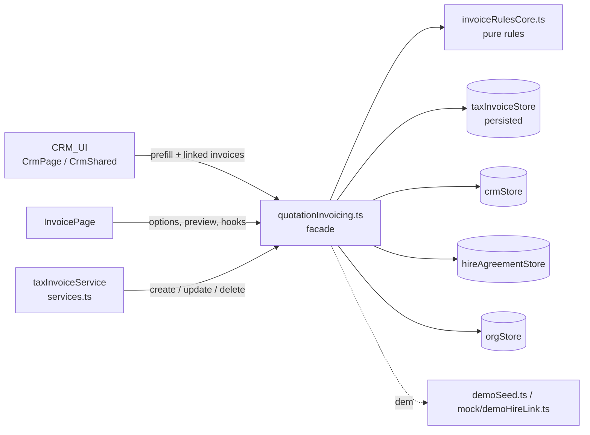
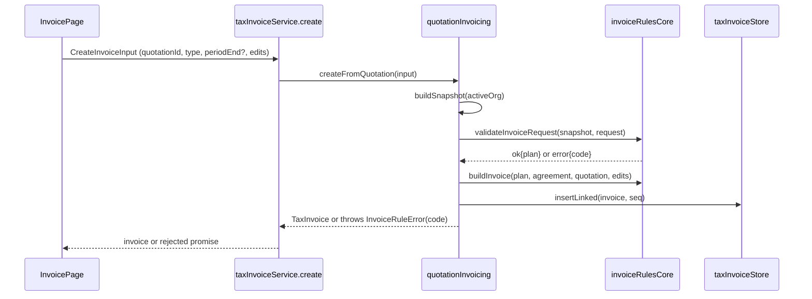

# Design Document

## Overview

Invoices become dependent on CRM quotations. A new invoice can be created only for a Won quotation, takes its number from the quotation (`QT-2026-0003/01`), and bills one period of the hire dates held by the Hire Agreement linked to that quotation. Rules are written once in a pure module (`invoiceRulesCore.ts`) and applied in two places: the tax invoice service (the "backend", authoritative) and the Invoice page (live feedback). A facade (`quotationInvoicing.ts`) is the only module that reads the CRM, Hire Agreement and Invoice stores together, following the `hireLinkCore.ts` / `hireLink.ts` pattern.

Language: TypeScript (React 18, zustand persisted stores, React Query, vitest + fast-check).

Key design decisions:

| Topic | Decision |
|---|---|
| Quotation identifier | `Quotation.number`. The quotation `id` is stored too, and is the link key. |
| Invoice number | `${quotation.number}/${NN}`, `NN` = per-quotation counter 01..99, kept in the store so deleted/cancelled numbers are not reused. |
| Hire dates | From the Source_Agreement. Candidates are agreements in the active org with `quotationId === quotation.id` and status not `Cancelled`. Exactly one is required: zero gives `NO_AGREEMENT`, several give `AMBIGUOUS_AGREEMENT` (block, do not guess). |
| Billing start | Never entered. Derived: hire start for the first active invoice, otherwise the day after the latest active period end. A client-supplied start is only compared against the derived value (`OVERLAP` / `GAP`). |
| Off-Hire with nothing left | If the latest active period already ends on or after the hire end, Off-Hire is rejected with `NOTHING_TO_BILL`. The quotation is then fully invoiced and the user can cancel the last invoice to bill differently. |
| Cancelled invoices | Do not occupy a billing period. They keep their sequence number. |
| Delete / cancel | Only the latest active invoice of a quotation, so periods stay gap-free. |
| Linked invoice edit | Identity and period fields are immutable. Amounts, dates other than the period, payment fields, notes and status are editable. Totals are always recomputed server-side. |
| Legacy invoices | No `quotationId`. Loadable, editable, deletable without the new rules. The existing agreement pick (`pickAgreement`) stays available on legacy forms. New invoices must be linked. |
| Charges | Carried over exactly as the existing agreement pick does (qty 1, monthly rental, transportation). No new charge types, no proration. The user can edit quantity and rate before saving. |
| Date arithmetic | Pure, UTC-based on `YYYY-MM-DD` strings (no local-time `Date` math), so results do not shift with the time zone. The current `addDays` in `InvoicePage` uses `toISOString` after a local `setDate`; the rules module replaces it for new code and the page reuses it. |

## Architecture



Boundaries (checked by `architecture.test.ts`):

- `invoiceRulesCore.ts` imports only types.
- `quotationInvoicing.ts` does not import `services.ts`, `appStore.ts` or any component.
- `src/features/documents` does not import `crmStore` (existing test). The Invoice page talks to the facade.
- `taxInvoiceService` in `services.ts` imports the facade (allowed direction: services -> facade).
- `constants/apps.ts` dependencies stay unchanged.

Request flow for create:



## Components and Interfaces

### Types (`src/types/taxinvoice.ts`, additive and optional)

```ts
export type InvoiceType = 'Continuous Hire' | 'Off-Hire';

export interface TaxInvoice {
  // ...existing fields unchanged...
  orgId?: string;            // set on store rows; legacy rows normalised to JA_ORG_ID
  quotationId?: string;      // link to Quotation.id; undefined = Legacy_Invoice
  quotationNumber?: string;  // Quotation.number at creation
  invoiceType?: InvoiceType;
  periodStart?: string;      // YYYY-MM-DD
  periodEnd?: string;        // YYYY-MM-DD
  sequence?: number;         // 1..99
  hireAgreementId?: string;  // Source_Agreement.id
}
```

### Pure rules (`src/services/invoiceRulesCore.ts`)

```ts
import type { InvoiceStatus, InvoiceType } from '@/types/taxinvoice';
import type { QuotationPhase } from '@/types/quotation';

export const VAT_RATE = 0.05;
export const MAX_SEQUENCE = 99;

export type RuleCode =
  | 'QUOTATION_REQUIRED' | 'QUOTATION_NOT_FOUND' | 'NOT_WON' | 'CRM_INACTIVE'
  | 'NO_AGREEMENT' | 'AMBIGUOUS_AGREEMENT' | 'AGREEMENT_DATES_INVALID'
  | 'INVALID_TYPE' | 'END_DATE_REQUIRED' | 'INVALID_DATE' | 'END_BEFORE_START'
  | 'END_AFTER_HIRE_END' | 'END_DATE_NOT_ALLOWED' | 'NOTHING_TO_BILL'
  | 'ALREADY_OFF_HIRED' | 'OVERLAP' | 'GAP' | 'DUPLICATE_PERIOD'
  | 'SEQUENCE_EXHAUSTED' | 'IMMUTABLE_FIELD' | 'NOT_LATEST_INVOICE';

export const RULE_MESSAGES: Record<RuleCode, string>;

export interface QuotationLite { id: string; orgId: string; number: string; phase: QuotationPhase; customerName: string; customerId: string; amount: number }
export interface AgreementLite {
  id: string; orgId: string; agreementNo: string; quotationId: string; status: string;
  hireStartDate: string; hireEndDate: string;
  /* carry-over fields: customer*, attn, contactNumber, billingAddress, deliveryLocation,
     paymentTerms, paymentMethod, securityDeposit, equipment*, serialNumber, workingHeight,
     capacity, monthlyRental, transportationCharges */
}
export interface InvoiceLite {
  id: string; orgId: string; quotationId?: string; invoiceType?: InvoiceType; status: InvoiceStatus;
  periodStart?: string; periodEnd?: string; sequence?: number;
}
export interface InvoicingSnapshot {
  orgId: string; today: string; crmActive: boolean;
  quotations: QuotationLite[]; agreements: AgreementLite[]; invoices: InvoiceLite[];
  /** highest sequence ever assigned per quotation id (survives deletes) */
  sequenceByQuotation: Record<string, number>;
}

export interface InvoiceRequest {
  quotationId?: string; invoiceType?: string;
  periodEnd?: string;      // Continuous Hire only
  periodStart?: string;    // optional; only compared with the derived start
}

export interface InvoicePlan {
  quotation: QuotationLite; agreement: AgreementLite; invoiceType: InvoiceType;
  periodStart: string; periodEnd: string; sequence: number; invoiceNo: string;
}
export type RuleResult<T> = { ok: true; value: T } | { ok: false; code: RuleCode; message: string };

// Dates (UTC arithmetic on YYYY-MM-DD)
export function isDateString(s: unknown): s is string;     // real calendar day
export function addDays(iso: string, n: number): string;
export function compareDates(a: string, b: string): number; // lexicographic on valid strings

// Quotation / agreement selection
export function listInvoiceableQuotations(s: InvoicingSnapshot): QuotationLite[]; // Won + org
export function resolveSourceAgreement(s: InvoicingSnapshot, quotationId: string): RuleResult<AgreementLite>;

// Billing period
export function activeInvoices(s: InvoicingSnapshot, quotationId: string): InvoiceLite[];
export function nextPeriodStart(agreement: AgreementLite, active: InvoiceLite[]): string;
export function validateInvoiceRequest(s: InvoicingSnapshot, r: InvoiceRequest): RuleResult<InvoicePlan>;

// Numbering
export function formatInvoiceNo(quotationNumber: string, seq: number): string;   // 'QT-2026-0003/01'
export function parseInvoiceNo(no: string): { quotationNumber: string; seq: number } | null;

// Totals (extracted unchanged from InvoicePage.recalc)
export function recalcTotals<T extends Partial<TotalsInput>>(f: T): T & TotalsOutput;

// Draft building and edit rules
export function buildInvoiceDraft(plan: InvoicePlan, s: InvoicingSnapshot, edits?: InvoiceEdits): Omit<TaxInvoice, 'id' | 'createdAt' | 'updatedAt'>;
export function validateInvoiceUpdate(existing: InvoiceLite & ProtectedFields, patch: Partial<TaxInvoice>): RuleResult<true>;
export function validateInvoiceRemoval(s: InvoicingSnapshot, invoiceId: string, action: 'delete' | 'cancel'): RuleResult<true>;
```

Derivation in `validateInvoiceRequest` (checks in this order, first failure wins):

1. `quotationId` empty -> `QUOTATION_REQUIRED`. `crmActive` false -> `CRM_INACTIVE`. Quotation missing or other org -> `QUOTATION_NOT_FOUND`. Phase != Won -> `NOT_WON`.
2. `resolveSourceAgreement`; hire dates valid and start <= end, else `AGREEMENT_DATES_INVALID`.
3. `invoiceType` must be one of the two literals, else `INVALID_TYPE`.
4. Active invoices of the quotation (status != Cancelled). If one is `Off-Hire` -> `ALREADY_OFF_HIRED`. Sequence: `max = sequenceByQuotation[id] ?? max(sequence of all invoices)`; `max >= 99` -> `SEQUENCE_EXHAUSTED`.
5. `start = nextPeriodStart(...)`: hire start if no active invoice, else `addDays(latest.periodEnd, 1)`. If the latest end is >= hire end, `start > hireEnd`: Continuous Hire gets `END_AFTER_HIRE_END` (any end is beyond), Off-Hire gets `NOTHING_TO_BILL` (checked before the end rules).
6. If `r.periodStart` given: `< start` -> `OVERLAP` (or `DUPLICATE_PERIOD` when both start and end equal an active period), `> start` -> `GAP`.
7. Continuous Hire: `periodEnd` empty -> `END_DATE_REQUIRED`; not a date -> `INVALID_DATE`; `< start` -> `END_BEFORE_START`; `> hireEnd` -> `END_AFTER_HIRE_END`. Off-Hire: `periodEnd` given and != hire end -> `END_DATE_NOT_ALLOWED`; end = hire end.
8. Plan: `sequence = max + 1`, `invoiceNo = formatInvoiceNo(number, sequence)`.

A Continuous Hire invoice whose end equals the hire end is allowed; the quotation then reads as fully invoiced and Off-Hire gives `NOTHING_TO_BILL`.

### Facade (`src/services/quotationInvoicing.ts`)

```ts
export class InvoiceRuleError extends Error { readonly code: RuleCode }

export interface InvoiceableQuotation { id: string; number: string; customerName: string; amount: number }
export interface CreateInvoiceInput extends InvoiceRequest { edits?: InvoiceEdits }
export interface InvoicePreview {   // for the form: same rules, no side effects
  ok: boolean; code?: RuleCode; message?: string;
  agreementNo?: string; hireStartDate?: string; hireEndDate?: string;
  periodStart?: string; periodEnd?: string; invoiceNo?: string; sequence?: number;
}

export function listWonQuotations(): InvoiceableQuotation[];
export function previewInvoice(req: InvoiceRequest): InvoicePreview;
export function createFromQuotation(input: CreateInvoiceInput): TaxInvoice;     // throws InvoiceRuleError
export function updateInvoice(id: string, patch: Partial<TaxInvoice>): TaxInvoice; // throws InvoiceRuleError
export function removeInvoice(id: string, action: 'delete' | 'cancel'): void;     // throws InvoiceRuleError
export function listInvoices(): TaxInvoice[];
export function getInvoice(id: string): TaxInvoice | undefined;
export function invoicesForQuotation(quotationId: string): TaxInvoice[];
export function useInvoicesForQuotation(quotationId: string): TaxInvoice[];       // zustand selector hook for CRM_UI
export function buildQuotationPrefill(q: { id: string; number: string; customerId: string; customerName: string; amount: number }): QuotationPrefill;
```

`buildSnapshot(orgId)` calls `ensureHireLinkDemo(orgId)`, `useHireAgreementStore.ensureSeeded(orgId)` and `useTaxInvoiceStore.ensureSeeded(orgId)`, reads `isAppActive(orgId, 'crm')`, and maps the stores to the lite types. `createFromQuotation` takes a fresh snapshot, validates, builds the draft, recomputes totals, and calls `insertLinked` synchronously, so back-to-back requests see each other (Requirement 6.8). Active org = `useAuthStore.getState().user?.orgId ?? JA_ORG_ID`, as in `hireLink.ts`.

`updateInvoice` on a Legacy_Invoice applies the patch as today (plus totals recompute). On a linked invoice it first calls `validateInvoiceUpdate` (`IMMUTABLE_FIELD` if the patch changes a protected field with a different value), then recomputes totals.

### Invoice store (`src/store/taxInvoiceStore.ts`)

Modelled on `hireAgreementStore.ts`.

```ts
interface TaxInvoiceState {
  invoices: TaxInvoice[];                 // all orgs, each with orgId
  seededOrgs: string[];                   // orgs whose legacy demo rows were inserted
  demoLinkedOrgs: string[];               // orgs whose sample linked invoice was inserted
  sequenceByQuotation: Record<string, number>;
  ensureSeeded(orgId: string): void;
  forOrg(orgId: string): TaxInvoice[];
  getById(id: string): TaxInvoice | undefined;
  insert(inv: TaxInvoice): void;                       // legacy create
  insertLinked(inv: TaxInvoice): void;                 // also bumps sequenceByQuotation
  patch(id: string, data: Partial<TaxInvoice>): TaxInvoice;
  remove(id: string): void;
  newId(): string;
}
```

- Persist key `fleet-tax-invoices-v1`, `version: 1`, `partialize` of the four data fields.
- `migrate`: if the persisted value is not an object with an `invoices` array, warn and reset to empty state. Otherwise run `normalizeInvoice` on each row (default `orgId = JA_ORG_ID`, keep missing link fields undefined), and rebuild `sequenceByQuotation` as the max of the stored map and the highest `sequence` found per `quotationId`.
- `ensureSeeded(orgId)`: once per org, insert copies of the existing demo invoices (`mock/taxinvoice.ts`) with ids `inv-seed-<orgId>-<n>` and `orgId`. This replaces `taxInvoicesForOrg` in `orgData.ts`, which is removed together with its cache (the in-memory dataset was shared by reference across callers and not persisted).
- `taxInvoiceService.list/get` read from the store through the facade and return `delay(...)` as before, so the React Query hooks in `useQueries.ts` keep their signatures.

### Service (`taxInvoiceService` in `services.ts`)

- `create(data)`: if `data.quotationId` is empty, throws `InvoiceRuleError('QUOTATION_REQUIRED')`. Otherwise `createFromQuotation(data)`. There is no remaining path that stores a new unlinked invoice. Legacy rows exist only through seeding and migration.
- `update(id, data)`: `facade.updateInvoice`.
- `delete(id)`: `facade.removeInvoice(id, 'delete')`. Setting status to `Cancelled` through `update` on a linked invoice runs the same `validateInvoiceRemoval(…, 'cancel')` check.
- Errors are thrown synchronously inside the service function and surface as rejected mutations; the page maps `InvoiceRuleError.code` to `RULE_MESSAGES[code]`.

### Invoice page (`InvoicePage.tsx`)

- `recalc` becomes a thin import of `recalcTotals` (formula unchanged, VAT 5%).
- New-invoice flow (`editId === null`): a "Create from quotation" panel on top of the form with
  - Quotation select (from `listWonQuotations()`), preselected from `location.state.prefill.quotationId`.
  - Invoice type radio (`Continuous Hire` / `Off-Hire`).
  - Read-only fields: Source agreement no., Hire start, Hire end, Billing period start.
  - Billing period end: a date input for Continuous Hire, read-only text (hire end) for Off-Hire.
  - Inline message from `previewInvoice` (debounce not needed; it is synchronous and pure). Save is disabled while `preview.ok` is false.
  - On a valid preview the form is filled from the plan: invoice no. (read-only), customer, agreement and charge fields, `hirePeriod` = `periodStart – periodEnd`.
- Edit flow for linked invoices: invoice no., quotation, type and period fields rendered read-only. Edit flow for legacy invoices: unchanged, including `pickAgreement` and the free-text invoice number input.
- `Hire Agreement No.` dropdown (`pickAgreement`) is shown only when the invoice is legacy (no `quotationId`) and the page is not in the new-invoice flow.
- Old prefill shape (`{customerId, customerName, amount, quotationNumber}`, without `quotationId`) is accepted: the page opens the new-invoice flow with no preselected quotation and shows the message to choose a Won quotation.
- List columns: add Quotation, Type, Billing period. Clicking the quotation number sets a list filter on `quotationNumber` (client-side, in the existing `DataTable` search).
- Delete handler shows the rule message on rejection (`NOT_LATEST_INVOICE`).

### CRM changes

- `crmRules.toInvoicePrefill(q)` adds `quotationId: q.id`. Existing fields stay.
- `CrmPage.proceedToInvoice` is unchanged (navigates with the new prefill).
- `QuotationDetail` (`CrmShared.tsx`) adds an "Invoices" section using `useInvoicesForQuotation(q.id)` from the facade: number, type, period, total, status; empty text "No invoices yet".

### Demo data

- `demoHireLink.ts` adds `demoInvoiceForQuotation(orgId)`: builds the sample Continuous Hire invoice for `qt-seed-10` (org-specific id via `demoQuotationId`) using the seed agreement `ha-seed-<org>-5` (HA-2026-005, hire `2026-11-14` to `2026-12-14`) and `buildInvoiceDraft`. Billing period `2026-11-14` to `2026-11-30`, number `QT-2026-0010/01` (org copies use their own seeded quotation number, which is the same text). Status `Sent`.
- `demoSeed.ts` adds `ensureInvoiceDemo(orgId)`: inserts the sample once per org (guarded by `demoLinkedOrgs`) when the quotation exists in the CRM store, and sets `sequenceByQuotation[qt] = 1`. It is called from `ensureHireLinkDemo` for non-JA orgs after quotations and agreements are seeded, and from the facade's `buildSnapshot` for `org-ja`. A deleted sample is not re-added.
- Demo agreement dates are used as they are; the sample billing period shows partial-month billing within them.

## Data Models

Stored invoice (linked example):

```json
{
  "id": "inv-lx3k-ab12", "orgId": "org-ja",
  "invoiceNo": "QT-2026-0010/01",
  "quotationId": "qt-seed-10", "quotationNumber": "QT-2026-0010",
  "invoiceType": "Continuous Hire", "periodStart": "2026-11-14", "periodEnd": "2026-11-30",
  "sequence": 1, "hireAgreementId": "ha-seed-org-ja-5", "hireAgreementNo": "HA-2026-005",
  "hirePeriod": "2026-11-14 – 2026-11-30", "status": "Sent"
}
```

Protected fields of a linked invoice: `quotationId`, `quotationNumber`, `invoiceNo`, `sequence`, `invoiceType`, `periodStart`, `periodEnd`, `hireAgreementId`, `orgId`.

Prefill shape from CRM: `{ quotationId, quotationNumber, customerId, customerName, amount }`.

## Error Handling

- All rule failures are `RuleResult` values in the core and `InvoiceRuleError(code)` at the facade/service boundary. The message comes from `RULE_MESSAGES`, which has one entry per code (messages name the reason, for example NO_AGREEMENT: "No hire agreement is linked to this quotation"; AMBIGUOUS_AGREEMENT appends the agreement numbers).
- The page shows rule errors inline (preview) and as an error toast on save. Unexpected errors keep the existing "Could not save invoice" toast.
- Persisted data problems: `migrate` resets to empty on malformed data and logs a warning; non-array or non-object rows are dropped.
- Failed creation stores nothing and does not change `sequenceByQuotation`.
- CRM inactive: creation rejected (`CRM_INACTIVE`); existing invoices stay visible and editable.
- If the quotation later leaves Won, existing invoices stay valid; only new invoices are blocked.

## Testing Strategy

Dual approach with vitest and fast-check (minimum 100 runs per property). Pure properties target `invoiceRulesCore.ts`; store and service behaviour use example tests with a reset store and a seeded CRM store.

- Property tests (file `src/services/invoiceRulesCore.test.ts`): Properties 1 to 12 below, each tagged `Feature: won-quotation-invoicing, Property N: <text>`.
- Example/unit tests: service rejects unlinked and non-Won creation; store persistence and migration of old/malformed data; demo seed (sample present, sequence 1, not re-added after delete); prefill shapes (old and new); legacy invoice load/edit; `pickAgreement` still fills a legacy form; CRM detail "No invoices yet".
- Architecture tests added to `architecture.test.ts`: `invoiceRulesCore.ts` has only type imports; `quotationInvoicing.ts` does not import `services.ts` or `appStore.ts`.
- UI rendering is covered by a small component test (type toggle shows/hides the end date input, Save disabled on invalid preview), not by property tests.

## Correctness Properties

*A property is a characteristic or behavior that should hold true across all valid executions of a system-essentially, a formal statement about what the system should do. Properties serve as the bridge between human-readable specifications and machine-verifiable correctness guarantees.*

### Property 1: Only Won quotations of the active organisation are invoiceable

For any snapshot of quotations (any phases, any orgs) and any invoice request referencing one of them, `listInvoiceableQuotations` returns exactly the quotations with phase Won and the active `orgId`, and `validateInvoiceRequest` fails with `NOT_WON` for every referenced quotation whose phase is not Won (and never stores or plans an invoice for it).

**Validates: Requirements 1.1, 1.2, 1.3**

### Property 2: Source agreement resolution is deterministic

For any set of hire agreements, `resolveSourceAgreement` returns the agreement when exactly one agreement in the active org has `quotationId` equal to the quotation id and status other than Cancelled, returns `NO_AGREEMENT` when none does, and returns `AMBIGUOUS_AGREEMENT` listing all candidate numbers when more than one does; the result does not depend on the order of the agreements.

**Validates: Requirements 2.1, 2.2, 2.3**

### Property 3: Invoice number round trip

For any quotation number without a trailing `/NN` and any sequence 1..99, `parseInvoiceNo(formatInvoiceNo(number, seq))` returns the same quotation number and sequence, and the formatted text ends with `/` followed by the sequence zero-padded to two digits.

**Validates: Requirements 3.1, 3.2**

### Property 4: Sequence numbers are strictly increasing and never reused

For any sequence of create, cancel and delete operations on one quotation, each created invoice receives a sequence number greater than every sequence number assigned earlier to that quotation (including deleted and Cancelled invoices), and a request made when the highest assigned sequence is 99 fails with `SEQUENCE_EXHAUSTED`.

**Validates: Requirements 3.3, 3.4, 11.3**

### Property 5: Billing period is derived from the hire dates and previous periods

For any valid agreement (start <= end) and any list of earlier active periods of the quotation, the derived `periodStart` equals the hire start when there are none and otherwise the day after the latest `periodEnd`; for a Continuous Hire request, a valid `periodEnd` is accepted exactly when `periodStart <= periodEnd <= hireEnd` and is then stored unchanged, and any other value fails with `END_DATE_REQUIRED`, `INVALID_DATE`, `END_BEFORE_START` or `END_AFTER_HIRE_END` as applicable. For any supplied `periodStart` different from the derived start, the request fails with `OVERLAP` (earlier) or `GAP` (later).

**Validates: Requirements 4.2, 4.3, 4.4, 4.5, 4.6, 4.7, 6.1, 6.2, 6.3, 6.4**

### Property 6: Off-Hire uses the hire end date and is final

For any valid agreement and prior invoices, an Off-Hire request without a period end yields `periodEnd` equal to the hire end when the latest active period ends before the hire end, fails with `NOTHING_TO_BILL` when it ends on or after the hire end, and fails with `END_DATE_NOT_ALLOWED` when a different end is supplied; and for any quotation that has an active Off-Hire invoice, every further request fails with `ALREADY_OFF_HIRED`, while the same request is accepted again after that invoice is Cancelled.

**Validates: Requirements 5.1, 5.3, 5.4, 5.5, 5.6, 5.7**

### Property 7: Active billing periods stay contiguous and within the hire dates

For any sequence of accepted create and cancel-or-delete operations (of latest invoices only) on one quotation, the active invoices sorted by sequence have non-overlapping periods, the first starts at the hire start, each starts the day after the previous one ends, and all lie within hire start and hire end; a request repeating an existing active period fails with `DUPLICATE_PERIOD`, `OVERLAP` or `GAP`, never with success.

**Validates: Requirements 6.5, 6.6, 6.7, 6.8**

### Property 8: Carry-over copies source data and links to the quotation

For any quotation and source agreement, the invoice draft built from a valid plan has `quotationId`, `quotationNumber`, `sequence`, `invoiceType`, `periodStart`, `periodEnd`, `hireAgreementId` and `orgId` equal to the plan values, `invoiceNo` equal to the formatted number, and customer, agreement number, delivery location, payment terms, payment method, security deposit, equipment quantity 1, equipment rate (monthly rental), transportation quantity 1 and transportation rate equal to the agreement values; `hirePeriod` equals `periodStart – periodEnd`, `status` is Draft, and `dueDate` equals the invoice date plus the numeric payment terms (30 when none).

**Validates: Requirements 3.6, 7.1, 7.2, 7.3, 7.4, 7.5, 7.6, 7.7, 7.9, 4.7**

### Property 9: Totals follow the existing VAT rules

For any non-negative quantities and rates, `recalcTotals` returns equipment amount = quantity x rate, transportation amount = quantity x rate, subtotal = their sum, VAT = round(subtotal x 0.05, 2), total = round(subtotal + VAT, 2) and amount due = total; and for any client-supplied total fields on a create or update, the stored values equal the recomputed values.

**Validates: Requirements 8.1, 8.2, 8.3, 8.4, 8.5**

### Property 10: Linked invoices keep protected fields, legacy invoices stay editable

For any linked invoice and any patch, `validateInvoiceUpdate` fails with `IMMUTABLE_FIELD` exactly when the patch changes a protected field to a different value, and accepts patches that touch only status, invoice date, due date, quantities, rates, payment fields and notes; for any legacy invoice (no `quotationId`) and any patch, the update is accepted.

**Validates: Requirements 9.5, 9.6, 9.7, 9.8**

### Property 11: Only the latest active linked invoice can be deleted or cancelled

For any quotation with several active invoices and any chosen invoice, `validateInvoiceRemoval` succeeds exactly when the chosen invoice has the latest `periodEnd` among the active invoices of that quotation, and otherwise fails with `NOT_LATEST_INVOICE`; for any legacy invoice it always succeeds.

**Validates: Requirements 11.1, 11.2, 11.4**

### Property 12: Store migration is total and preserves rows

For any persisted value (arbitrary JSON, including non-arrays and rows with missing fields), the store `migrate` function returns a state whose `invoices` is an array of rows each with an `orgId`, resets to an empty state when `invoices` is not an array, keeps every valid row's `id`, and returns a `sequenceByQuotation` that is at least the highest stored `sequence` of each quotation.

**Validates: Requirements 9.2, 9.4**

### Property 13: Every rule code has a reason message

For any `RuleCode`, `RULE_MESSAGES` holds a non-empty message, and every failed `RuleResult` carries the message of its code.

**Validates: Requirements 1.8**
